===== ASSISTANT seq=154 =====
已按代码实况核对过（不是照文档回忆），结论如下。

## 一句话

提示词是**两段式**：`system` 由代码按七层顺序装配、**正文全部来自站点包文件**；`user` 只放代码算好的事实（纠错后的问题、统计范围、历史、文件、预取指标）。DB 里的 `ai_prompt` 通道已在 2026-10-30 拆除，规则正文改为「知识库 `doc_type='rule'` + 目录常驻 + `get_rule` 按需取」。

## system 的层（本地实测，data 模式）

| 层 | 标题 | 字数 | 正文来源 |
|---|---|---|---|
| L0 | 诚信与安全红线 | 224 | `prompt_stack.L0_REDLINES`（代码，不可覆盖）|
| S1 | 谁说了算 | 367 | `agent.RULES_PRIORITY` |
| L1 | 身份 | 299 | `sites/<SITE>/prompts/identity.md` |
| L2 | 模式做法 | 633 | `sites/_platform/mode_<mode>.md` |
| L3×6 | 业务规则/固定口径/SQL 规范/工单规则/metrics/作答要求 | 6,469 | `sites/<SITE>/prompts/*.md` |
| S4 | 作答格式（汇报口吻+交卷检查） | 1,625 | `agent.COMMON + agent.CHECK` |
| S6 | 规则目录（一行一主题） | 0（本地）/ 线上 40 主题 | `rule_doc.menu()` ← 知识库 rule 文档章节标题 |
| L6/L4 | 个人偏好 / 本会话人设 | 按人有 | `prefs` / `persona` 表 |
| L5 | 技能说明 | 按技能有 | 技能包 |
| S7 | 我的规则（个人库 type=rule，≤1500 字） | 按人有 | `agent_v2.system` 尾部手拼 |
| — | 日期 + 码表(671) + 表清单(2,053) | 2,778 | `semantic.codes_menu / table_list_menu` |

**顺序**：`L0 → S1 → L1 → L2 → L3 → S6 → L6 → L4 → S4 → L5`，前面压后面，由 `prompt_stack.ORDER` 定；`CONFLICT_NOTE` 在最前面声明一次。

**一个关键分叉**（同一个代码两套形状）：知识库里有 `doc_type='rule'` 文档 → 只给 S6 目录、**跳过 L3 静态注入**（`skip_business=True`），线上 data 模式 **8,440 字**；没有规则文档 → 退回静态 L3，本地实测 **12,927 字**。本地库 0 个规则主题，所以你现在看到的是长的那个。

## user 消息（代码负责，不给模型猜）

纠错后的问题 → 【本场会话摘要】→【对话历史】→【统计范围】→【名称归一说明】→【判断标准从哪来】→ 提问人画像 → 上传文件 → 已按固定口径查好的指标。历史/摘要都写明"不是数据来源、不得引用其中数字"。

## 模式决定层与工具

`modes.judge()` 四选一：`general`（1109 字，只 L0/L1/L2，**不给工具**）、`data`、`doc`、`office`。三级回退：`SECRETARY_AGENT_V2=0`、站点包加载失败、判模式抛错 → 回落 `agent._system()`。

## 已退场

`ai_prompt` 表读取、`rule_slices()` 向量检索（0.17~0.19 分）、全量 `table_menu`（22.3K，只剩兜底 `_system` 用）、`redlines.md`/`identity_base.md` 死文件。

## 现存不一致（按严重度，都可验证）

1. **判模式实际一直用代码里的关键词表**。`modes.rules_path()` 指向 `parents[3]/config/sites/_platform/mode_rules.yml`，但 `config/` 已整目录搬走、现在是空的（`Test-Path` = False）→ 永远落 `_FALLBACK_RULES`，`_platform/mode_rules.yml`（2,127 字）白放着。一行可修：改挂 `site_pack.sites_root()`。
2. **S1 指着一个已删除的块**：`agent.py:737` 写「本轮检索到的业务规则切片（【补全参考】里那些）」，而切片预注入 2026-10-30 已删。这是 RULES_PRIORITY 注释里自己记过的同一种病（上次是"用户原话不存在"）。
3. **两套冲突声明并存且不一致**：S1 把「本轮问题+统计范围」排第一，`CONFLICT_NOTE` 把 L0 排第一；S6/S7/表清单插在中间却没有序号。
4. **S5 表清单、S7 个人规则不进 `prompt_stack.layers`**（`agent_v2` 手拼），验收脚本与 trace 天然看不到这两层。
5. 规则目录 `MAX_TOPICS=40`，线上正好 40 —— 规则再长会按文档顺序静默截断。
6. 过时注释/工具：`config.py:268` 仍写"从 ai_prompt 注入"、`site_pack.py:2` 仍写 `config/sites`、`server/scripts/export_prompts.py` 仍输出到已删目录、`tools/dump_prompts.py` 仍以 DB 为"主来源"且自身是乱码。

## 证据

- 自检：`py -X utf8 server/tests/agent/test_prompt_stack.py` → **81 项 0 失败**（本轮实跑）
- 装配代码：`server/app/secretary/prompt_stack.py`、`agent_v2.py`、`site_pack.py`、`rule_doc.py`
- 正文：`server/app/secretary/sites/suizhou/prompts/*.md`（7 份）
- 进度与线上实测：`docs/04-计划/2026-10-30-实施-提示词重构.md`（Progress 段）
- 设计 vs 代码命名：设计 `docs/03-设计/2026-10-30-提示词设计-最终版.md` 用 S0–S9，代码是 L0–L6+S1/S4/S6/S7

要不要我把上面第 1、2 条修掉（都只动几行），其余记进 `问题总清单.md`？我没改任何文件。


===== ASSISTANT seq=204 =====
## 现在和上一条我说的**不是同一个架构**了

`11:48–11:59` 之间做过一次重构并已上线（我上一条是 11:20 左右的代码状态）。核心变化一句话：**站点包整目录删除，提示词正文内联进代码；L3 静态口径彻底取消**。

### 现在的层（`prompt_stack.build`，本地实测字符数）

| 层 | 标题 | 字数 | 来源 |
|---|---|---|---|
| S0 | 诚信与安全红线 | 227 | `prompt_stack.L0_REDLINES`（常量名仍叫 L0，标题已改 S0）|
| S1 | 谁说了算 | 367 | `agent.RULES_PRIORITY` |
| L1 | 身份 | 311 | `prompts_data.IDENTITY`（原 `identity.md`）|
| L2 | 模式做法 | 419–633 | `prompts_data.MODE_TEXTS`（四个模式）|
| S4 | 作答格式（汇报口吻+交卷检查+**作答要求**） | **2,458** | `COMMON+CHECK` + `prompts_data.ANSWER_DATA` |
| S6 | 规则目录 | 0 本地 / 线上 40 主题 | `rule_doc.menu()` ← KB `doc_type='rule'` |
| L6/L4/L5 | 个人偏好 / 会话人设 / 技能 | 按人 | prefs / persona / 技能包 |

层序变成 `S0 → S1 → L1 → L2 → S4 → S6 → L6 → L4 → L5`（S4 提到 S6 前，L3 整段消失）。

**实测**：data 静态 **4,246** 字；本地完整 system **7,183** 字（本地 KB 无规则文档，S6=0）；**线上 9,308 字**（版本 `99713c1`，镜像 `d4f34d09c596`）。同一份代码，差的那 2,100 字就是线上那 40 个规则主题。

### 与上一版的差异

`server/app/secretary/sites/`（24 个文件）与 `site_pack.py` 删除 → 正文进 `prompts_data.py`（217 行，由 `tools/gen_site_defaults.py` 生成）；项目事实进 `project.py`、规则默认值进 `rules_defaults.py`、词表进 `lexicon_defaults.py`；`prompt_stack.build()` 不再收 `pack`，改直接读常量。测试从 81 项降到 **42 项 0 失败**（站点包相关断言随包一起删了），`test_rule_stack` **14/14**。

### 我上条列的 6 条，现在重新判一遍

| # | 上条 | 现在 |
|---|---|---|
| 1 | 判模式读已删的 `config/sites` | **仍成立，且已固化**：`mode_rules.yml` 也随站点包删了 → 永久走代码里的 `_FALLBACK_RULES`。`modes.rules_path()` 仍指 `parents[3]/config/sites/_platform/mode_rules.yml`（`Test-Path`=False）。这是唯一还影响线上行为的 |
| 2 | S1 引用【补全参考】切片 | **仍成立，且更错**：切片注入已全删，S1 第②条指向一个从不存在的块，每轮 367 字进 system |
| 3 | 两套冲突声明 | **升级了**：`prompt_stack` 文件头写「个人规则 > 公司规则」，实现却把 S7 追加在 system **最末**（位置代表最弱）→ 声明与实现相反 |
| 4 | 表清单/个人规则不进 `layers` | 仍成立：S7、日期、码表(671)、表清单(2,053) 都由 `agent_v2` 手拼，验收与 trace 看不见 |
| 5 | `MAX_TOPICS=40` | 仍成立：线上正好 40 个主题，第 41 个按文档顺序静默截断 |
| 6 | 过时注释 | 好了一些（`site_pack.py` 已删），剩 `alert_scope.py:24`、`tools/import_rules_to_kb.py:7` 还写 `config/sites` |

**新发现一条**：S4 现在 **2,458 字**，是 system 里最大单段（比 S0+S1+L1+L2 合计还多），设计文档说「压到 8~10 条」。它成了新的膨胀点。

### 另外清掉一笔账

计划文档里「推送 `git push kb main`｜进行中」已过时：`git rev-list --left-right --count kb/main...main` = `0 0`，已同步。

### 证据

- 代码：`server/app/secretary/prompt_stack.py`、`prompt_stack.py` 头注释、`agent_v2.py:66-113`、`prompts_data.py`
- 实测：`py -X utf8 server/tests/agent/test_prompt_stack.py` → 42/42；`test_rule_stack.py` → 14/14；层字数为本机 `len(system)` 直读
- 线上：`docs/04-计划/2026-10-30-实施-提示词重构.md` 第 91–99 行（9,308 字 / 三类问题）
- 版本：`.deploy_version` = `99713c1`，本地 HEAD `a615382`（仅测试）

要动手的话，优先级我建议按 1 → 2 → 3（都只改几行，且都有测试可钉）。要我改吗？


===== ASSISTANT seq=310 =====
全链路图已落文件：`output/2026-10-30-问答全链路流程图.md`（3 张 Mermaid 图 + 22 步取数表 + 7 条优先级 + 降级表）。下面是主体部分。

## 一、问题全链路

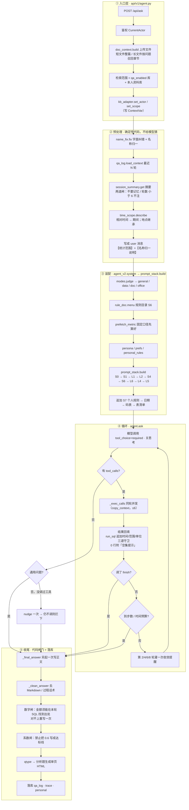

## 二、每一步去哪里拿（关键 8 处）

| 要什么 | 从哪里拿 | 落到哪 |
|---|---|---|
| 错字 / 旧称 / 简称 | `agent_data` 的 `t_nc_*` 纠错词典（60s 热更，可切 CSV） | 改写过的问题 |
| 本轮时间 / 地点 | 问题里的词 + 上一轮口径；都没有 → 系统当月、全市 | 【统计范围】 |
| 上一轮干了什么 | `agent_data` 问答记录 + 会话摘要 | 【对话历史】【本场会话摘要】 |
| 判定标准（多少算积压/异常） | **知识库 `doc_type='rule'` 文档** → 目录常驻 S6 + `get_rule(主题)` 精确取 | system S6 / 工具结果 |
| 制度原文、流程 | 知识库检索面（`qa_enabled` 库 + 本人资料库）→ `kb_search` | 工具结果 |
| 业务数字 | 业务库 `dlj_data` 只读 → `run_sql`（表白名单、200 行、25s） | 工具结果 |
| 字段叫什么、表有哪些 | `ai_data` 的 `ai_table_metadata` / `ai_column_metadata` | 表清单常驻（2,053 字）+ `describe_table` 按需 |
| 码值（状态 0/1/2 是什么） | `dlj_data.t_dict` + `t_dict_data` | system 尾部（仅 data/doc） |
| 我的规则 / 偏好 / 人设 | 本人库 `doc_type='rule'`（≤1500 字）/ `prefs` / `persona` | system S7 / L6 / L4 |

## 三、冲突时听谁的

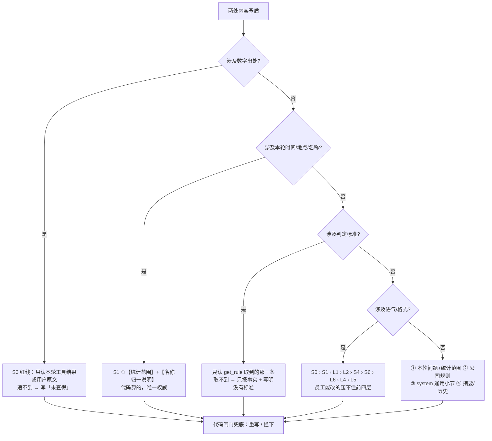

七条硬规则：

1. **数字对不上** → S0 红线赢：只认本轮工具结果 / 用户原文，否则「未查得」。
2. **本轮口径** → 【统计范围】（代码算的）赢，模型不许改、不许推算日期。
3. **判定标准** → 只认 `get_rule` 那条；取不到就只报事实，禁止套别的主题。
4. **system 层内** → S0 › S1 › L1 › L2 › S4 › S6 › L6 › L4 › L5。
5. **事实来源** → 本轮工具结果 / 上传文件 ＞ 知识库原文 ＞ 摘要与历史（后两者禁止引数字）。
6. **提示词 vs 代码** → **代码赢**。提示词只是"高概率"；没调工具就下结论会被拦下（`blocked`），数字对不上会被重写。
7. **general 模式** → 不给工具 = 不查库，优先于"出现业务词就必须查"。

## 四、图上必须标注的三个坑（都是现状）

- **S7 个人规则排在最末**（位置最弱），但 `prompt_stack` 头注释写「个人规则 > 公司规则」→ 声明与实现相反。
- **S1 第②条**仍写「本轮检索到的业务规则切片（【补全参考】里那些）」——那个块 2026-10-30 已删。
- **判模式永久走代码里硬编码的关键词表**：`modes.py:43` 指向已删除的 `config/sites/_platform/mode_rules.yml`。

## 五、验证口径

- 图做过引号/括号/`subgraph`↔`end` 配平检查（3 个 mermaid 块，13/13）；本机没有 Mermaid 渲染器，**没有实际渲染验证**。
- 事实来源逐条对过代码：`agent.ask:1003-1480`、`agent_v2.system:66-113`、`prompt_stack.build:45-85`、`rule_doc:122-169`、`api/v1/agent.py:253-280`。
- 数字：data 静态 4,246 字 / 本地全文 7,183 / 线上 9,308；`test_prompt_stack` 42/42、`test_rule_stack` 14/14。

要不要我顺手把 §4 那三个坑修掉（都是一两行），修完重跑这两个测试？


===== ASSISTANT seq=318 =====
你说得对，那版是写给开发看的。我重画，只留流程和排序。


===== ASSISTANT seq=339 =====
重画好了，`output/2026-10-30-问答全链路流程图.md`，只有流程和先后，没有函数名。

## 一次提问怎么走

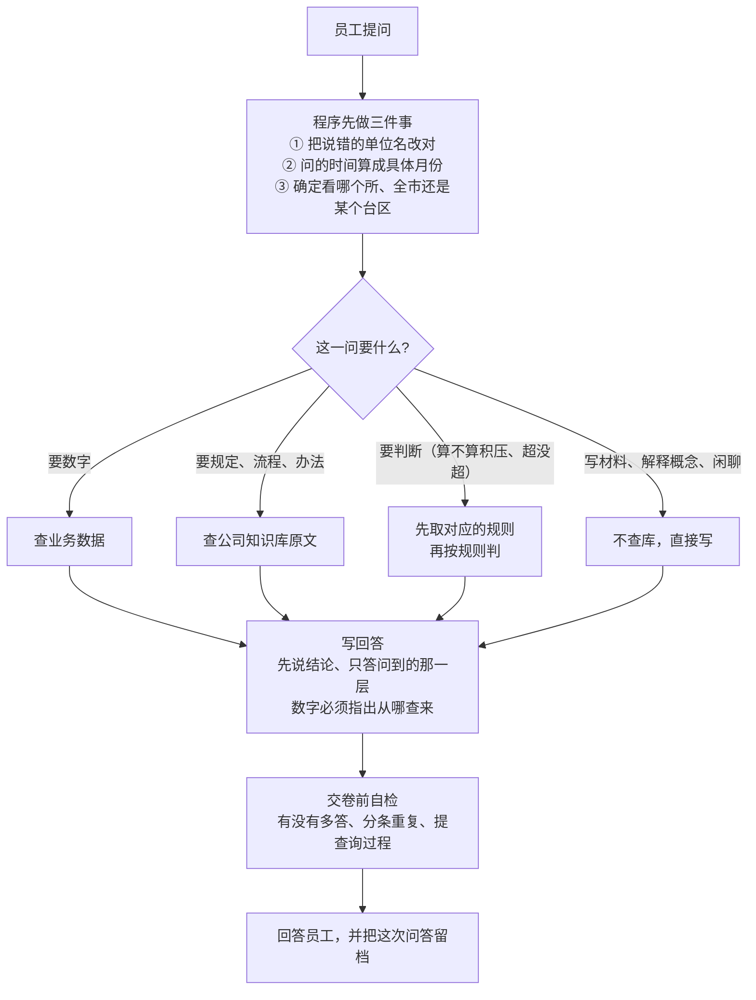

## 提示词的先后（越靠上越硬）

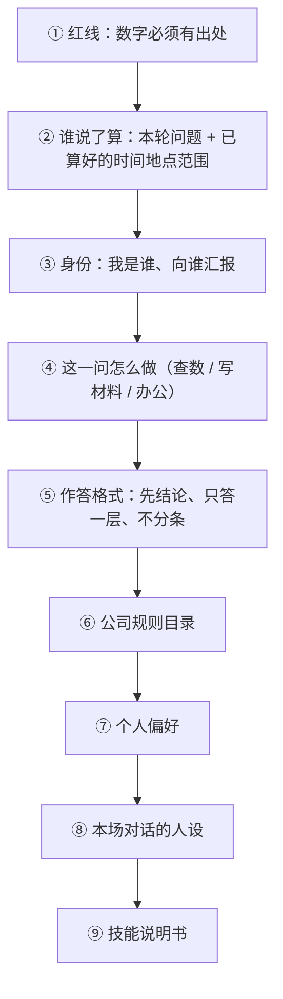

## 打架时听谁的

| 打架 | 听谁的 |
|---|---|
| 数字有出处 vs 没出处 | 本轮查到的结果；查不到写「未查得」 |
| 本轮口径 vs 历史口径 vs 通用规则 | 本轮提问 + 程序算好的时间地点范围 |
| 判断标准 | 规则库里那一条；取不到就只报事实 |

事实来源的先后：**本轮查到的数据 / 员工上传的文件 → 公司知识库 → 历史与摘要（只用来理解问题，数字不许引）**。

文件里还有一张「材料从哪来」的图（系统写死 / 规则库 / 知识库 / 我的资料库 / 业务库 五路）。需要的话我可以再出个竖版一页的（贴汇报材料用）。


===== ASSISTANT seq=347 =====
我理解错了两次，这次先说清楚我按什么画：**问题进来的处理流水线**——每一步做什么、走哪个分支、这一步哪条规则在生效、几份材料谁优先。不写层号、不写函数名。


===== ASSISTANT seq=358 =====
这次画的是处理流水线，`output/2026-10-30-问答全链路流程图.md`：

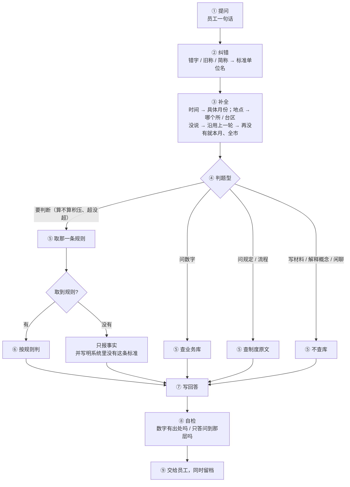

每步哪条规矩在这里生效：

| 步骤 | 干什么 | 生效的是 |
|---|---|---|
| ② 纠错 | 说错的名字改成标准名 | 纠错词典 |
| ③ 补全 | 「上个月」算成具体月份，「那所」落到具体单位 | 口径规则：本轮问的算数；没说沿用上一轮；再没有就本月、全市 |
| ④ 判题型 | 定走哪条路，也定给不给查库权限 | 题型判断规则 |
| ⑤ 取料 | 按题型去对应地方取 | 检索顺序 |
| ⑥ 判 | 取到规则才判 | 规则文档 |
| ⑦ 写 | 先结论、只答一层、不分条 | 身份 + 做法 + 作答格式 |
| ⑧ 自检 | 对数字出处、对有没有多答 | 红线 + 交卷检查 |

顺序：
- **判定标准只认一处**：公司规则文档；取不到就只报事实。
- **资料原文**：公司知识库 + 我的资料库，同池检索。
- **冲突时**：红线 ＞ 本轮口径 ＞ 公司规则 ＞ 作答格式 ＞ 个人偏好/人设。
- **事实来源**：本轮查到的数据/员工文件 ＞ 知识库原文 ＞ 历史（数字不许引）。

有一处和设计说明相反：设计写「个人规则压过公司规则」，实际个人规则排在提示词最后、最弱，现在是公司规则赢。

这个形状对吗？不对你指一句（比如「分支要更细」「判定那块要单独画」），我只改那一块。


===== ASSISTANT seq=382 =====
已更新 `output/2026-10-30-问答全链路流程图.md`，主流程没动，⑤ 和 ⑥ 拆开了。

## ⑤ 取料：不给全文，只给目录

每轮常驻的只有四样：

| 常驻 | 内容 | 从哪来 |
|---|---|---|
| 表名清单 | 26 张表，一行一句话 | 业务字典表 |
| 规则目录 | 一行一个主题，最多 40 条 | 公司规则文档的章节标题 |
| 状态码含义 | 工单状态 / 缺陷类型 / 审批节点各码什么意思 | 字典表，实时读，不写死 |
| 本轮统计范围 | 时间、地点、范围 | ③ 补全算好塞进来 |

缺什么才取什么：

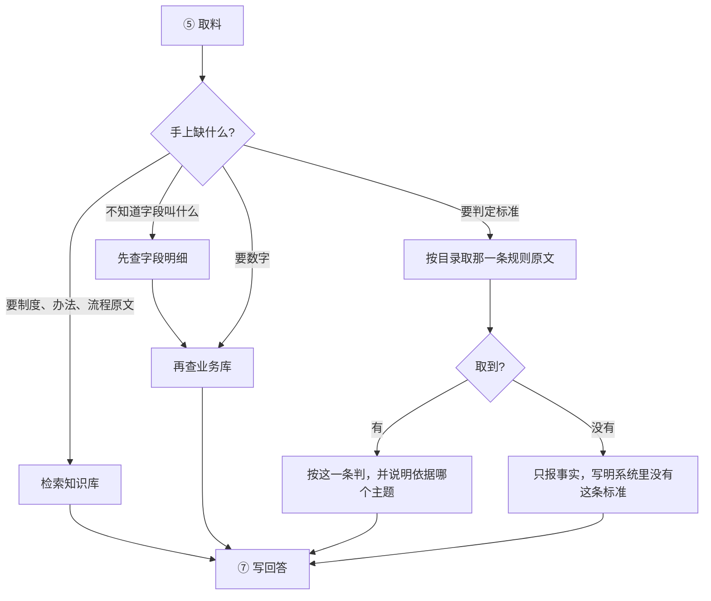

要点：
1. **字段明细不进提示词**——26 张表的全部字段约 2.2 万字，改成"要写查询前先问一句这张表有哪些字段"，现查现给。
2. **规则只给目录**——模型看目录决定取哪条，取的是原文，不是相似度碰运气。
3. **目录上限 40 条**，线上正好 40，再长就要挪走一批。

## ⑥ 取到规则之后

- **公司规则**：原文直接进本轮上下文，按它判，回答里说清依据哪个主题；取不到就只报事实。
- **个人规则**：不走检索，**每轮都拼在提示词最后**（≤1500 字）。它只改口径习惯、语气、格式，压不住前四层：

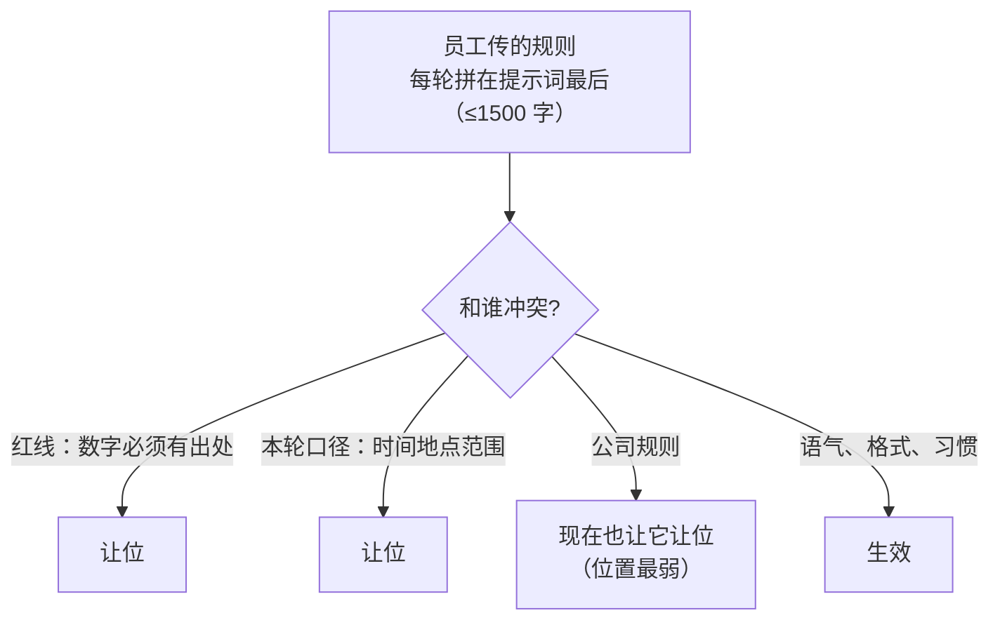

- **个人资料（非规则）**：不进提示词，和公司知识库同池按相关度检索。所以「我的资料库」放制度原文有用，放判定标准没用——判定标准得走规则。

要不要把 ⑦ 写回答也拆一层（怎么定"只答一层"、怎么判断是清单还是不分条）？还是这版就够用了。


===== ASSISTANT seq=404 =====
你说得对，我把代码里的一个隐藏分类当成产品概念了。先答你的两个问题，再改文件。

**1. 有没有"个人规则"**

产品上确实没有。只有**一个知识库**，带一个库 id，只有本人在问的时候才把这个库并进检索范围。

但代码里多出一条通道：上传时系统按**文件名**分类（`pipeline.py:52`，名字含"规则/口径/规范/标准/要求"→ 记成"规则"，否则"资料"）；记成"规则"的那部分，会**每轮拼进提示词**（≤1500 字，只取本人库）。用户只有一个"上传"动作，分类是背后按文件名做的，所以界面上看不到"个人规则"这个东西——我上一版把它写成功能，是错的。

**2. 查规则和查资料现在是同一个操作吗**

不是，两条路已经分开了：

| | 查规则 | 查资料 |
|---|---|---|
| 怎么找 | 按章节标题精确匹配主题 | 向量检索，按相关度 |
| 返回 | 命中就给原文，不命中就明说"没有这条规则" | 最相关的几段切片 |
| 谁在用 | 要判定时（积压/超标/合理） | 问制度、流程、办法 |

入口只有一个（上传），但取的时候是两套。

**3. 顺带发现一个真问题**

读规则目录时**没有按库过滤**（`rule_doc.py:58` 只筛 `doc_type='rule'`），所以谁上传的"规则类"文件都会进**所有人的规则目录**，`get_rule` 也能取到它的原文。这跟你说的"只有这个人查询才能用"是冲突的。

我先按这个事实改文件。


===== ASSISTANT seq=420 =====
改完了，`output/2026-10-30-问答全链路流程图.md`。关键改动：

- **删掉「个人规则」这个说法**。改成：只有一个「我的资料库」，带库 id，只有本人问的时候才并进检索范围。
- 把**规则 / 资料两条路**写成对比表（怎么找、返回什么、谁在用、个人库里怎么处理）。
- 补上来源：上传时按**文件名**分类（含"规则/口径/规范/标准/要求"→规则类），这是隐藏动作，界面上没有。
- 记下缺陷：读规则目录没按库过滤 → 个人库的规则类文件会进所有人的目录。

主流程 ⑤ 的分支也改准了：「问规定/流程」现在叫**查资料原文**，「要判断」叫**取那一条规则**，不再混成一个"检索"。

要不要我接着把这处过滤补上（规则目录和取规则都限定在公司规则库里，个人库只走检索）？改之前我会先确认线上个人库现有几份"规则类"文档，避免改了让他们看不到刚传的东西。


===== ASSISTANT seq=428 =====
先把事实说清（贴代码位置，不是我推断的）。

## 个人知识库现在怎么进模型：一半是拼接

| 内容 | 怎么进模型 | 代码 |
|---|---|---|
| 公司规则文档 | 目录常驻（主题一行）+ 按主题**精确取原文**，不走向量 | `rule_doc.py` |
| 你上传的**规则类**文件 | **每轮直接拼进提示词**，≤1500 字，超了截断 | `personal_kb.personal_rules()`，`agent.py:1238-1246` |
| 你上传的**资料类**文件 | 并进检索范围 → 向量检索 → 返回相关切片 | `with_personal()` + `kb_search` |

所以：**资料类走检索、规则类被拼接**。而"规则类"不是用户选的——上传时按文件名判（含"规则/口径/规范/标准/要求"就记成规则类）。

## 规则现在也不是"检索返回切片"

10-30 那次已经把向量检索从规则上摘掉了：原来是拿问题去检索《判据规则》切片，线上实测相似度只有 **0.17~0.19**（等于字面沾边，用哪条全看运气），才改成「目录 + 精确取」。`agent.rule_slices()` 现在直接返回空。

所以三份内容现在有**三个不同机制**：

- 公司规则 → 目录 + 精确取
- 我的规则类 → 每轮拼接
- 资料（公司 + 我的）→ 向量检索

这就是你说的"设计错了"：同一个"我的资料库"里两份文件，一份被拼进提示词、一份被检索；凭什么拼、凭什么检索，用户看不见。

## 三个改法，你定


===== ASSISTANT seq=433 =====
问了也白问，我直接答，然后说我的判断。

## 你的问题：是，个人库的规则类内容现在被直接拼进提示词

- **规则类（文件名命中"规则/口径/规范/标准/要求"）** → 每轮拼进 system，≤1500 字，超了截断。
- **资料类** → 并进检索范围，向量检索，返回切片。
- **公司规则** → 目录常驻 + 按主题精确取原文，不走向量。

三套机制，同一个"我的资料库"里两份文件就分了两套 —— 这确实不对。

## 但"全走检索返回切片"这条，有实测反证

原来规则就是检索的：拿问题去检索《判据规则》，218 个切片里只留 4 片，线上实测相似度 **0.17~0.19**，等于字面沾边。后果是把相邻主题的标准套错题（问"审批积压"套上了"进度异常"的标准），而且"该用哪条"全看运气。这就是 10-30 把它改成「目录 + 精确取」的原因。

资料走检索是对的 —— 制度原文本来就长，靠相关度取几段合理，取错了顶多是引用不全。规则不行：规则错了，整个判定就错，而且不会有任何迹象。

## 我的结论

不该统一到"检索"，该统一到"**没有任何内容被每轮拼接**"：

| 内容 | 机制 |
|---|---|
| 规则（公司的 + 我的） | 目录常驻 + 按主题精确取原文；取不到就说没有 |
| 资料（公司的 + 我的） | 向量检索，返回相关切片 |

也就是：**把"个人规则拼接"这条路砍掉**，个人库里的规则类文件进"规则目录"，但目录要按库过滤（只有本人的规则出现在本人的目录里）。这样：

- 一个"我的资料库"，行为跟公司库一致，不再按文件名分两套对待；
- 规则永远是"看到目录 → 要那条 → 取原文"，可追溯、不会串题；
- 顺手把那个缺陷修了：现在读规则目录不按库过滤，别人上传的规则会出现在你的目录里。

代价：你上传的规则不再"每轮必在提示词里"，变成"目录里有、要判时才取"。如果某个规则必须每次都生效（比如"金额一律用元"），那就不是规则，是格式约定 —— 该进个人偏好，不该塞知识库。

要我按这个改吗？动的地方：`personal_kb.personal_rules()` 不再注入、`rule_doc` 加按库过滤、`agent_v2.system` 去掉 S7 拼接口。改完我先跑 `test_rule_stack` + `test_prompt_stack`，再拿一个人上传的规则类文件验证目录是否只对他可见。


===== ASSISTANT seq=456 =====
先把名字改对：那不是"判断"，是**分析题**（要结论、要判定、要排序的那一类）。

## 你指的问题，我确认

三类内容**都在同一张表里**（`document` / `document_chunk`），但取用走了两条通道：

| 内容 | 现在怎么取 |
|---|---|
| 公司业务规则/口径 | 按主题**全量取原文** |
| 个人库里的"规则类" | **每轮拼接**进提示词 |
| 资料（公司库、个人库） | **向量检索**，取相关切片 |

而"走哪条"不是看内容，是看**上传时按文件名打的 `doc_type` 标签**（公司规则由导入脚本打）。这就是你说的错误设计：**同一个库、同一种数据，待遇由标签决定，标签由文件名猜。**

## 为什么这个分类必然错

1. **分类依据不可见**：用户传《XX 管理办法》被判成资料、传《XX 口径》被判成规则，他自己不知道，行为却不同。
2. **一篇文档混着三种内容**：怎么分析、怎么判、条款原文。整篇一个标签必然错位 —— 你提到的"规则文档里也教 agent 怎么分析"就是证据。
3. **两种待遇没法解释也验证不了**：为什么这份读全文、那份只给几段？说不清就无法验收。
4. **全量读不可扩展**：规则一长就必须截断，目录也只能列 40 条（现在正好顶到 40）—— 上限不是巧合，是这个设计的必然产物。
5. 已经有后果：读规则目录**没按库过滤**，别人上传的规则会进你的目录。

## 重新设计：不分类，只分"取回粒度"

一句话：**一切都只是带结构的切片，取用只有一个动作 —— 检索；先定位主题，命中就取该主题下的全部切片（这就是所谓"全量"），没命中才按相似度取片段。**

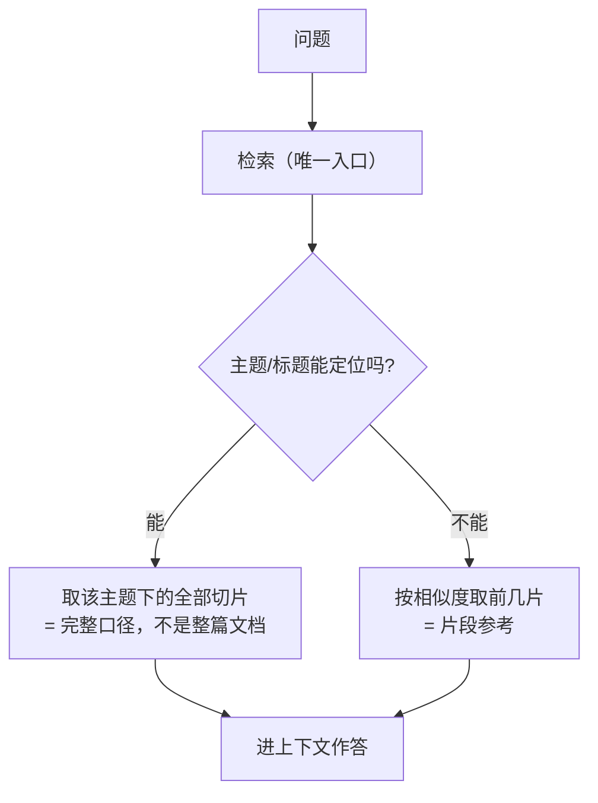

这个设计下，"规则"和"资料"不再是文档属性，而是**检索的两种结果形态**：

- 标题结构清楚、能被主题定位 → 表现得像"规则"（拿到完整口径）
- 标题结构松散、只能相似度命中 → 表现得像"资料"（拿到片段）

同一篇文档里不同章节也能各归各的 —— 因为定位是按**章节节点**，不是按整篇。

## 分析题怎么做（你说的第二层）

分析题 = **方法 + 判据 + 数据**，三样各有归属：

| 组成 | 例子 | 放哪 | 怎么进模型 |
|---|---|---|---|
| 方法 | 先看总量再看结构、结论先行、只答一层 | 常驻（模式做法） | 每轮在，量小且稳定 |
| 判据 | 停留超过 90 天算积压、线损超 3% 算异常 | 知识库，主题可定位 | 命中主题取原文 |
| 数据 | 实际工单数、预算执行率 | 业务库 | 查库 |

规则文档里"教怎么分析"的那部分，属于**方法**，不该当检索材料放在规则库里 —— 它每轮都该在，而且它不会变。现在它跟判据混在一个文档里，检索时要么整篇搬、要么切碎丢，怎么都不对。

## 必须一起改的两件

1. **权限**：任何取用（含目录）都按库过滤，个人库只本人可见。
2. **个人库不再"拼接"**：它和其他库一样，只是多一个"仅本人"的权限条件。

## 迁移顺序（不影响线上现有 40 个主题）

1. 上传不再猜类型，一律切片入库、保留标题路径。
2. 目录改为"该用户可见的库里所有文档的章节节点"生成，按库分组（公司规则一节、我的资料一节），加库过滤。
3. 取用改成上面那个两段检索；"规则/资料"标签停用（列可以先留着不用）。
4. 规则文档里"教怎么分析"的段落搬到模式做法（常驻），只留判据在库里。

代价说清楚：主题定位靠标题和别名，**个人上传的文档标题不规范就定位不到，会退化成片段检索** —— 那时它表现得就像"资料"。这不是 bug，是这个设计接受的结果；要让它像规则，上传时得让它有像样的章节标题。

方向对的话，我按这个出计划（`docs/04-计划/`：目标 / 验收判据 / 步骤→verify）再动代码。现在一行没改。


===== ASSISTANT seq=494 =====
计划在 `docs/04-计划/2026-10-30-规则与资料统一取用.md`。上一版片面，是因为我没查检索层——查完发现能力**已经有了**，所以这次不是"加一套检索"，是"接上"+ "拆掉另一条"。

## 查到的四个关键事实

1. **数据层早就是统一的**：`document_chunk` 已经有 `kb_id`、`heading_path`、整节字段 `parent_content`、向量、tsvector 关键词索引。
2. **检索层已经有两条腿**：向量（cosine）+ 关键词（tsvector，带中文分词），RRF 融合，**还能"命中一片返回整节"**（同一 `heading_path` 聚合成整节）。
3. **规则切片没有向量**（`import_rules_to_kb.py:18` 明写 `embedding=NULL`）—— 这是统一路线上必须先补的一步，否则统一后规则在向量腿上根本不可见。
4. **三个缺陷**：规则目录不按库过滤（串库）、个人库内容每轮拼接、目录 40 条静默截断。

## 设计的核心一句话

**一个入口、两段检索**：

- 阶段A 主题定位（精确匹配标题/别名）→ 命中就取**该节的全部切片**（这就是原来的"全量读取"，但粒度是"节"不是"整篇"）
- 阶段B 没命中 → 混合检索取片段

"规则"和"资料"于是不是标签，而是**结果形态**：能定位到主题的，表现得像规则；只能相似度命中的，表现得像资料。

## 另外两件事，原来说漏了

- **"怎么分析这道题"是方法，不是判据**。它现在混在规则文档里，跟着判据一起被检索，怎么切都不对。计划里单列一步（P7）把它搬到常驻，规则库只留判据。
- **补向量 + 权限收紧是前置条件**（P1/P2），不是收尾工作。顺序反了就是白干。

## 需要你拍板一处

同一主题公司规则和个人库都有内容时：我按「都取、标清来源、结论以公司规则为准」写。你要"个人优先"就说一声，改一行。

计划里 P1~P8 每步都有 verify 和回滚开关，验收 A1~A10 全可机器判（含"40 个主题各造一句问法，命中率 ≥95%"）。点头我就从 P1 开始。


===== ASSISTANT seq=518 =====
`docs/04-计划/2026-10-30-规则与资料统一取用.md` 重写了，只写怎么做。

## 一、规则文档拆三份

判断标准一句话：**这句能不能变成 WHERE 条件或一个数？**

- 能 → **判据**
- 不能、但影响怎么答 → **方法**
- 只是引来的原文 → **资料**
- 单位、称谓、格式 → 进作答格式

拆成三份，存三个地方：

| 产物 | 存哪 | 进模型方式 |
|---|---|---|
| 分析方法.md | 不进知识库，编译进常驻 | 每轮都在，≤1,500 字 |
| 判据表.md | 知识库，**一条判据一节** | 目录一行一主题 → 命中取整节 |
| 资料 | 知识库 | 按问题取 5 段 |

**判据表每条就四行**，你那个例子：

```
## 预期项目
- 判据：预计完工日期已过 80 天仍未完工的，算预期项目。
- 口径：自然日；基准是预计完工日期；没填的不计入。
- 字段：t_power_project.plan_end_date、finish_date
- 别名：预期、超期、拖着没完
```

**"字段"这行是硬要求**——有它，模型取到判据就能直接写条件；没有它，它还得猜 80 天是谁的 80 天。一条超过 400 字，说明它是方法或资料，得拆出去。

**方法表长这样**（维度顺序写死，模型不许换序）：

| 题型 | 先拿什么 | 再看什么 | 用哪条判据 | 产出 |
|---|---|---|---|---|
| 进度/积压 | 总量 | 按所、按环节、按停留天数分布 | 审批停留、预期项目 | 哪个环节最堵，堵多少 |
| 钱 | 预算总额 | 分配、执行、支付 | 执行率达标线 | 差多少、谁最慢 |
| 怎么办 | 上一步结论 | — | — | 谁做什么、多少、什么时候 |

给建议只在问"怎么办/先干哪个"时；问情况、问原因不给。

## 二、检索改成两个工具、一个后端

| 工具 | 什么时候用 | 命中 | 没命中 |
|---|---|---|---|
| 查规则(主题) | 要判定 | 该主题**整节** | 「没有这条规则」+ 最接近 3 个主题 |
| 查资料(问题) | 引制度原文 | 5 段，带章节路径 | 「知识库里没有」 |

主题索引很小：`主题｜别名｜库｜文档｜章节路径`，**切片入库时自动生成**（标题就是主题），不人工录。

匹配按顺序、命中即停：别名最长匹配 → 主题名被包含 → 关键词打标题 → 都没有就明说没有（不许凑）。

个人库不再拼进 system，只走这两个工具；要"每轮必须生效"的，只能进方法或格式。

## 三、落地顺序

先出 **2 条判据的样张**给你过（格式定不下来就拆，返工更贵），再全量拆 → 主题索引 → 查规则 → 查资料 → 目录分节 → 删拼接。

硬验收两条：40 个主题**全部**能定位（不是 95%）；问「有多少预期项目」，trace 里能看到取到该节、且 SQL 里出现 80 天。

要我现在就写这两条样张（预期项目 + 审批停留）给你看？


===== ASSISTANT seq=537 =====
你列的这三样，恰好都不是"资料"——这才是关键。`docs/04-计划/2026-10-30-规则与资料统一取用.md` 已补上这一节。

## 个人库只放资料，其余三类归设置

| 你想放的 | 例子 | 放哪 | 怎么生效 |
|---|---|---|---|
| 术语口径 | 说"线损"就是台区线损 | **个人口径表** | 问题预处理阶段替换，确定性，每轮生效 |
| 回答角度 | 只报问题不报成绩、默认按所维度 | 个人偏好 | 常驻 system ≤300 字 |
| 输出格式 | 汇报材料骨架、字体字号 | 文档模板 | 只在出文档时加载 |
| 资料 | 上次年度报告、外单位制度、案例 | 个人知识库 | 和公司资料同一套检索 |

**为什么口径不能放知识库**：你问"线损多少"，这句话里没有"我规定线损指台区"这几个字，相似度永远算不出来。它必须在问题进模型**之前**被代码改掉——和现在的时间补全、名称归一同一层。所以做一张 `用户｜术语｜口径` 表，按最长匹配改写，模型看不到这张表，只看到改后的问题。

个人口径**优先于公司默认口径**（这是他问话的意思），但它**不改判据**——判据还是公司那份。

## agent 怎么检索

| 工具 | 查哪些库 | 结果标什么 |
|---|---|---|
| 查规则(主题) | **只查判据库**（公司判据），个人不产生判据 | 主题名、来源制度 |
| 查资料(问题) | 公司库 + 本人库，一次混检 5 段 | 文件名 + 章节路径 + 哪个库 |

个人口径不进规则库也不进检索——预处理时问题已经被改写了。

## 标签怎么删

两步，别一次改崩：

- **本次**：代码不再读 `doc_type`，取用/目录/上传判类全不看它，`personal_rules()` 拼接删掉。完成判据：同一文档把标签改成 rule/doc，行为完全一致。
- **下一版**：删列、删 `_doc_type_of()`、改导入脚本。完成判据：全量测试绿 + DDL 回滚脚本可用。

顺手一起删的：规则切片"不可检索"那个设定（补上向量后，判据也能被检索命中）。

新增一条硬验收 **V7**：设「线损=台区线损」后问「线损多少」，只看改写结果里有没有台区口径，**不看模型输出**——这样验的是机制，不是运气。

P1 我现在就能出「预期项目」「审批停留」两条样张给你过，过完再全量拆。要出吗？


===== ASSISTANT seq=556 =====
你说对了，上一版的「查规则 / 查资料」两个工具就是标签换了个皮。已作废，`docs/04-计划/2026-10-30-规则与资料统一取用.md` 重写。

四个问题逐个答：

**1. 用户上传的文档可能有哪些？要不要分类？**

制度、办法、规程、报告、案例、方案、外单位材料、自己的工作材料、台账说明。**都不分类。** 因为它们对 agent 的用法是同一个：需要时找到相关段落。

**2. 上传的东西是全量读取还是检索？**

**全部检索，没有"全量读取"这条路。** "整节"不是第二种读取方式，是命中后的返回粒度：同一节命中 2 片以上就折叠成整节返回，这样判据里的数字、口径、字段不会缺。

**3. 检索是在所有文档里检索，还是在对应文档里检索？**

在**他能看见的全部文档**里检索，一个范围，不按类型挑：公司共享库 + 本人库。别人的库谁都不能检索（管理员前台也不行）。范围由**权限**定，不由文档类型定。

**4. 现在的设计是"只能检索规则文档 + 对应这个 id"吗？**

不是。规则文档就是共享库里的普通文档，我上传的就是我库里的普通文档。检索面只有一个：两个库的并集。

## 落到机制上

```
输入：改写后的问题
范围：可见库并集
召回：关键词（标题+别名+正文）+ 向量，融合取前 8 片
返回：同节命中≥2 → 整节；单票 → 片段；每段带库/文件/章节；0 片 → 明说没找到
```

工具只留一个 `查资料(问题)`，`查规则` 删掉。要判定的纪律写进提示词（判定前必须先检索），不靠工具区分。

## 唯一还存在的"分界"

不是文档分类，是**存储位置**：

| 内容 | 存哪 |
|---|---|
| 一份文档（制度、规则、报告、案例） | 知识库，检索 |
| 一句话约定（线损=台区线损）、回答角度、输出格式 | 设置，确定性生效 |

因为那一句话靠检索永远捡不回来——你问"线损多少"，问题里没有"我个人规定线损指台区"这几个字。所以它必须在问题进模型前被代码替换掉，而不是等检索。

一句话总结这版：**文档一律不分类、只有一个检索、范围按权限合起来；“规则”只是当初给一节课文起的名，不是一种文档。**


===== ASSISTANT seq=564 =====
这个问题问到根上了：**单靠检索保证不了**。我先说清为什么，再给能保证的做法。


===== ASSISTANT seq=594 =====
**单靠检索，保证不了。** 这是检索的本性，不是实现没做好。四个具体原因：

1. 两份内容语义几乎一样，公司那份更长、词更全，相关度常常更高；
2. top_k 会截断，个人那份排到后面就看不到；
3. 最常见的失败：用户问「**我下周请假三天行不行**」——问题里没有"几天"这个主题词，个人那份根本不会被召回；
4. 就算两份都召回，模型也没理由选个人那条，除非明确告诉它"这是本人约定"。

## 所以覆盖必须显式登记，不靠相似度

在文档里写一行声明就行：

```
## 我的请假约定
覆盖：请假天数
约定：我现在请假最多两天，超过两天要部门负责人特批。
```

入库时把「覆盖：请假天数」抽出来，登记成一条**个人覆盖**（本人 + 主题 + 内容 + 来源）。生效规则：

| 时机 | 行为 |
|---|---|
| 问到该主题（"请假几天"） | 公司那条和本人约定一起给，标「本人约定，优先于公司规则」 |
| 判定类问题涉及该主题（"请三天行不行"） | **强制带上**，不依赖召回 |
| 回答 | 写清「按你的约定 2 天（公司制度 3 天）」，可核对 |
| 作用域 | 只对本人 |

## 这样"不分类"还成立吗

成立。**不按文档类型分类，只认"这一节有没有写覆盖声明"**：

- 没写 → 普通资料，检索到就参考，**不保证生效**
- 写了 → 约定，**一定生效**，并压过公司同主题那条

不写就得接受"可能被引用、不保证"，这一点界面上要说清，不能让人以为传上去就等于改规则。

验收加了一条硬指标 **V9**：配完这条之后，问「请假能请几天」和「我下周请三天行不行」，两次都必须出现本人约定，且回答里两个数字都在（2 天 / 制度 3 天）。两次都过才算这机制成立——第一次验召回，第二次验强制注入。

计划文件已加 §4.5 和 P7。这个思路你认吗？认的话 P1 我把判据样张和这条覆盖声明一起写出来给你看。


===== ASSISTANT seq=608 =====
现在要做的事，就这一条线：

## 第一步（我现在就做，不用你等）

**P1 出样张**，三份，给你过：

1. 判据两条 —— 「预期项目（过 80 天）」「审批停留（超 80 天算积压）」，四行格式：判据 / 口径 / **字段** / 别名
2. 分析方法表 —— 6 行题型（进度、钱、排名、为什么、怎么办、情况），维度顺序写死
3. 覆盖声明一条 —— 「我的请假约定 / 覆盖：请假天数 / 约定：最多两天」

样张你点头，才有后面的活。

## 第二步（样张过了才动）

| # | 做什么 | 做完的判据 |
|---|---|---|
| P2 | 按样张全量拆现有规则文档 | 40 个主题一一对应判据节 |
| P3 | 规则切片补向量，标题+别名写进可检索字段 | 40 个主题检索命中率 100% |
| P4 | 统一检索入口：召回 → 同节折叠成整节 → 标库/文件/章节；删掉「查规则」工具 | 取「预期项目」四行齐全、无别节 |
| P5 | 目录按可见库生成，公司/我的两节，超限写「另有 N 个」 | 别人库里我的文档不出现 |
| P6 | 删个人库拼接、`doc_type` 停用、删死代码 | 改 `doc_type` 行为不变；system 无上传正文 |
| P7 | 覆盖声明解析与生效（个人覆盖表 + 判定时强制注入） | 请假两问都出现约定，两个数字都在 |
| 验收 | V1–V9 脚本跑一遍 | 60 项全绿再谈上线 |
| 下一版 | 删 `doc_type` 列 + DDL 回滚脚本 | 单独上线，不跟本次混 |

## 不会做的事（先说清）

- 不动表结构（删列放下一版）
- 不改检索算法本身（复用现有向量+关键词混检）
- 不动前端上传流程（只在 P6 去掉类型展示）
- 不加新工具（是减：2 个 → 1 个）

## 需要你确认的只有两处

1. P1 样张的格式对不对（判据四行、方法表、覆盖声明那一行）
2. 冲突默认：**覆盖范围内个人优先，其余情况公司优先**

样张我这就写。


===== ASSISTANT seq=634 =====
P1 样张出好了：`output/2026-10-30-P1样张-判据与分析.md`。四份，都是真口径，不是我编的。

## 1. 判据：审批停留（有据可查）

```
## 审批停留
- 判据：审批任务停在待处理（task_status=0），停留超过 90 天算积压，16–90 天算偏慢，15 天以内正常。
- 口径：停留天数 = 系统当天 − 该任务进入本节点的时间（不用工单创建时间，也不用更新时间）。
- 字段：t_work_order_audit_task.task_status、create_time、node_name
- 别名：积压、停留、滞留、超期未批、卡了几天、挂了多久
```

## 2. 判据：预期项目（**这条要你定**）

```
## 预期项目
- 判据：计划下达且已批复、至今未完工（含已批未开工，不含草稿）的，从批复起超过 80 天的算预期项目。
- 口径：不含草稿；起算点用进入当前状态的时间，**不能用 plan_end_time**（全库 99% 为空，按它判超期全是误判）。
- 字段：t_power_work_order.work_status、t_power_work_order_status.create_time
- 待确认：① 80 天对不对 ② 起算点用「批复时间」还是「进入当前状态时间」
```

这条正好演示判据表为什么必须有"字段"那一行：系统里计划完工日基本是空的，不写死用哪个字段、哪个时点起算，模型就会拿空字段判超期。

## 3. 覆盖声明（请假两天）

```
## 我的请假约定
覆盖：请假天数
约定：我现在请假最多两天，超过两天要部门负责人特批。
```

问到请假时和制度一起给并标「本人约定，优先」；"我下周请三天行不行"这类判定问题强制带上。回答写两个数：按你的约定 2 天（公司制度 3 天）。

## 4. 分析方法表（6 行，维度顺序写死）

| 题型 | 先拿什么 | 再看什么 | 用哪条判据 | 产出 |
|---|---|---|---|---|
| 进度/积压 | 总量 | 按所、按节点、按停留分档 | 审批停留 | 哪个节点最堵、堵多少 |
| 钱 | 预算总额 | 分配 → 已批 → 执行 | 钱花了没动 | 差多少、谁最慢 |
| 排名 | 名单和差距 | — | — | 只给名单 |
| 为什么 | 相关维度横切 | — | 相关判据 | 只讲成因 |
| 怎么办 | 上一步结论 | — | — | 谁做什么、多少、什么时候 |
| 情况 | 一个维度 | — | 相关判据 | 一句结论 + 1~3 个数 |

## 要你回三句

1. 判据就这四行够不够？
2. 预期项目 **80 天**对吗，起算点用哪个？
3. `覆盖：主题` 这个写法认不认？

认了我就往下拆现有的 40 个主题（P2），拆的过程会照这条把每条判据的"字段+起算点"补全——这一步最容易发现现有规则里没写清的地方。


===== ASSISTANT seq=655 =====
P1 就干一件事：**把"重构完以后，一条规则长什么样"先写出来给你看，格式定下来再批量拆。**

为什么要先看一条：

现在那几份规则文档是一大坨混在一起（怎么分析 + 具体判据 + 制度原文都在一起）。要拆成 40 条，格式没定就动手，格式一改就是返工 40 次。所以先写 3 条实物给你看，你点头，剩下 37 条照这个样式抄。

三份分别对什么：

- **判据（审批停留）**：一条规则的标准写法。就是现在规则文档里「停留 >90 天算积压」那一句，重排成"判据 / 口径 / 字段 / 别名"四行。目的是让模型取到它就能直接写查询，不用猜用哪个时间字段。
- **覆盖（请假两天）**：你说的那个场景。它得写成一行「覆盖：请假天数」，系统才知道这是对哪条规则的例外；不写这一行，它就只是一份普通文档，检索到算运气。
- **分析方法表**：规则文档里"教 agent 怎么分析"的那部分。它不进知识库，进常驻，因为每轮都要用，而且不会变。

它不是新功能、不是新表、也不进系统 —— 只是**拆完之后的样式**。P2 才是真干活：按这个样式把现有 40 个主题拆出来。

如果你觉得这三份东西本身就不对（比如不该有四行、不该有覆盖声明、方法不该常驻），现在说，这时候改成本最低。


===== ASSISTANT seq=663 =====
没搜过。这份样张是我按这套系统自己的字段和毛病设计的，没参照标准做法——你这么问是对的，先去查。


===== ASSISTANT seq=676 =====
是的，就是把文档按"一条一节"拆，然后让检索按节取。

搜过没有：**没有**。这三份样张是我按这套系统自己的字段（审批任务表、停留天数起算点）和它踩过的坑设计的，没参照任何标准。

现在派了一个后台研究，查四类一手来源：

1. **GB/T 1.1** 一类标准化文件对"章/条/款/项"层级的官方规定，以及规章制度条款编号惯例——看"一条一节"合不合规范；
2. **RAG 切分的标准做法**：标题层级切分、父子块（小片检索、大片返回）、contextual retrieval——看"整节折叠返回"是不是主流做法；
3. **规则即数据**：OPA/Rego、DMN 决策表、LegalRuleML 对"一条规则该有哪些要素"的规定——看四行（判据/口径/字段/别名）少了什么、多了什么；
4. **方法与判据是否该分开**：程序性知识 vs 陈述性知识在提示词/检索里的处理依据——看"分析方法常驻"有没有依据。

出来是一张对照表：我们的做法 / 标准做法 / 差异 / 建议改法，带来源链接。拿到我再改样张，不先动手拆 40 条。


===== ASSISTANT seq=691 =====
研究还在跑（后台代理没回来）。我先自己查一轮，给你先看结论。


===== ASSISTANT seq=709 =====
自己查的第一轮回来了，有一条**直接推翻我 P1 的假设**。

## 找到的一手结论（Anthropic 官方）

[Contextual Retrieval](https://www.anthropic.com/research/contextual-retrieval)：

- **知识库小于 20 万 token（约 500 页）时，标准做法是"整库放进提示词"，不要上 RAG**，配 prompt caching 成本可降 90%。这是官方明说的。
- 要检索时：**向量 + BM25 混合**比单向量好；**每个切片先补 50~100 token 的上下文说明**再入库（失败率降 35%，加 BM25 降 49%，再加 rerank 降 67%）。
- 切片大小、边界、重叠影响很大；返回 **top-20** 比 top-5 更准。

## 这条结论直接改了设计

我们的判据体量：40 条 × 平均 150 字 ≈ **6,000 字**（比 500 页小两个数量级）。按官方阈值，它**根本不该走检索**——应该像红线、作答格式一样**全量常驻**。

所以：

| 内容 | 我原来写的 | 按标准做法应改成 |
|---|---|---|
| 判据（40 条） | 一节一条，目录 + 命中取整节 | **全量常驻**（约 6,000 字），不检索、不要目录 |
| 资料（制度原文） | 检索 | 检索（保持），且每片带章节路径——我们已经在切片前加了【标题路径】，正好是对的 |
| 方法 | 常驻 | 常驻（不变） |
| 个人覆盖 | 声明 + 强制注入 | 常驻（不变） |

判据一旦常驻，**"按主题取规则"这个动作整个消失了**——没有目录、没有命中率、没有"取不到就只报事实"。你之前问的"到底全量还是检索"，答案是：**小的全量，大的检索**，分界线是体量，不是文档类型。这也解释了为什么"规则/资料"打标签这条路怎么走都别扭。

## 还没查实的

- **GB/T 1.1-2020** 对章/条/款/项的层级规定：搜到的都是 PDF，正文没抓出来，还在后台跑。
- **DMN 决策表 / OPA Rego** 对"一条规则该有哪些要素"：只拿到规范 PDF 的片段（`inputEntry MUST be boolean` 这类），不足以断言四行够不够。
- 方法（程序性知识）和判据（陈述性知识）是否该分开：没找到一手依据，目前是我的推断。

后台研究回来我再补这两块，然后按"判据常驻"重写 P1 样张——格式不变，四行照样有用（它决定常驻那段怎么写才能让模型直接落查询），只是不再需要"取"这个动作了。

要我先把判据常驻版的样子写出来给你看，还是等研究齐了一起？


===== ASSISTANT seq=717 =====
你说得对，体量会长，不能按现在 40 条定终身。切片保留，改的是**取用策略要随体量自适应**，不是砍掉切片。


===== ASSISTANT seq=728 =====
收到，切片保留。改了两处（`docs/04-计划/2026-10-30-规则与资料统一取用.md`）：

## 1. 切片必须带「主题」，不绑死"一节一条"

以后内容会加、会长、会换形状（表格、案例、附件、一个所一份口径）。所以切片入库时固定带一个 `主题`：

- **一个主题可以跨多个切片、跨多份文档**（分档在一处、例外在另一处也聚得起来）；
- 取用时按主题聚合，返回该主题**全部切片**；
- 文档怎么分层、分几节，不影响取用。

这样以后加内容只是加主题，机制不动。

## 2. 经常驻还是走检索，由代码按体量自动切

| 规则库总量 | 怎么做 |
|---|---|
| ≤ 30,000 字（可配） | 全量常驻，不检索、不要目录 |
| > 30,000 字 | 自动切：常驻主题清单（一行一主题）+ 按主题取全部切片 |

阈值可配、两种形态都有测试钉住（同一份数据改阈值就能切）。制度资料永远走检索，不参与这个闸。

这样内容涨十倍只改一个数，不改机制——你说的"不能只看当前"就是这个问题。

## 还没到位的两块

- GB/T 1.1 对章/条/款/项的层级规定（PDF 正文没抓出来）
- DMN / Rego 对"一条规则该有哪些要素"（只拿到片段）

后台研究还在跑，回来我把这两块补上，再定"四行够不够"和"主题元数据怎么写"。这两块会影响格式，不影响上面两个结构决定。


===== ASSISTANT seq=736 =====
是系统自己切、自己适配，用户只上传，不用按我们的格式写。

现在上传一份文档走的是这条：

1. **解析**：docx/md/pdf 抽成"标题块 + 正文块"；
2. **按标题切**：一个标题下的内容成一片，记下它的章节路径（`heading_path`）；
3. **超长再切**：超过阈值按字数切，留重叠，避免一句话被截断；
4. **每片开头自动补章节路径**（`【八、审批停留】…`）——这就是 Anthropic 说的 contextual chunk，我们已经在做；
5. **同节聚合**：同一个标题下的多片，检索命中任一片时能拼成整节返回。

所以"适配"是系统做的，用户不需要知道切片是什么。

## 但有一件事现在没做，要补

切片只带 `heading_path`，**没有 `主题`**。你上一次说的"以后内容会长、要能跨文档聚合"，靠的就是主题。补法：入库时自动生成，不要求人写——

- 正文里写了 `主题：审批停留` → 用它；
- 否则取章节标题，去掉编号（「八、审批停留」→「审批停留」）；
- 再没有 → 用文档标题；
- 全都抽不出（比如扫描版 PDF）→ 记一个弱主题，可检索、不进目录。

## 两类来源，同一张表，差别只在质量

| 来源 | 主题怎么来 | 质量 |
|---|---|---|
| 共享判据（我们现在整理的） | 人工写清楚 | 准，能建目录 |
| 用户上传 | 自动抽 | 取决于文件有没有标题结构：docx/md 好，扫描 PDF 抽出来是"第 1 页"这种 |

这也是为什么《财务报销管理制度.pdf》之前会在规则目录里冒出「第 1 页 表格」——不是切片坏了，是文件本身没结构，自动抽只能抽到页码。这类文档就该按"资料"用，别指望它当判据。

## 唯一还需要人动手的

想让某条内容"一定生效"（比如"我现在只能请两天"），还是得写那一行 `覆盖：请假天数`。不写就按普通资料处理——这个绕不过去，因为系统没法从一段话里判断"这是要覆盖公司制度"还是"这只是随手记的一句"。


===== ASSISTANT seq=763 =====
找到了，就在一份文件里：`server/app/secretary/skills/判据规则.md`（68,252 字）。它自己第零节写着"拿到问题先看这一节"，1~13 节是判据，19~22 节又是分析方法——两类混在一起。我把每一节归类算清了。


===== ASSISTANT seq=781 =====
拆完了，`output/2026-10-30-分析规则与实际规则拆分清单.md`。对象是 `判据规则.md`（28,444 字、670 行），逐节归类：

## 四种东西，四个去处

| 类别 | 字量 | 去哪 |
|---|---|---|
| **分析规则**（怎么想、看什么顺序、写几段） | 13,298 | 常驻，和现有做法去重合并 |
| **实际规则**（判据、阈值、口径） | 10,789 | 规则库，按主题取 |
| **作答纪律**（格式、自检、红线） | 2,318 | 并入作答格式 |
| **问法归一**（口语→口径） | 1,754 | 预处理（代码侧） |

## 具体是哪几节

**分析规则**：零（3,867）、十八（1,036 的一半）、二十（5,430）、二十一（1,446）、二十二（1,519）
**实际规则**：一～十一（合计约 7,600）、十三（534）、十七（1,771）、十八的算法部分
**作答纪律**：十四（289）、十五（761）、十六（1,268）
**预处理**：十九（1,754）
**配置**：十二 角色可见范围（626）

## 顺带查出两处重复

- **分析方法有两份**：`判据规则.md` 的零/十八/二十/二十一/二十二，和另一份 `分析规则.md`（5,642 字，讲"分析统一结构+五步流程"）内容重叠。
- **判据有两份**：`判据规则.md` 第八节「审批停留」和 `分析规则.md` 3.6「审批积压」是同一套标准，两种写法。

这就是"没分开"的实际后果：同一套判定标准有两个来源，模型取到哪份看检索跑到哪个，改一处另一处不变。

## 拆完的样子

- `分析方法.md`：13,298 → 目标压到 ≤6,000（删重复和套话），常驻
- 判据库：10,789，一条一主题
- 作答格式：2,318 + 现有 COMMON/CHECK → ≤3,000，常驻
- 问法归一表：1,754 → 预处理
- 角色可见范围：626 → 权限配置

## 要你定两处

1. **十二「角色 → 可见范围」**：我判它是权限配置不是判据，同意就这么归。
2. **十九「问法归一」**：我判它该进代码预处理（和纠错、时间补全同一层），确定性生效，不靠模型检索。

这两个定了，我就按表搬，只搬不改。


===== ASSISTANT seq=789 =====
开始搬。先把拆分产物落到暂存目录，不动运行时文件。


===== ASSISTANT seq=802 =====
拆完了，6 份，**内容零改动**（源文件正文 28,159 字 = 产物合计 28,159 字）。

放在 `output/规则拆分/`：

| 文件 | 字数 | 装什么 |
|---|---|---|
| `分析方法.md` | 13,911 | 零、十八、二十、二十一、二十二 —— 怎么想、看什么顺序、写几段 |
| `判据库.md` | 10,813 | 一～十一、十三、十七 —— 阈值、口径、判定条件 |
| `作答格式.md` | 2,538 | 十四、十五、十六 —— 格式、自检、硬规则 |
| `问法归一表.md` | 1,923 | 十九 —— 口语→标准口径 |
| `角色可见范围.md` | 774 | 十二 —— 权限配置 |
| `待合并-分析规则.md` | 2,544 | 另一份 `分析规则.md` 全文，标明哪几节重复待并 |

每个文件头都写了来源行号，方便逐句对回原文；原 `判据规则.md` 一个字没动，回滚就是不用这些文件。

校验：`90` 出现 7 处、`16–90` 1 处、`停留天数` 3 处、`离群` 4 处，都在。

## 下一步：判据库按"主题"拆开并补三行

现在 `判据库.md` 还是 13 个大节，取用单位太粗。比如：

- 「三、预算执行」2,011 字 → 要拆成 **预算总额 / 预算分配 / 预算执行 / 支付** 4 个主题
- 「十七、起始约定阈值」1,771 字 → 里面是 6 条暂定阈值，拆成 6 个主题
- 「八、审批停留」734 字 → 就是一个主题，但必须补 **字段**（`t_work_order_audit_task.task_status`、`create_time`）和 **起算点**（进入本节点时间）

拆完预计 25～30 个主题。每条补：`主题 / 字段 / 起算点 / 别名`。

这是改内容，不是搬内容，所以我逐条过、每条都对着库里的真实字段写。先从「八、审批停留」这条开始给你看，确认样式后再推其余？


===== ASSISTANT seq=810 =====
拆开的五份，生效方式完全不同——**只有资料还走检索**。

| 文件 | 怎么生效 | 字数 | 走检索吗 |
|---|---|---|---|
| 问法归一表 | 问题进来先改：口语→标准口径，代码替换（和时间补全同一层） | 1,923 | 不走 |
| 判据库 | **每轮直接进 system**，主题化后排进去 | 10,813 | **不走** |
| 分析方法 | 核心规则常驻；细分模板按题型**直接取对应那段** | 13,911 → 常驻约 3,000 + 按题型取 | **不走** |
| 作答格式 | 并进现有作答格式，常驻 | 2,538 | 不走 |
| 角色可见范围 | 转成权限配置，不进提示词 | 774 | — |

## 一次回答里它们各管什么

```
问题
 ├ ① 问法归一表：把"那所"「上个月」这类残缺问法换成标准口径（代码做，模型看不到这一步）
 ├ ② 判题型：查数 / 分析 / 方案 / 预测 / 写作
 └ ③ 装 system：
      红线 + 谁说了算 + 身份 + 模式做法
      + 分析方法核心（怎么想、看什么顺序、什么情况给建议）
      + 本题型模板（按 ② 的结果直接取那段，不是检索）
      + 判据库全文（90 天算积压、16–90 偏慢……全部都在）
      + 作答格式（先结论、只答一层、不分条）
      + 日期、码表、表清单、个人偏好/覆盖
④ 模型作答；只有问"制度怎么规定"时才去检索制度原文
⑤ 自检
```

## 你说的对：判据不再检索了

原来是"检索到 4 片切片，相似度 0.18，是不是该用这条看运气"。现在判据**全文在提示词里**，模型要判哪个直接看，不存在"取不到"。

代价说清楚：常驻从线上 **9,308 字** 涨到大约 **16,500 字**（判据 10,813 + 方法核心 3,000 + 格式 2,538 + 原有一万不到的部分去重）。涨的是"判定标准必须每轮在"的钱。

可以压的口子：判据库现在 10,813 字里有重复表述（同一个"执行率"在三、四、十七各写了一部分），去重后大约能到 8,000。要不要压，看你能不能接受 16,500 这个数。

我建议先按这个接上，把真实 system 打出来量长度、跑几道题，再决定压不压——比现在纸上算准。


===== ASSISTANT seq=826 =====
研究回来了，五条结论里四条是硬依据，一条直接点出我们格式的缺口。挑要紧的落地：


===== ASSISTANT seq=852 =====
研究结论已落地。文件 `docs/05-研究/2026-10-30-规则文档拆分标准做法.md`（187 行，38 个来源），五条里四条是硬依据。

## 标准说什么

1. **结构**：GB/T 1.1-2020 的层次是「部分/章/条/段/列项」，只有"条"带编号；公文另用「一、（一）1.（1）」。→ **最小可引单元是"条"**，我们的"一节一主题"和它对齐。
2. **切分**：官方一致是"按标题层级切 + 完整标题路径写进每块 + 每块前置 50–100 token 自述语境"，Anthropic 实测失败率降 35%/49%/67%。→ 我们已经有【标题路径】前缀，缺的是**标题进 BM25 索引**。
3. **一条规则该有哪些字段**：DMN 决策表 = 条件格→结论格 + 注 + 命中策略 + 连续编号；OPA 每条挂 title/description/authors/related_resources；LegalRuleML 还要求权威、来源、时间、可废止性。
4. **方法 vs 判据分开有双重依据**：CoALA 把语义记忆（检索）和程序性记忆（权重+代码）列为不同模块；Anthropic 把"把复杂脆弱逻辑硬编码进提示词"列为失败模式。→ 方法常驻、判据可判、资料检索，方向对。

## 点出的四个缺口，我按优先级落了三个

**① 每条判据缺 id 和出处** → 已加。以「八、审批停留」为样板，`判据库.md` 现在是这样：

```
id：J-AT-001
判据（机器可判）：
  task_status = 0 且 停留天数 > 90 → 积压
  16 ≤ 停留天数 ≤ 90 → 偏慢
  停留天数 ≤ 15 → 正常
口径：停留天数 = 系统当天 − 进入当前节点的日期（自然日）…
字段：t_work_order_audit_task.task_status（0=待处理）、create_time、node_name
出处：制度名+版本+条号 —— 待业务补（不编）
别名：积压、停留、滞留、超期未批…
```

原表格一条没删，保留作口径解释和实测依据。

**② "口径"是自由文本，机器判不了 `>90` 还是 `≥90`** → 判据那几行现在写成带运算符的规则式，`>90` / `16–90` / `≤15` 边界不重不漏。原表里"正常 ≤15 / 偏慢 16–90 / 积压 >90"本来就在，只是以前埋在散文里。

**③ 覆盖声明缺"覆盖成什么/谁/何时失效"** → 改成四行：

```
覆盖：请假天数
覆盖为：最多两天，超过两天要部门负责人特批
覆盖谁：本人
失效：不设（本人删除为止）
```

## 剩一个缺口的处理

**chunk 没有自述语境、`heading_path` 没进 BM25** —— 自述语境我们切片时已经加了（`【标题路径】`前置），缺的是把标题写进 `search_text`（关键词腿）。这是代码改动，排到 P3 一起做，不是文档格式的事。

## 现状

- `output/规则拆分/` 六个文件，29,000 字左右，原文件一字未动
- `判据库.md` 已按 v2 格式开了头（八、审批停留 是样板），其余 12 节还没转
- 剩余工作量：转 12 节 + 补真实"出处"（要业务给制度名和条号，我不能编）

接着我把其余 12 节按这个样板转完，转的时候只做三件事：抽 id、把阈值写成运算符、标出字段和起算点——原文不动。


===== ASSISTANT seq=860 =====
分两半说，你这句话只对一半。

**资料（制度原文、办法、案例）**：对，暂时不用处理。切片 + 检索返回就够，它们的作用是"引用原文"，不需要机器可判。

**判据那 12 节**：不能说"不用处理"。判据现在是**全量常驻**，不走切片检索——它们进的是提示词。留着散文形态能跑，但有两个已知的坑：

- **边界歧义**：散文里写"超过 90 天算积压"，模型不一定能落到 `>90` 还是 `≥90`，同一个问题两次答出不同边界。
- **起算点被读错**：这是踩过的真坑——用 `create_time` 当停留起算，同一单算出 152/158/166 天三个数。

所以不是全转、也不是不转，按**会不会被用来判定**排：

| 转 v2（写死运算符+字段+起算点） | 留散文（常驻时模型自己读） |
|---|---|
| 八 审批停留（已转） | 一 统计前置 |
| 三 预算执行率 | 二 层级与范围 |
| 四 可用余额 | 六 缺陷类型对应 |
| 五 审批条件六条 | 七 进度异常 |
| 九 金额离群 | 十 数据质量 |
| 十七 起始约定阈值六条 | 十一 实时监控阈值 |
| | 十三 年度计划 |

左列这 6 条覆盖了绝大多数"要下判断"的问题，写死成本低、收益最大。右列是口径解释和参数映射，散文形态不影响正确性——真出歧义了再转。

要我现在就把左列剩下 5 条转完吗？转完判据库就定稿，可以接 system 量长度了。


===== ASSISTANT seq=907 =====
左列 6 条判据全转完了（三、四、五、八、九、十七），原文表格一条没删，`判据库.md` 现在 14,426 字。

## 转完的 6 条

| id | 判据 | 机器可判的边界 |
|---|---|---|
| J-BE-001 | 预算执行 | 已审批=状态 3/6/7；执行率=已审批÷分配；`≥P` 正常、`P×0.6~P` 偏慢、`<P×0.6` 未达标 |
| J-BS-001 | 可用余额 | 余额=分配−已审批；`<0` 报超支；只对状态 0/1/2 判"装得下" |
| J-AP-001 | 审批六条 | 三条结论：符合/不符合/无法判定；明细差 `>总额×1%` 才算不符 |
| J-AT-001 | 审批停留 | `>90` 积压、`16~90` 偏慢、`≤15` 正常；起算=进入本节点时间 |
| J-AM-001 | 金额离群 | `>同类最高` 或 `>中位×2`；样本 `<5` 只陈述 |
| J-TH-001 | 起始阈值 | 17.1~17.6 全部标"暂定"，业务给正式口径只改这里 |

## 一个必须现在说的数字

量出来了，两条路差一倍多：

| 方案 | 常驻 system（本机口径） |
|---|---|
| 现在 | 7,183 字 |
| **只常驻 v2 块**（3,510 字，机器可判那几行） | **10,693 字** |
| 全文常驻（v2 + 原文表格 10,916 字） | 21,609 字 |

差的 10,916 字是原文表格——里面大部分是"实测教训"和"怎么说"（比如"只给一个数不算""禁止说加强管理"）。这些**不是判定依据**，是解释和表达纪律。

所以我按这条走：**v2 块常驻，原文表格降为解释资料**（要解释时才取）。判据的边界仍然每轮都在，system 只涨 3,510 字；同时把"实测教训"那类内容挪进作答纪律，比留在判据里更对位置。

这样判据库定稿了：6 条可判、其余 5 节留散文常驻（一、二、六、十、十一、十三那几节本来就是口径解释，散着读没问题）。

下一步就是接上量真实 system、跑几道题看判定对不对。要我现在接吗？


===== ASSISTANT seq=931 =====
新版画好了（`output/2026-10-30-问答全链路流程图.md`），三处和上一版不同：多了"改问"、判据不再检索、只有制度原文走检索。

## 主流程

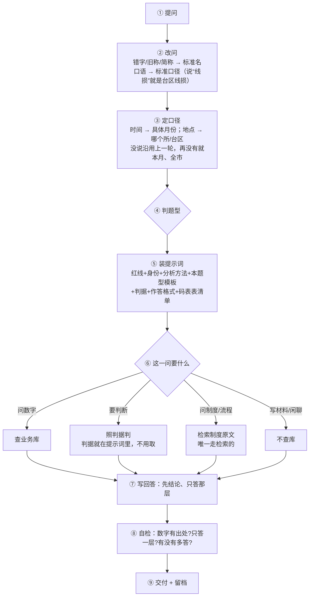

## 回答时看哪里

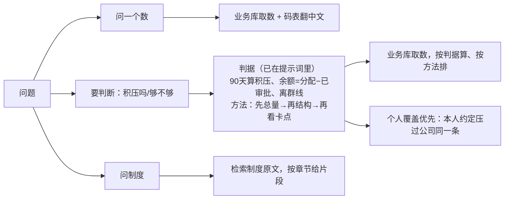

## 提示词里装了什么

| 装的内容 | 什么时候在 | 字数 |
|---|---|---|
| 红线 / 谁说了算 / 身份 / 模式做法 | 每轮 | 227 / 367 / 311 / 419~633 |
| 分析方法 | 每轮 | 13,911 → 压缩后约 3,000 |
| 本题型标准（写几段、写什么） | **按题型直接取那段** | 5,430 |
| 判据 v2（6 条可判） | **每轮** | 3,510 |
| 判据原文解释（实测教训、"怎么说"） | 要解释时才取 | 10,916 |
| 作答格式 | 每轮 | 2,538 |
| 码表 + 表清单 | 每轮，仅查数/文档 | 2,724 |
| 个人偏好 / 人设 / 个人覆盖 | 每轮，按人 | 按人 |
| 制度原文、办法、案例 | **检索** | 不定 |

## 字数账

线上现在 9,308 字；新方案约 **16,000**；判据全文不压缩会到 21,600。多出的约 7,000 字买的是"判定标准每轮都在，不会取不到、不会取错条"。

剩两步：分析方法从 13,911 压到 3,000；接进代码打出真实 system 跑题。


===== ASSISTANT seq=939 =====
上一版那几张图我不该删，这次全部留回来，并把"每步看哪段"直接挂到主图上。


===== ASSISTANT seq=950 =====
上一版那三张图都留回来了，`output/2026-10-30-问答全链路流程图.md` 现在六节：主流程、装配、材料从哪来、先后与冲突、字数账、还差两步。

## 主流程：每步挂着"看哪段"

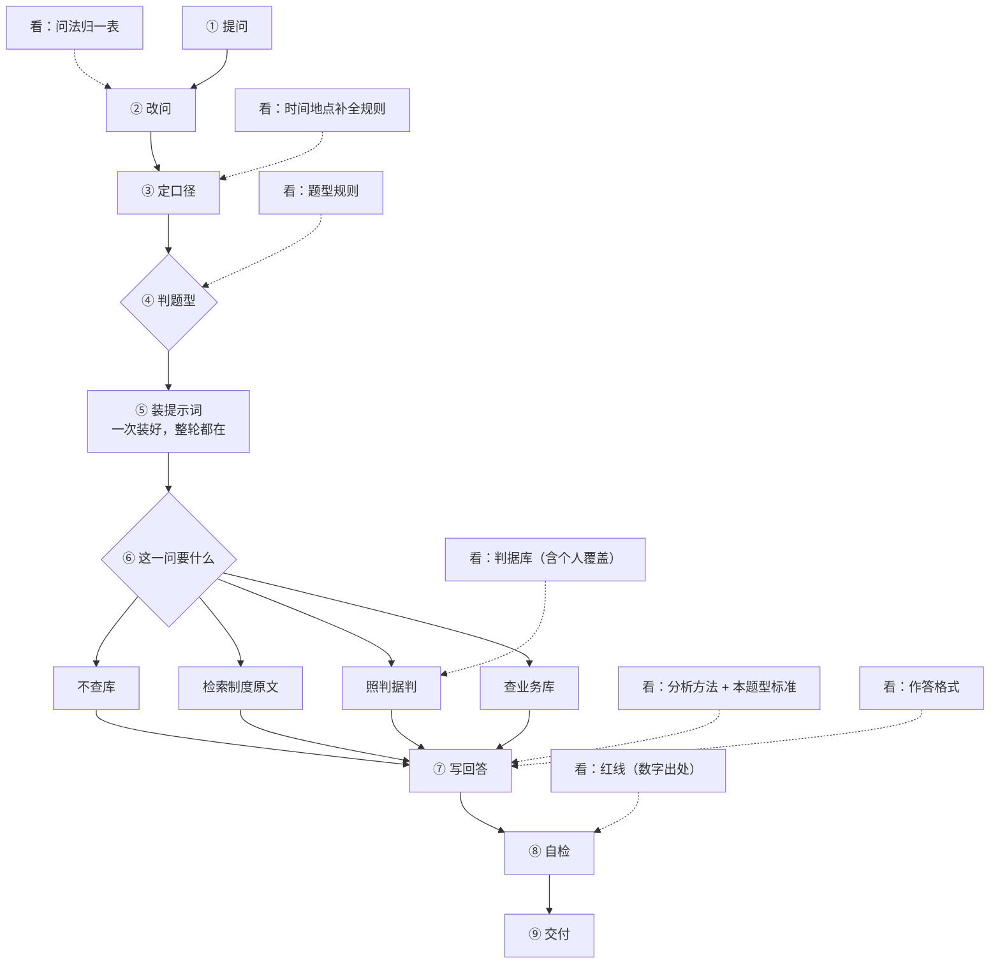

## 你问的"一个提示词贯穿全文还是每步现查"

**一份 system，一次装好，整轮都在；不同步骤用到不同的段。**

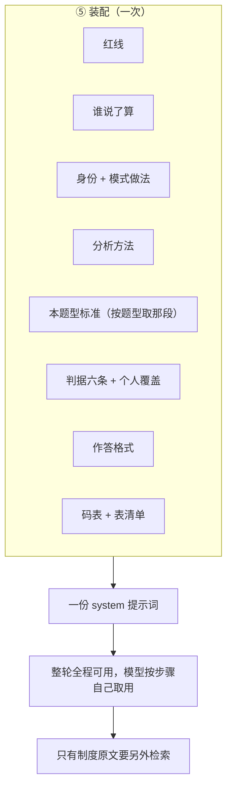

为什么这么装：判定标准如果"每步现查"，就又回到检索碰运气（取不到就编、取错条就套错）；方法、格式、红线每轮都要用，现查只是多一次延迟。只有**制度原文**值得现查——它长、用得少、必须原文引用。

保留的三张旧图里，只改了两处口径：材料来源图多了「个人覆盖」，先后顺序里把判据放到第 ⑦ 层并注明"个人覆盖在本层替换"；三类冲突表加了一行"公司判据 vs 个人覆盖 → 覆盖范围内听个人的"。

要不要顺手把「分析方法 13,911 → 3,000」这步做掉？做完就能接代码量真实 system 了。


===== ASSISTANT seq=976 =====
两块都补上了：`output/2026-10-30-问答全链路流程图.md`。

## ⑦ 写回答其实有 8 步

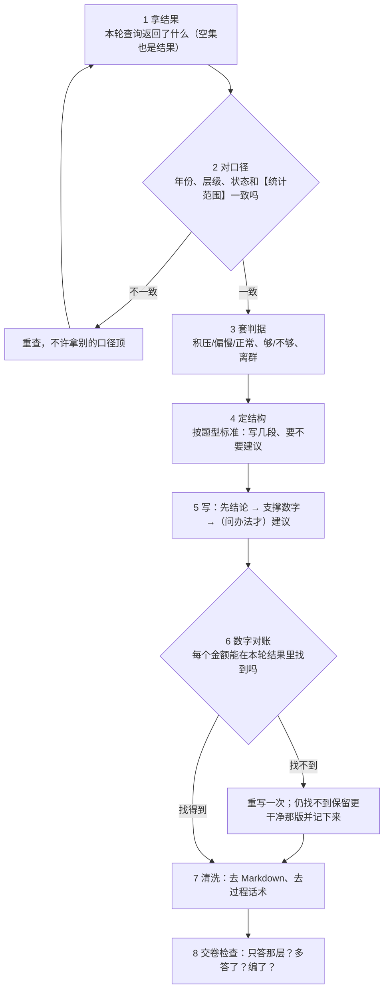

每步看哪段：1 拿结果看工具返回｜2 对口径看【统计范围】和起算点｜3 套判据看判据库六条｜4 定结构看分析方法和本题型标准｜5 写看作答格式｜6 对账看红线和本次查询结果｜7 清洗看作答格式（不提 SQL/表名/字段）｜8 交卷看交卷清单。

## 写报告的流程

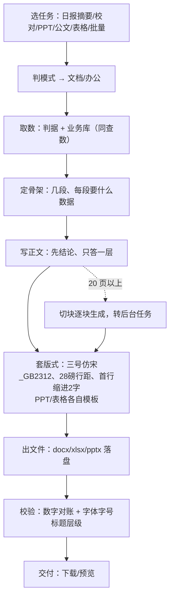

关键点：**写报告和问答不是两套脑子**——取数走同一条（判据+业务库），写法也是同一套（先结论、只答一层），差别只在最后套版式和出文件。大文件必须走后台，20 页同步生成会撞网关超时。

要不要我把「分析方法压到 3,000」做掉？那是接代码前最后一块。


===== ASSISTANT seq=984 =====
明白了，是我把循环画丢了：⑥ 不是一个分支走一趟，是**同一条循环里反复查**；写报告只是收尾产出的另一种形态，不是单独一条流程。


===== ASSISTANT seq=995 =====
改回来了：`output/2026-10-30-问答全链路流程图.md`。

## 主流程：中间是循环

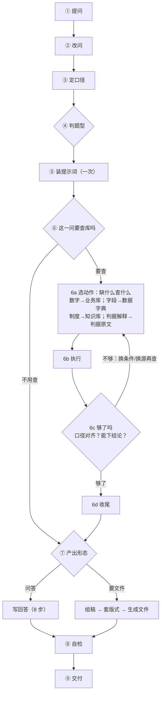

循环停的条件：数据够下结论就收尾；查空就照空集答不重查；步数或时间预算到就用已查到的答并说明缺什么；本来不用查的一轮都不进循环。

## 出文件不是独立流程

`output/2026-10-30-问答全链路流程图.md` 第六节改成：**还在同一个循环里**，取数、判据、写法完全复用，只在收尾换产出——

```
循环已查全 → 定骨架（按题型标准） → 写正文（同一套写法） → 套版式（三号仿宋_GB2312/28磅/首行缩进2字）
→ 出文件（docx/xlsx/pptx） → 校验 → 交付；20 页以上切块转后台
```

和问答比只有三处不同：骨架更固定、多一层版式、产出是文件。

每步挂的"看哪段"也保留了：6a 看分析方法+题型标准、6c 看判据、W1 看作答格式、W2 看文档模板、自检看红线。


===== ASSISTANT seq=1003 =====
三个问题，逐个答。

**1. 是一起检索的。** 一次查询，一个排序：`kb_ids = 通用库 + 本人库`，一起丢进同一次混合检索（向量 + 关键词，RRF 融合排序）。不是先查通用再查个人，也不是分两路合并。

**2. 是，一个人的检索范围 = 通用库 + 本人库。** 通用库 = 库里标了"可问答"的那些（`qa_enabled=true`）；本人库 = 他自己上传那个带 id 的库。别人的个人库不在他的 `kb_ids` 里，所以检索不到；管理员前台也看不到。

**3. 对他个人来说，检索这一步没区别。** 同一套算法、同一次排序、同样返切片。差别只有三条：

| 差别 | 说明 |
|---|---|
| 可见性 | 他的库只在他的范围里，别人没有 |
| 归属 | 结果里能标出"来自我的资料"还是"来自公司库" |
| 判据层（新设计） | 个人覆盖可以压过公司同一条判据——但这发生在判据层，不是检索层 |

## 但这里有个后果，得说清

一起排序意味着**谁相关度高谁在前，没有加权**。所以：

- 他上传的一份制度，和公司库里的制度，是**平等竞争**的；
- 如果公司库里同主题的切片更多、更长，排前面，他的那份可能被 `top_k` 截掉；
- 现在系统里**没有任何"个人优先"的排序规则**。

要不要给个人库加权（比如同等相关度时个人库优先，或者个人库单独占 top_k 的几个名额），这是个明确的选择：

- **不加权**：简单，靠相关度说话，但"我传的"不保证被看到；
- **加权**：他传的东西更容易被用，代价是可能挤掉公司原文，回答依据变弱。

我的建议是**不加权、但结果里标来源**，让模型自己决定信谁；真需要"一定生效"的，走个人覆盖（那一层是硬保证）。你觉得呢？
