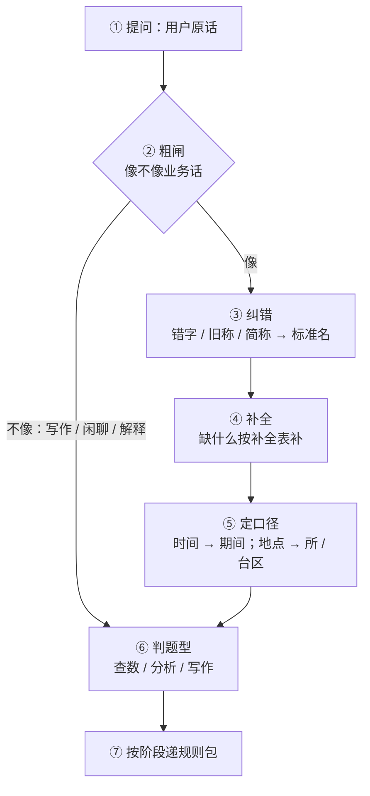

# 设计：规则出库、按阶段注入、提示词页面（2026-11-01 定稿）

> 配套需求：`2026-11-01-需求-规则出库与提示词页面.md`；主流程：`2026-11-01-问答主流程图.md`
> 这份说怎么做。做完之前不许改这份文档里的决策。

## 一、四条决策（先定死）

1. **规则离开知识库**。规则进 `rule_section` 表；知识库只留资料。`document.doc_type` 作废。
2. **规则按阶段注入**。六个包，流程走到哪一步递哪个包，每包 ≤4000 字。一条规则只属于一个包。
3. **流程前段重排**：粗闸 → 纠错 → 补全 → 定口径 → 判题型。补全独立成步，读独立表。
4. **提示词可看可改**：`/prompts` 页面三块（当前生效 / 规则包 / 补全表），改了下轮生效。

## 二、规则存哪

```sql
CREATE TABLE rule_section (
  id           bigserial PRIMARY KEY,
  stage        varchar(16)  NOT NULL,   -- triage | fetch | judge | answer | check
  topic        varchar(120) NOT NULL,   -- 主题名（get_rule 认这个名字）
  aliases      text         NOT NULL DEFAULT '',  -- 别名，逗号分隔
  body         text         NOT NULL,   -- 正文 markdown
  heading_path varchar(300) NOT NULL DEFAULT '',
  enabled      boolean      NOT NULL DEFAULT true,
  version_no   int          NOT NULL DEFAULT 1,
  updated_by   varchar(64)  NOT NULL DEFAULT '',
  updated_at   timestamptz  NOT NULL DEFAULT now()
);
CREATE INDEX idx_rule_stage ON rule_section (stage, enabled);

CREATE TABLE complete_rule (                -- 补全表，独立
  id          bigserial PRIMARY KEY,
  kind        varchar(16) NOT NULL,        -- fill(补缺) | norm(归一)
  match_text  varchar(200) NOT NULL,       -- 匹配什么（词/问法）
  fill_text   varchar(300) NOT NULL,       -- 补成什么
  priority    int NOT NULL DEFAULT 100,
  enabled     boolean NOT NULL DEFAULT true,
  updated_at  timestamptz NOT NULL DEFAULT now()
);
```

**六个包**（`stage` 的取值和内容）：

| stage | 什么时候注入 | 装什么 | 预算 |
|---|---|---|---|
| `triage` | 判题型之后 | 分流判据（零节 0.1~0.9） | ≤2K |
| `fetch` | 进查数循环前 | 层级范围、口径、阈值（一~四、十三、十七 + 表清单） | ≤3K |
| `judge` | 第一次下判断时 | 审批条件、进度异常、停留、离群（五~十二） | ≤3K |
| `answer` | 收尾写正文 | 格式、比较、问法归一、标准项（十五、十八、十九、二十） | ≤4K |
| `check` | 交卷前 | 自查清单（十四、22.5） | ≤1K |

`complete_rule` 在预处理阶段读，不占提示词预算。

**一条规则只进一个包**。这是硬约束，页面要能检查出重复。

## 二·一、包只换不叠（关键机制，定死）

每进入一个阶段，`prompt_stack.build()` **重新拼一次完整 system**，只带当前阶段的包；上一阶段的包退出。

- `build()` 签名必须带 `stage`，每次返回完整 system（不是增量）。调用方不许缓存上一阶段的 system。
- 峰值 = 常驻 4248 + 最大包 4000 = **8248 字**，**不随规则总量增长**。规则从 60 个主题涨到 600 个，峰值不变。
- 中间结果不进提示词：查询结果留在对话轮次与工具返回里，规则原文退出、结论留下。
- 对照：累加式走到收尾是 17248 字，就是 10-30 那份「16000 字方案」的坑。差别只在「撤不撤」。

## 三、代码怎么改（改动清单）

| 文件 | 改什么 |
|---|---|
| `server/app/secretary/rule_store.py` | **新建**。`sections(stage)`、`pack(stage)`、`get(topic)`、`save(id, body)`、`menu(stage)`。任何读失败都返回空，不让问答崩 |
| `server/app/secretary/rule_doc.py` | 保留同名对外函数（`menu` / `get` / `topics`），内部改读 `rule_store`；不再拼 SQL 打 `document` 表 |
| `server/app/secretary/prompt_stack.py` | `build()` 增加 `packs` 参数，按阶段注入；`ORDER` 里 `S6` 拆成 `S6a~S6e` 五个位置，各带自己的包 |
| `server/app/secretary/agent_v2.py` | `system()` 增加 `stage`，把包传进 `prompt_stack`；循环里进入判定/作答时追加对应包 |
| `server/app/secretary/preprocess.py` | **新建**。`gate(question)` 粗闸、`complete(question, rows)` 补全。纯本机逻辑，不打模型 |
| `server/app/secretary/agent.py` | `ask()` 前段重排：gate → name_fix → complete → time_scope → judge_mode。写作/闲聊类跳过前三步 |
| `server/app/services/ingestion/pipeline.py` | 删 `_doc_type_of`，上传一律 `doc_type='doc'` |
| `server/app/api/v1/prompts.py` | **新建**。`GET /api/prompts/current`、`GET /api/prompts/packs`、`PUT /api/prompts/section/{id}`、`GET/PUT /api/prompts/complete` |
| `web/src/pages/Prompts.tsx` | **新建**。三个 Tab |
| `web/src/App.tsx` / `MainLayout.tsx` | 加路由 `/prompts` 与菜单「提示词」 |
| `server/app/db_init.py` | 建两张表的 DDL；把现有 `doc_type='rule'` 的文档正文按章节导入 `rule_section` |

**迁移不做自动猜测**：现有规则文档 60 个主题，按第二节的包划分逐条落 `stage`。分不清的先全给 `triage`，页面上一眼能看出来再挪。

## 四、流程前段（新）



三条规则：

- **粗闸只看原话**，只看「有没有业务对象或问数痕迹」的字，不改任何字。判不出来 → 不动原话。
- **原话永远随原文一起交给模型**，不许只给改写后的版本。
- **补全表只做两件事**：补缺（只有对象没问法 → 补默认问法）、归一（口语问法 → 标准口径）。

## 五、提示词页面（按主流程做成树）

路由 `/prompts`，菜单「提示词」。**左树右详情**：左边就是主流程那 14 步的树，每一步后面挂着这一步要用的材料；点节点，右边显示这份材料的字数、正文、来源。

```
① 提问
② 粗闸 ───────────── [编辑] 业务词表
③ 纠错 ───────────── [只读] 纠错词典（在知识库页维护）
④ 补全 ───────────── [编辑] 补全表
⑤ 定口径 ─────────── [只读] 时间 / 地点规则
⑥ 判题型 ─────────── [编辑] 题型关键词表
⑦ 递规则 ─────────── [编辑] 分流包 triage
⑧ 要不要查
   ├ 不查 ─→ ⑫ 写回答 ─── [编辑] 作答包 answer
   └ 要查 ─→ ⑨ 选动作 ─── [编辑] 取数包 fetch
                └ ⑩ 执行
                   └ ⑪ 够了吗 ─ [编辑] 判定包 judge
                      └ ⑫ 写回答
                         └ ⑬ 自检 ─ [只读] 自查包 check + 红线
                            └ ⑭ 交付
常驻（每一步都在）───── [只读] S0 红线 / S1 优先级 / L1 身份 / L2 模式做法 / S4 作答格式
```

右边详情固定四块：**这是哪份材料 / 多少字 / 正文 / 来源**（表 / 文件 / 代码常量）。可编辑的带保存按钮，保存后版本 +1。

**「提示词是哪一份」页面直接给答案，不用猜：**

当前生效的 system = 代码常量（S0/S1/L1/L2/S4）+ 本阶段规则包 + 个人规则 / 偏好 / 人设。树顶上放一个「模型这一轮收到的完整 system」视图，直接调 `prompt_stack.build()` 生成——页面看到的就是模型收到的，不另写一份拼装逻辑。

## 五·一、阶段 → 材料 → 存哪 → 谁能改

| 步 | 材料 | 存在哪 | 页面 |
|---|---|---|---|
| ② 粗闸 | 业务词表 | `modes` 关键词表（后续进表 `keyword_table`） | 看 / 改 |
| ③ 纠错 | 纠错词典 | `agent_data` 的 `t_nc_*` | 只读，跳知识库页 |
| ④ 补全 | 补全表 | **新表 `complete_rule`** | 看 / 改 |
| ⑤ 定口径 | 时间地点规则 | `time_scope.py` 代码 | 只读 |
| ⑥ 判题型 | 题型关键词表 | `modes` 关键词表 | 看 / 改 |
| ⑦ 递规则 | 分流包 | **新表 `rule_section`**，`stage='triage'` | 看 / 改 |
| ⑨ 选动作 | 取数包 | 同上，`stage='fetch'` | 看 / 改 |
| ⑪ 够了吗 | 判定包 | 同上，`stage='judge'` | 看 / 改 |
| ⑫ 写回答 | 作答包 | 同上，`stage='answer'` | 看 / 改 |
| ⑬ 自检 | 自查包 | 同上，`stage='check'` | 看 / 改 |
| 全程 | 红线 / 优先级 / 身份 / 模式 / 格式 | `prompts_data.py` + `agent.py` 常量 | 只读 |

**页面只读提示词与规则，不碰知识库上传。**

## 六、不改什么

- 不动 S0 红线正文、S1 优先级正文（只把它们显示在 Tab 1）。
- 不动资料检索链路、`run_sql`、`doc_context`。
- 不动判模式四分类。
- 不做「一条问题一个规则条目」。

## 七、分步落地

| # | 做什么 | verify |
|---|---|---|
| P1 | 建两张表 + 把现有规则按包导入 | 页面能列出五个包，主题总数 = 60 |
| P2 | `rule_store` + `rule_doc` 切换，删 `doc_type` 读取 | A1、A2 |
| P3 | `prompt_stack` 按包注入 | A3、A4 |
| P4 | `preprocess.py` 粗闸 + 补全，`ask()` 前段重排 | A6、A7 |
| P5 | `prompts.py` 接口 | A5、A8 |
| P6 | 前端页面 | A8（本地打开能看见） |
| P7 | 跑全量测试 | A9 |

## Progress

- 2026-11-01 定稿。决策：规则出库进 `rule_section`；六包按阶段注入；补全独立表；提示词页面三 Tab 且复用 `prompt_stack.build()` 作数据源。
