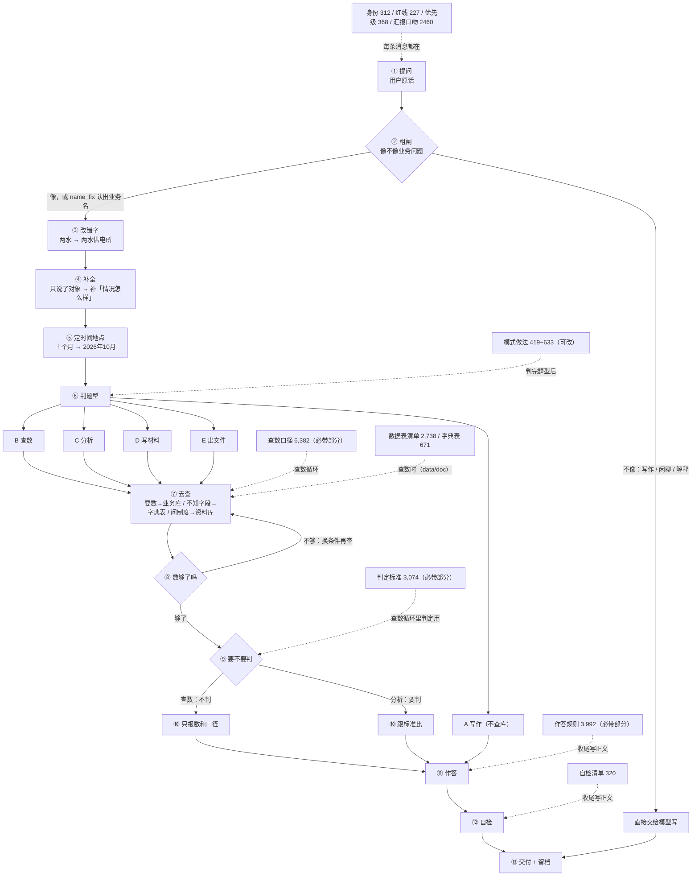

# 问答主流程图（2026-11-02 改后版）

> 这份对齐**现在线上跑的代码**（镜像 `46f47594`），不是设计稿。
> 图上看三件事：每步挂什么材料、材料什么时候进提示词、哪些能改。
> 页面：`http://47.121.183.81/prompts`（左侧菜单「提示词」）

## 一、主流程图



## 二、四份进提示词的材料（页面可改、可加节、可删节）

| 份 | 装什么 | 全部字数 | 必带字数 | 什么时候注入 |
|---|---|---|---|---|
| **查数口径** | 一/二/三/四/十三/十六/十七+17.x：表、条件、单位、层级、阈值 | 6,603 | **6,382** | 查数循环 |
| **判定标准** | 五~十二：多少算积压、超支、偏慢、离群 | 5,177 | **3,074** | 查数循环里判定用 |
| **作答规则** | 0.2 思路 / 0.5 分层 / 十五格式 / 十八比较 / 十九问法 / 二十标准项 / 二十一角度 / 二十二方案 | 11,276 | **3,992** | 收尾写正文 |
| **自检清单** | 十四：七条（占比、条数、只答一层、结论有依据…） | 314 | **314** | 收尾写正文 |

**必带 = 正文直接进提示词；不勾 = 正文不进去，只把标题放进「可取规则清单」**，模型要判断时调 `get_rule(主题)` 取。清单随提示词一起发，所以模型知道有哪些可取（这点之前是断的，已修）。

## 三、四份从代码搬到页面的（存 `prompt_text`，覆盖式，可恢复默认）

| 材料 | 字数 | 说明 |
|---|---|---|
| 身份 | 312 | 可改 |
| 汇报口吻 + 作答格式 | 1,627 | 可改（原来散在 COMMON + CHECK 两处） |
| 模式做法 | 2,310 | 四个模式，JSON |
| 业务词表 / 题型词表 | 1,150 | JSON |

**红线、优先级永远只读** —— 能改「数字必须有出处」等于允许编数。

## 四、代码自己读、不进提示词的（页面上只读展示）

| 挂在哪 | 材料 | 干什么 |
|---|---|---|
| ② 粗闸 | 业务词表 | 判断这句话是不是业务问题 |
| ③ 改错字 | 纠错词典（105 条） | 两水 → 两水供电所 |
| ④ 补全 | **补全表 13 条** | 问法 → 标准口径（页面可增删改） |
| ⑤ 定时间地点 | 时间地点规则 | 相对时间换具体期间 |
| ⑥ 判题型 | 题型词表 | 查数 / 分析 / 写作 / 出文件 |
| ⑦ 去查 | 字段说明 31,768 | `describe_table(表名)` 按需取 |

## 五、字数账（线上实测）

```
常驻（身份+红线+优先级+汇报口吻+模式）        4,248
查数循环：fetch 6,382 + judge 3,074 + 可取清单  = block 9,706  → 合计 ≈ 13,954
收尾作答：answer 3,992 + check 320 + 可取清单   = block 5,101  → 合计 ≈  9,349
```

**换，不叠。** 两个阶段是替换关系：规则全文 23,745 字，任何一步最多只带 9,706 字，且不随规则增长（再加规则只会进清单）。

## 六、改哪份修哪个毛病

| 现象 | 改哪份 |
|---|---|
| 该改的字没改对 | 纠错词典 |
| 「两水」没补成完整问法 | 补全表 |
| 年份 / 部门 / 期间错 | 时间地点规则 |
| 分析题被当查数 | 题型词表 |
| 找错表、条件写错、单位错 | **查数口径** |
| 该判的不判、阈值不对 | **判定标准** |
| 啰嗦、多答一层 | **作答规则** + 汇报口吻 |
| 前后矛盾、条数对不上 | **自检清单** |
| 编数字 | 红线（锁死的） |

## 七、作废清单

- `output/2026-10-30-问答全链路流程图.md` 六节分图作废。
- 早期设计里「六个包（triage/fetch/judge/answer/check）」的说法作废 —— 现在是**四份材料**。
