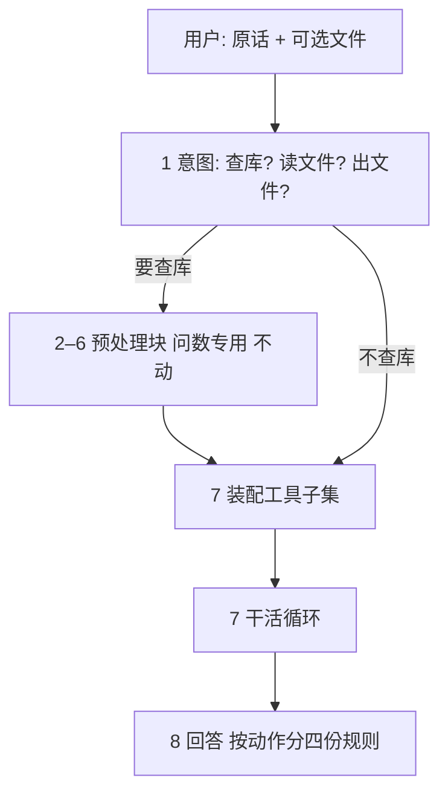

# 改后的智能体架构（分流 → 装配 → 干活 → 回答）

- 日期：2026-11-05
- 状态：待 Fred 确认，未动代码
- 一句话：第 1 步判三个是/否；第 2–6 步原样折成一个块，只有问数分支进去；第 7 步先按布尔塞工具再干活；第 8 步按动作分开写回答。主循环只有一份。

---

## 一、总览

八步去掉折叠后是**五段**：意图 → 预处理块（问数专用）→ 装配 → 干活 → 回答。

---

## 二、逐段

### 第 1 步 · 意图

| 项 | 内容 |
|---|---|
| 进来 | 原话 + 最近几轮 |
| 做 | 一次小模型调用，回答三个布尔 + 一句理由：要不要查业务库、要不要读文件、要不要出文件 |
| 出去 | `{use_db, use_file, make_file, reason}` |
| 谁控制 | 页面框 `intent`，代码不写词表 |
| 物理兜底 | 有 `file_id` → `use_file` 强制真；选了知识库 → `kb_search` 始终可用；判不出 → 三个都否 |
| 作用 | **唯一的岔路口**：`use_db` 真才进预处理块；`use_file` / `make_file` 决定第 7 步塞什么手 |

### 第 2–6 步 · 预处理块（问数专用，原样不动）

折叠成一段：纠错 → 补问法 → 补全表 → 问题确定。它的输入是原话和最近几轮，输出是一句定稿 + 文件清单。

- **只有 `use_db=true` 才进这一段**；聊天和文件处理直接跳过。
- 段内逻辑一行不改（现在跑得稳的就是它），包括页面上的纠错词典、补问法、补全表、问题确定四个框。
- 唯一加法：把「文件清单」（文件名 / 类型 / 字数 / 目录 / `file_id`）带进第 6 步的输入，让定稿能提到是哪份文件。

### 第 7 步 · 装配 + 干活

**7.1 物理调用处理（不调模型，纯代码）**

| 装什么 | 条件 |
|---|---|
| 工具定义子集 | 按三个布尔，见第三节 |
| 查数口径 | 仅 `use_db=true` |
| 做法目录 | `use_file` 或 `make_file`：拿定稿 `kb_search` 一次，只给标题 + 一句摘要 + `doc_id` |
| 工具说明 | 始终（页面 `tools` 框） |
| 文件清单 | 有文件时：文件名 / 类型 / 字数 / 目录 / `file_id`，**不注入正文** |

**7.2 干活循环**

调模型 → 有 `tool_calls` 就执行、回填、再来一轮 → 不再发工具就收尾。

- 全流程**每个动作分开执行、分开记账**：查库是一次工具调用，读文件是另一次，出文件是另一次，改库是另一次；同一个动作里最多并发几条互不依赖的调用（例如一次发 3 条 `run_sql`，或读同一文件的 2 页）。
- 超时：`read_file` / `kb_read` 10 s，`make_file` 120 s，`run_code` 60 s；超时返回「已转后台任务 + job_id」，下一轮自己轮询。
- 步数上限 30，只防死循环。
- 产出分开记账：**事实清单**（数值类）、**文件清单**（结论 / 出处 / 谁做 / 时限）、**产物**（`out/` 文件 + 自检结论）、**库变更**（新建 / 修改 / 删除了哪篇）。

### 第 8 步 · 回答（按动作分四份规则）

不塞在同一段里。这轮干了哪几种动作，就套哪几种规则：

| 动作 | 规则 | 输出形态 |
|---|---|---|
| 只回答（聊天 / 问数） | 现有回答规则 | 正文 |
| 读文件出清单 | 清单规则：一条一结论，带出处（章节 + 段落）与「谁做 / 时限」；条目原样，不重排不合并 | 清单 |
| 出文件 | 产物规则：一句话说清做了什么 + 文件名 + 下载链接 + 自检结论；**不贴正文** | 文件卡片 |
| 改知识库 | 变更规则：新建 / 改了 / 删了哪篇（标题 + `doc_id`）、改了什么；给复查方式 | 变更回执 |

四份规则都放页面（沿用现有的提示词材料机制，可改可清空）。数字闸只对「事实清单」生效；清单里的数（如「50 万以上」）不过闸。

---

## 三、工具子集

| 布尔组合 | 给的手 | 口径 |
|---|---|---|
| 全否 | 0 只 | 不带 |
| 只查库 | `kb_search` `describe_table` `find_column` `run_sql` `finish` | 带 |
| 只读文件 | `kb_search` `kb_read` `read_file` | 不带 |
| 读文件 + 出文件 | 上面 + `make_file` | 不带 |
| 查库 + 出文件 | 查库 5 只 + `make_file` | 带 |
| 三样都要 | 并起来（最多 8 只） | 带 |
| 兜底 | `run_code`，页面开才给，说明写「能用结构化就别写脚本」 | — |

三条硬规则：有 `file_id` → `read_file` 必给；选了知识库 → `kb_search` 必给；知识库的写 / 改 / 删只在定稿明确说「改库 / 存进去 / 删掉」时才给，写和删要二次确认。

---

## 四、前端要改什么

现在是：一个输入框、一个 📎（单文件）、一个任务下拉、一个进度条、一个下载按钮、trace 一段纯文本。

| 位置 | 现在 | 改成 |
|---|---|---|
| 输入区 | 单个文件、文件只显示名字 | 多份文件卡片：类型徽标（文档 / 表格）、字数或行数、可删；上传中显示解析状态 |
| 知识库 | 只有勾选检索范围 | 加「从知识库挑一篇」入口，挑中的作为输入素材 |
| 对话区 | 只有文字 | 清单单独渲染（条目 / 表格），不跟正文混在一段 |
| 产物 | 只有任务接口的下载按钮 | 文件卡片：文件名、大小、自检结论、下载（带鉴权 blob） |
| trace | `kb_search` / `run_sql` / `answer` 三色 | 补新工具：`kb_read` `read_file` `make_file` `run_code` `kb_write` `kb_update` `kb_delete`；各自入参可展开、显示耗时 |
| 改库 | 无 | 写 / 删要二次确认弹窗；改完显示变更回执 |
| 长任务 | 有进度条（任务接口） | 工具触发后台任务时，进度条要能跟着 job_id 走 |

---

## 五、验收

1. 问数：「今年预算执行怎么样」→ 走预处理块 + 5 只手，答案与现在抽样一致。
2. 速读：上传 28 页 docx 说「速读」→ `kb_search` 取做法目录 → `kb_read` 取做法 → `read_file` 分页读 → 清单，每条带章节出处。
3. 出文件：「按这份材料做 PPT」→ `.pptx` 出来，`inspect_deck` 判「通过」，回答是文件卡片不是正文。
4. 纯聊天：「你好」→ 0 次工具调用，system 里没有查数口径。
5. 判不出：「帮我弄一下」→ 走对话，不瞎查库。
6. 改库：「把这篇文章存进知识库」→ 建文档 + 变更回执；删之前弹确认。
