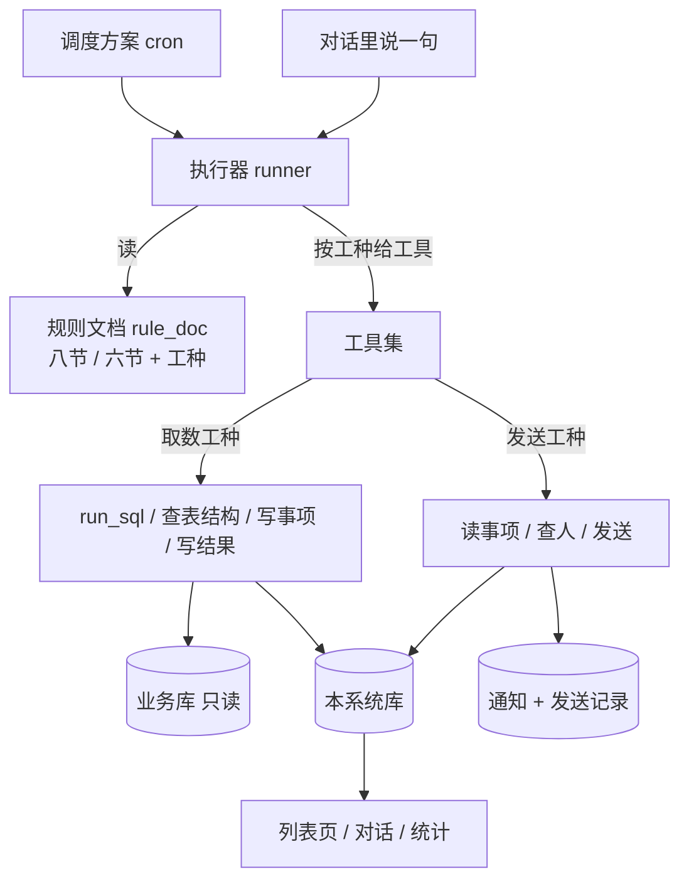

# 预警框架 · 设计（2026-11-06）

- 状态：待 Fred 审，未动代码。需求基线：`docs/03-设计/specs/2026-11-06-预警框架-需求确认.md`
- 一句话：**一个执行器、一套工具、一张带工种的文档表、一个调度器、六张存储表。** 预警 = 一份"取数"文档跑一轮；发送 = 一份"发送"文档跑一轮；业务规则全在文档里，代码零业务词。

---

## 一、总览



三层存储（对应需求 D8）：**过程** `run` + `run_log`，**流水** `check_result`，**结果** `alert_item`。

## 二、模块边界

新建 `server/app/workflow/`，与业务无关；原有的预警与派单链路（`secretary/alerts*.py`、`services/alert_service.py`、`services/dispatch_service.py` 等）**整体删除**，不做并行保留。删除清单与依赖处置见 §十四。

| 文件 | 职责 | 业务词 |
|---|---|---|
| `models.py` | 六张表 ORM | 0 |
| `docs.py` | 文档 CRUD、模板（八节/六节）、版本 | 0 |
| `schedule.py` | 调度方案 CRUD、注册/重载 | 0 |
| `runner.py` | 执行器：装配 → 工具循环 → 校验 → 落库 | 0 |
| `tools.py` | 十一只工具的实现 | 0 |
| `store.py` | 批次/流水/事项的写入与关闭、幂等、保留 | 0 |
| `api.py` | `/api/workflows/*` 路由 | 0 |
| `templates.py` | 两套空文档模板（教人怎么填的骨架） | 0 |

**不建 `identity.py`。** "账号属于哪个所、算到哪一层、发给谁" 都是规则，归文档。代码只给**取数工具**（`list_tables` / `describe_table` / `run_sql` + 落库工具），不做任何映射判断。旧 `alert_scope.py` 连同它的 4 张表 join、所级部门例外、角色优先级一起删。

**已知缺口**：发送工种要"查人"，但业务字典白名单（12 张表）里没有账号/员工表，模型写不出查人的 SQL，只能按文档规则回"查不到人、不发"。两条路：① 业务字典补账号表；② 框架加 `find_user`（单位 + 岗位 → 候选人，只查不判）。二者都未做。

## 三、数据模型（实际建成的 9 张表）

原则：表名统一 `wf_` 前缀（与旧表不撞）、`bigserial` 主键、`timestamptz`、`jsonb` 存明细、不建外键、`wf_doc` 逻辑删除用 `deleted_flag`。

### 3.1 `wf_doc` —— 规则文档（配置）

一行 = 一份文档。

| 字段 | 说明 |
|---|---|
| `id`、`name`（唯一） | 文档名 |
| `work_type` | `detect`（取数）/ `send`（发送），决定模板与工具子集 |
| `alert_type` | 自由文本，只作分组标签，不是枚举 |
| `enabled`、`disabled_reason` | 启用开关；停用会从定时方案上自动解挂 |
| `scope_level` | 算到哪一层：`station` / `county` / `city` |
| `schedule_id` | 挂在哪个定时方案上（空 = 只能手工跑） |
| `doc` | 正文（jsonb，键 = 节名：`basic/data/calc/judge/grain/output/title/exclude` 或发送六节） |
| `version`、`updated_by`、`updated_at`、`deleted_flag` | 版本每次保存 +1 |

### 3.2 `wf_doc_version` —— 文档历史版本

`id`、`doc_id`、`version`、`doc`（正文快照）、`updated_by`、`created_at`。运行记录靠它还原"那一轮用的文档原文"。

### 3.3 `wf_schedule` —— 定时方案（配置）

`id`、`name`（唯一）、`cron`（5 段）、`timezone`、`enabled`、`note`。文档通过 `wf_doc.schedule_id` 挂上来；一个方案挂多份文档，到点全跑。

### 3.4 `wf_run` —— 一轮运行（过程）

一行 = 一份文档跑一次。`id`、`run_key`（唯一，幂等）、`doc_id`、`doc_name`、`doc_version`、`work_type`、`trigger`（`cron`/`manual`/`test`）、`started_at`、`finished_at`、`status`（`running`/`ok`/`failed`）、`data_as_of`、`checked_n`、`hit_n`、`new_n`、`closed_n`、`sent_n`、`error`、`dry_run`。

### 3.5 `wf_run_log` —— 这一轮的每一步（过程细节）

`id`、`run_id`、`seq`、`at`、`kind`（`read_doc`/`sql`/`tool`/`error`）、`payload`（jsonb：读文档时的分节字数、SQL 原文与行数、工具入参出参、报错）。运行详情页的"模型实际做的事"就是这张表。

### 3.6 `wf_result` —— 每个对象每轮一行（流水）

| 字段 | 说明 |
|---|---|
| `run_id` / `doc_id` / `object_key` | 唯一约束 `(run_id, doc_id, object_key)` |
| `object_name` / `scope_type` / `scope_key` | 这条说谁 |
| `value` / `threshold` / `op` / `tier` | 实测值、阈值、比较方式、档位 |
| `hit` | **没命中也有行**（这就是"为什么不报"的依据） |
| `detail` / `evidence` / `reliable` | 明细、依据（表.字段 + 口径 + 数据截止日）、数据是否可靠 |

### 3.7 `wf_item` —— 一个在办的问题（结果）

`id`、`dedupe_key`（唯一 = `doc_id|object_key`）、`doc_id`、`alert_type`、`object_key`、`object_name`、`scope_*`、`value`、`threshold`、`op`、`tier`、`detail`、`evidence`、`reliable`、`title`、`body`、`status`（`open`/`closed`）、`close_reason`、`first_seen`、`last_seen`、`seen_times`、`run_id_last`、`sent_at`、`task_id`（留给下一期的任务）。

### 3.8 `wf_notify` —— 一条发送（发送结果）

`id`、`item_id`、`recipient_login`、`recipient_name`、`channel`（本期 `station`）、`reason`（为什么发给他的依据）、`sent_at`、`ok`、`error`、`run_id`、`doc_version`。

### 3.9 `wf_param` —— 运行参数（存取规则，不进业务文档）

`key`、`value`、`note`。现有：`max_steps`（单轮步数上限）、`max_items_per_run`（单轮最多写几条）、`no_repeat_days`（同人多少天内不重发）、`retention_months`（流水保留月数）、`send_channel_default`（默认通道）。**页面已不提供编辑**（2026-11-06 按 Fred 意见收敛），由技术侧直接改库。

### 3.10 存下来的东西能回答什么

| 想回答的问题 | 查哪张表 |
|---|---|
| 现在有哪些没关闭的问题、什么档位、哪个单位 | `wf_item` |
| 这条从什么时候开始、命中过几次、最近一次什么值 | `wf_item`（`first_seen`/`seen_times`/`value`） |
| 这个单位这轮算出来多少、命中没有、为什么不报 | `wf_result`（含 `hit=false`） |
| 这个单位的值怎么变的 | `wf_result`（按 `object_key` 取多轮） |
| 今天跑了没有、几份文档、各命中几条、哪轮失败 | `wf_run` |
| 这轮到底查了哪张表、写了什么 SQL、报什么错 | `wf_run_log` |
| 报的和文档写的不一样 | `wf_run_log` ＋ `wf_doc_version`（那一版原文） |
| 这条发给谁了、依据是什么、什么时候发的 | `wf_notify` |
| 有哪些规则文档、哪份没填全、哪份停用、几点跑 | `wf_doc` / `wf_schedule` |

**注意**：这些表在本系统 PG，问数用的 `run_sql` 连的是业务库 MySQL，所以对话里现在查不到；要接需给问数加只读工具（见 §九）。

## 四、文档结构

### 4.1 取数文档（`work_type=detect`）四节

| 节键 | 内容 |
|---|---|
| `what` | 一 管什么：这条预警盯的是哪件事、算到哪一层。一句话。 |
| `data` | 二 看哪些数据：哪张表、哪几列是什么意思、只取哪些行、坑（单位、怎么关联、缺数据怎么办）。 |
| `calc` | 三 怎么算：那个数怎么算出来（时间口径、外推、按什么分组、一个对象一条还是并一条）。 |
| `judge` | 四 多少算异常：比较方式、阈值、分档，以及多少以上不报。 |

**不写进文档的**：对象/当前值/阈值/档位/明细/依据这些字段是框架固定收的；`status`/时间/去重键/标题文案由框架和发送工作流负责。

### 4.2 发送文档（`work_type=send`）四节

| 节键 | 内容 |
|---|---|
| `what` | 一 管什么：这个发送工作流每天几点做什么。 |
| `source` | 二 读什么：读哪些事项、怎么排序、取多少条。 |
| `who` | 三 发给谁、说什么：按什么规则找人（写成话）、一句话怎么组织；查不到人怎么办。 |
| `cadence` | 四 发几次、什么不发：静默期、升档补发、关闭不发、已发过不重发。 |

### 4.3 模板

`templates.py` 存两套空模板，是"教人怎么填"的骨架（每节一句提示 + 一个填空示例），页面新建文档时用它初始化。模板内容不含任何业务口径。

## 五、执行器

### 5.1 一轮的形状

```
载入文档（含版本）
  → 按 work_type 装配：system = 文档正文 + 工具说明 + 今天日期 + 输出纪律
  → 工具循环（最多 max_steps 步，每步写 run_log）
  → 结束条件：模型不再调工具，或调了 finish
  → 校验：检测工种必须有 ≥1 次 write_result（证明真查了）；发送工种必须有 ≥1 次 read_items；
          每条事项必须带 evidence/reason，缺则工具层已拒绝
  → 落库：run 收尾（checked/hit/new/closed/sent）
```

不走 `/api/ask` 主链路（那套有纠错、补全表、问题确定，预警不需要）；直接复用 `app.providers` 的 `bundle.llm.chat` 和现有工具调用协议。

### 5.2 结构化结果靠工具落库，不靠模型输出 JSON

模型**没有**"写一段自由文本就算完"的出口。落库只能用这两只工具，参数即结构：

- `write_result(对象键, 对象名, 当前值, 阈值, 比较方式, 档位, 命中, 明细, 依据, 可靠性)` —— 写 `check_result`；缺字段 → 工具报错返回，模型重试。
- `write_item(...)` —— 写 `alert_item`（命中才调）。

这样"格式不对"变成一次工具报错，而不是一段没法校验的文字。

### 5.3 幂等与关闭（框架负责，文档不写）

- `run_key` 唯一：`{trigger}-{doc_id}-{date}-{cadence}`。
- 事项按 `dedupe_key` 唯一：同键只更新 `value/tier/detail/last_seen`，`seen_times`+1，`first_seen` 不动。
- 本轮某对象未命中且上轮有事项 → 置 `closed`（`close_reason=数据恢复`）。
- 结果不完整（第六节给不全 / 校验不过）→ `run.status=failed`，不许静默丢。
- 保留：`check_result` 按 `retention_months`（默认 12）清理；`alert_item` 永久。

### 5.4 试跑

`trigger=dry` + `dry_run=1`：照常调模型、照常写 `run`/`run_log`，**不写 `check_result`、不写 `alert_item`**，返回完整结果给页面看。这是业务方改文档的安全网。

## 六、工具清单

| 工具 | 工种 | 干什么 | 底层 |
|---|---|---|---|
| `list_tables` | 两者 | 列出业务库表 | `tools_db` |
| `describe_table` | 两者 | 表结构 + 字段含义 | `tools_db` |
| `run_sql` | detect | 只读查询（带行数上限） | `tools_db._exec`，只读闸 |
| `list_units` | 两者 | 按层级列出单位（全市/某县下的所），给范围用 | 业务库只读 |
| `get_employee` | 两者 | 账号 → 姓名、部门、岗位 | 业务库只读 |
| `find_user` | send | 单位 + 岗位/角色 → 候选人（含上级候选），只查不判 | 业务库只读 |
| `read_items` | send | 按条件读 `alert_item` | `store` |
| `send` | send | 发给某人：写 `notify` + `alert_item.sent_at` | `store` |
| `write_result` | detect | 写一条流水 | `store` |
| `write_item` | detect | 写/更新一条事项 | `store` |
| `finish` | 两者 | 交本轮结论摘要 | `runner` |

工具子集由 `work_type` 决定；运行参数里的 `min_amount` / `max_items_per_run` 由 `store` 在执行工具参数时统一套用，模型不感知。

**工具只做取数，不做判断**：`find_user` 返回候选人和它们的部门/岗位，选谁由文档写的规则加模型决定；`list_units` 只列单位，哪个单位该算由文档第一节的范围规则说。

## 七、前端页面

六个入口，全部挂在左侧菜单「工作流」下，路由前缀 `/workflows`（避开被知识库异步任务占用的 `/tasks`）。
系统**没有推送**（无 WebSocket / SSE），所以每个列表页统一：手动刷新按钮 ＋ 30 秒自动刷新开关（默认关）＋ 最后刷新时间。

### 7.1 文档列表 `/workflows`

| 功能 | 细节 |
|---|---|
| 表格列 | 名称、工种（取数/发送）、预警类型、启用开关、挂的方案、版本、上次运行（时间 / 命中数 / 状态）、操作 |
| 操作 | 编辑、试跑、复制（以它为模板建新文档）、启用/停用、删除 |
| 新建 | 先选工种（取数 / 发送），再按该工种的模板初始化 → 直接进编辑页 |
| 筛选 | 工种、类型、启用状态、关键字 |
| 空态 | 「还没有规则文档。预警是文档跑出来的，先新建一份。」＋ 新建按钮 |

### 7.2 文档编辑 `/workflows/docs/:id`

| 功能 | 细节 |
|---|---|
| 节导航 | 左侧列出该工种的节（取数八节 / 发送六节），显示每节必填是否已填（红点提示） |
| 表单 | 每节一个多行输入框 + 节内提示（来自模板）＋ 该节的填写示例（可折叠） |
| 保存 | 保存即 version+1，记 `updated_by`；可「保存草稿」（未完备也能存，但标「未完备」，且不能挂方案） |
| 版本 | 抽屉列出历史版本（谁、何时、第几版），可查看、可回滚（回滚也是新增一版） |
| 试跑 | 顶部按钮：选日期（默认今天）、范围（全市 / 某县 / 某所）→ 出结果：命中项表格 + 未命中数 + 本次步骤（SQL 原文、耗时） |
| 校验 | 保存时只校验结构（节是否为空）；跑的时候才校验内容对不对 |

### 7.3 定时任务 `/workflows/schedules`

| 功能 | 细节 |
|---|---|
| 列表列 | 名称、频率（人话，如「每天 08:00」）、cron 原文、下次触发、挂了几份文档、启用、上次触发（时间 / 结果）、操作 |
| 编辑表单 | 频率选择：每 N 分钟 / 每小时 / 每天 / 每周（选星期）/ 每月（选日）→ 生成 cron；下方显示 cron 原文 + **未来 5 次触发时间**；cron 非法即时红字报错，存不进去 |
| 挂哪些文档 | 表单里可选该方案下的文档（也可在文档页改），保存后热重载，列表的「下次触发」立刻变 |
| 立即运行 | 跑该方案下所有文档，逐份显示结果（命中数 / 状态），不等待、跑完写 `run` |
| 删除保护 | 方案下还挂着文档时不允许直接删 → 弹窗列出文档，选「先解挂」或「一起停用」 |
| 空态 | 「还没有定时方案。定时是外置的，不建方案就不会自动跑。」 |

### 7.4 运行记录 `/workflows/runs`

| 功能 | 细节 |
|---|---|
| 列表列 | 时间、文档（＋版本）、工种、触发方式（定时 / 手工 / 试跑）、状态、检查数、命中数、新增、关闭、发送数、耗时 |
| 筛选 | 文档、工种、状态、触发方式、日期范围 |
| 详情 | 步骤时间线：读文档 → 每条 SQL（原文 / 行数 / 耗时）→ 判（命中/未命中数）→ 写（新增/更新/关闭/发送）；错误信息与模型原文片段 |
| 试跑标记 | `dry_run=1` 的行另外标「试跑」，不计入统计 |

### 7.5 事项 `/workflows/items`（结果展示）

| 功能 | 细节 |
|---|---|
| 列表列 | 档位徽标（高/中/低）、对象名、标题、当前值 / 阈值、类型、状态（open/closed）、首次命中、最近命中、已发几人 |
| 筛选 | 工种、类型、档位、状态、单位、时间范围、关键字 |
| 详情抽屉 | 明细表（`detail` 逐项）、依据（表.字段 / 口径 / 数据截止日 / 是否可靠）、历史（每轮的值与命中，表格，默认最近 30 轮）、发送记录 |
| 操作 | 「进对话」（复用会话表，写一条卡片消息）、「手工关闭」（必填原因）、「复制标题与明细」 |
| 可见性 | 本期**不做**"按账号所属单位过滤"—— 那本身是把组织规则写进代码。默认登录即可见；要隔离就在运行参数里配可见范围（配置，不是代码） |
| 空态 | 「暂时没有问题。跑过一轮之后，命中的会出现在这里。」 |

### 7.6 发送记录 `/workflows/notifications`

列：事项、收件人（登录名 + 姓名）、通道、发送时间、依据（模型给的理由）、结果（成功 / 失败原因）。
筛选：文档、通道、成败、日期范围。

### 7.7 运行参数 `/workflows/params`

金额下限、单轮最多写几条、同一事项多久内不重复报、流水保留月数、执行步数上限、默认通道。改完即生效（读库，不重启）。

### 7.8 横切规则

- 权限：文档、方案、参数三个页面只对管理员开放；事项与发送记录对业务用户按范围过滤。
- 危险操作（删除文档 / 删方案 / 手工关闭）都要二次确认并留痕。
- 无推送：所有列表靠刷新；正在跑的批次显示「运行中」并要求手动刷新。
- 所有时间显示按本地时区，且标注数据截止日（`data_as_of`）与运行时间不是一回事。

## 八、接口

| 方法 | 路径 | 说明 |
|---|---|---|
| GET/POST/PUT/DELETE | `/api/workflows/docs` | 文档 CRUD（每次保存 version+1） |
| POST | `/api/workflows/docs/{id}/dry-run` | 试跑 |
| GET/POST/PUT | `/api/workflows/schedules` | 调度方案 |
| GET | `/api/workflows/runs` / `/runs/{id}` | 批次与步骤留痕 |
| GET | `/api/workflows/items` | 事项列表（按登录人范围过滤） |
| POST | `/api/workflows/items/{id}/chat` | 事项进对话（复用现有会话表） |
| GET/PUT | `/api/workflows/params` | 运行参数 |
| POST | `/api/workflows/run` | 手工跑一份文档（内部令牌） |

## 九、对话接入

主问答流程加两只工具（沿用 11-05 分流文档"按条件塞工具"的做法，页面开关控制）：

- `workflow_items(条件)` —— 查事项，返回结构化行（对象、值、阈值、档位、明细、依据、状态）。
- `workflow_run(doc_id, 范围, 日期)` —— 现跑一份检测文档，返回同结构（不落库）。

点一条事项进对话：复用 `t_chat_session`，写一条卡片消息（`meta.kind=alert_item`）+ 事项全字段，接着问即可。对话里问「发给谁」→ 调 `workflow_run` 跑发送文档（`dry`），返回收件人 + 依据。

## 十、验收判据（机器可判）

| # | 判据 | 怎么判 |
|---|---|---|
| V1 | 代码零业务词 | `grep -E '供电所\|预算\|工单\|审批\|线损\|台区\|万元\|营销部' server/app/workflow/` 命中 0 |
| V2 | 空库可跑 | 建表脚本在空库执行通过；无文档时到点只写一条 `run`（`hit_n=0`，`status=ok`） |
| V3 | 结果三层齐 | 跑一份测试文档后：`run` 1 行、`run_log` ≥3 行、`check_result` = 对象数行、`alert_item` = 命中数 |
| V4 | 没命中也有行 | 构造一个必然不命中的对象，`check_result` 里该对象 `hit=false` 存在 |
| V5 | 幂等 | 同一 `run_key` 再触发，`run` 不增行、`alert_item` 不增行 |
| V6 | 自动关闭 | 第二轮把数据改到达标，对应事项 `status=closed`、`close_reason=数据恢复` |
| V7 | 试跑不落库 | `dry` 跑完 `check_result`/`alert_item` 行数不变，响应里有完整结果 |
| V8 | 工种隔离 | 发送工种的工具清单里没有 `run_sql`；检测工种里没有 `send` |
| V9 | 发送可核 | 跑发送文档后 `notify` 有行，每行带 `reason`；查不到人时 `ok=false` 且有原因 |
| V10 | 热重载 | 页面上改 cron 保存后，`/api/workflows/schedules` 显示新 `next_run_time`，进程不重启 |
| V11 | 加一类不改码 | 新建一份 `alert_type=自定义` 的文档、跑通、事项落库；`git diff` 为空 |
| V12 | 对话可选 | `/api/ask` 问「为什么这条会触发」→ 回答里的数字能在 `check_result` 里找到同值行 |
| V13 | cron 预览准 | 保存方案返回未来 5 次触发时间；到点实际触发时间与之误差 < 1 分钟 |
| V14 | 未完备不许挂 | 缺必填节的文档挂方案 → 422，错误信息指出缺哪一节 |
| V15 | 删除保护 | 删除仍挂着文档的方案 → 409，响应列出文档名 |
| V16 | 旧链路清零 | 删除清单（§十四）里的文件、路由、表在代码与库里都不存在：`grep -r` 命中 0、`\dt` 查无 `alert_item` / `dispatch_*` |

## 十一、分期

| 期 | 内容 | 完成标志 |
|---|---|---|
| P0 | 导出 CSV 备份 → 删旧链路（代码 / 路由 / 表 / 文档归档） | V16 通过，服务能正常起、问答不受影响 |
| P1 | 六张表 + `store` + `runner` + 检测工具集 | V2–V8 通过（用一份测试文档，不经页面） |
| P2 | 页面（文档 / 定时任务 / 试跑 / 运行记录 / 事项 / 发送记录 / 参数） | V10、V11、V13–V15 通过 |
| P3 | 发送工种（`read_items` / `find_user` / `send` + 发送文档模板） | V9 通过 |
| P4 | 对话接入（两只工具 + 事项进对话） | V12 通过 |

## 十二、非目标

- 不做建任务、下发、流转、核销（下一期，事项表已留 `任务号` 位置）。
- 不做邮件/短信/微信通道，只留 `channel` 字段与一个适配口子。
- 不做可视化流程图编排（自由编排那套在需求阶段被收敛成"工种 + 文档"）。
- 旧的预警与派单链路**整体删除**，不做并行保留、不做兼容层（清单见 §十四）。

## 十四、旧链路删除清单

原则：代码删、表删、接口删、文档归档；**只有"账号→范围"和"会话写入"两段能力搬进新框架**，其余不保留。

### 14.1 代码

| 文件 | 现在是什么 | 处置 |
|---|---|---|
| `secretary/alerts.py` | 旧 10 类判据 + `_facts` 取数（30 KB） | 删（`/api/alerts/daily` 一起下线） |
| `secretary/alerts4.py` | 13 个判据函数（29 KB） | 删 |
| `secretary/alert_rules.py` | 阈值/角色/类型常量 | 删 |
| `secretary/rules_defaults.py` | 313 行业务默认值（生成件） | 删 |
| `secretary/alert_scope.py` | 账号 → 角色 + 范围（4 张表 join、所级部门例外、角色优先级） | 删；只把"查单位 / 查账号"变成 `workflow/tools.py` 里的只读工具，不带任何映射规则 |
| `secretary/alert_wording.py` | 一句话模板 | 删 |
| `dispatch_rules.py` | 子判据元信息、职责线、时限、开关（22 KB） | 删 |
| `services/alert_service.py` | 扫描/落库/列表/卡片/会话（25 KB） | 删；会话写入那段搬进 `workflow/store.py` |
| `services/dispatch_service.py` | 任务流转 31 个动作（130 KB） | 删 |
| `services/dispatch_ai.py` | 按角色手写的建议文案（38 KB） | 删 |
| `services/dispatch_chain.py` | 层级权限 | 删 |
| `api/v1/alerts.py`、`api/v1/dispatch.py` | 50 个路由 | 删 |
| `schemas/dispatch.py`、`models/dispatch.py` | 请求模型与 10 张表 ORM | 删 |
| `models/__init__.py` | 导入并导出那 10 张表与 `ALERT_STATUSES` | 删相关导入与 `__all__` 条目 |
| `db/dispatch_tables.sql` | 10 张表 DDL | 删（换成新框架的建表脚本） |
| `secretary/scheduler.py` | 4 条预警/派单定时活 + `JOBS` 白名单 | 改：换成新框架的 `run_doc` 一条活 |
| `secretary/project.py` 的 `JOBS` | 6 条 cron（含已停用的旧预警） | 清空，改由库里的调度方案驱动 |
| `main.py` | 内置 tick 循环、两条 `include_router` | 删 |

### 14.2 数据表

`alert_scan_run`、`alert_item`、`dispatch_task`、`dispatch_task_assignee`、`dispatch_task_event`、
`dispatch_task_plan`、`dispatch_check`、`dispatch_notice`、`dispatch_attachment`、`alert_chat_link`。

**DROP 之前先导出**：每张表导 CSV 到 `output/backup/2026-11-06-旧预警表/`，并在归档文档里写清恢复办法。

### 14.3 文档

`docs/01-接口/预警与任务流转-*.md`、`docs/02-部署/预警与任务流转-部署说明.md`、
`docs/03-设计/specs/2026-10-19-预警四类归并与任务流转-design.md`、`2026-10-15-每日预警推送-design.md`、
`docs/04-计划/2026-10-15-每日预警推送.md`、`2026-10-19-预警与任务流转.md`、`docs/01-接口/对外接口文档.md` 里 `/api/alerts/*` 的段落
→ 全部移到 `docs/08-历史归档/2026-11-06-删除的预警与派单/`，加一份 README 说明为什么删、口径来源在哪（那 13 条判据的口径原文在 `skills/判据规则.md`，**保留不动**）。

### 14.4 依赖方

| 依赖方 | 处置 |
|---|---|
| 外部 crontab 调 `/api/alerts/scan`、`/api/dispatch/tick` | 部署时一起删（旧部署说明里有 `alert_cron.sh`） |
| 老前端调 `/api/alerts/daily` | 库里没有预警页，无前端依赖；有外部调用方就通知下线 |
| `alert_cron.sh` 等脚本 | 删 |
| `skills/判据规则.md`（59 KB 口径原文） | **保留**：它是业务口径的唯一原文，业务方写文档时照着它填 |

### 14.5 后果（说清，不装作没有）

- 任务下发、流转、催办、升级、自动核销、通知中心 —— 从删掉到下一期重建之间**不存在**。
- 旧库里已产生的预警与任务记录会随 DROP 消失，只有 CSV 备份。
- 删除与新建要分两次提交，先删后建，中间不留半套。

## 十三、风险与兜底

| 风险 | 兜底 |
|---|---|
| 模型写的 SQL 跑错表/超时 | `run_sql` 只读 + 行数上限 + 超时；错就记 `run_log` 让模型重试，超步数判失败 |
| 模型给出算不出依据的数字 | 落库只走工具，`evidence` 必填；缺依据的 `write_item` 直接报错 |
| 同一文档两次跑出不同结果 | `check_result` 落每轮值，差异可查；`run_log` 存 SQL 原文 |
| 文档写得太松（判据含糊） | 模板每节给示例；试跑可见效果；`run.status=failed` 时不写事项 |
| PG 挂 | 取数不写库就不影响；发送/事项停，页面标不可用 |
