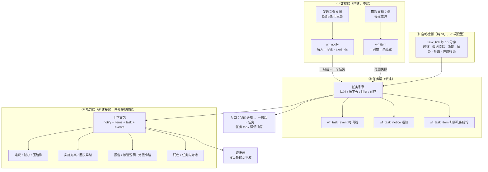

# 任务流转 · 框架设计（2026-11-07）

> 前提：预警三层已定死 —— 取数文档 → `wf_item`（一个对象一条结论）→ 发送文档 → `wf_notify`（每人一句话，`alert_ids` 指回那批结论），见 `2026-11-07-预警逻辑与表结构-定稿.md`。
>
> **本文的边界**：旧任务流转的**能力**一个不少（给建议、拟办、自动检测、催办升级、写报告、核销说明、处置小结、润色、任务内对话），改的只是**接线**——输入不再是 `alert_item.data`、核销不再是六种 `verify_rule`、分层不再靠 `alert_scope`。
> 旧设计全文在 `docs/08-历史归档/预警旧链路/2026-10-19-预警四类归并与任务流转-design.md`（985 行），本文逐项对应它的能力清单。

---

## 一 框架一句话

**四层：预警数据 → 任务引擎 → 能力层（AI / 文书 / 对话）→ 入口；中间用一份「上下文包」把九处 AI 的取数只做一遍。**



四条边界：

1. **任务层不碰数据口径**：`wf_task` 里不写任何"预算执行率 ≥80%"这种判据，达没达标问 `wf_item`。
2. **能力层不吃库、只吃上下文包**：九处 AI 都从同一个 `context` 取数，不各自写 SQL（否则又是九份口径）。
3. **自动检测不调模型**：`task_tick` 全是 SQL + 参数，模型可挂、可换、可停，闭环照跑。
4. **所有 AI 输出都是草稿**：不落库、不改状态；只有人点确认才写库（旧设计 A8「一键发起只是草稿」的纪律继承）。

---

## 二 模块清单（输入 → 输出）

| 模块 | 文件（拟） | 输入 | 输出 | 状态 |
|---|---|---|---|---|
| 取数执行器 | `workflow/runner.py` | 取数文档 + 定时方案 | `wf_item` | 已有 |
| 发送执行器 | `workflow/runner.py` + `tools.py` | 发送文档 + `wf_item` | `wf_notify` | 已有 |
| 任务引擎 | `workflow/tasks.py` | `notify_id` / 动作调用 | `wf_task` + 事件 + 通知 | 新建 |
| 自动检测 | `workflow/tasks.py`（`tick()`） | 4 张任务表 + `wf_item` | 状态推进 + 事件 + 通知 | 新建 |
| 上下文包 | `workflow/context.py` | `notify_id` 或 `task_id` | 一份 dict（下面 §三 第 0 行） | 新建 |
| AI 服务 | `workflow/ai.py` | 上下文包 + 挂点名 | 文本/JSON（草稿） | 新建，复用 `secretary/agent._chat`（执行器用的同一个入口） |
| 文书服务 | `workflow/report.py` | 上下文包 + 事件 | docx / 文本 | 复用 `secretary/docgen.write_docx` |
| 对话入口 | `workflow/api.py` + `/api/ask` | 上下文包 | 会话消息（`store.append_chat`） | 复用会话表 |
| 接口层 | `workflow/api.py` | HTTP | 见 §七 | 新建 |
| 页面 | `web/src/pages/Workflows.tsx` | 接口 | 任务 tab + 详情抽屉 | 新建 tab |

---

## 三 能力挂点（11 个，一个不少）

第 0 行是**所有挂点的公共输入**，先说一次，后面不再重复：

> **上下文包 `ctx`** = `{notify, items[], task, events[], children[], scope}`，
> `notify` = `wf_notify` 那行（收件人、层面、`scope_name`、`alert_ids`、message）；
> `items` = `alert_ids` 对应的 `wf_item`（含 `value` / `threshold` / `tier` / `detail` / `evidence` / `status`）；
> `task` / `events` / `children` = 任务本体、时间线、子任务。**取数只在这里做一次。**

| # | 挂点 | 谁触发 | 干什么 | 输出到哪 | 兜底 |
|---|---|---|---|---|---|
| A1 | **点开一句话的说明** | 点通知 | 模板拼"为什么发这句 / 差多少 / 涉及哪几条"，**不调模型** | 前端卡片 | 数据缺就只出 `evidence` 原文 |
| A2 | **处置建议（三条）** | 点通知 / 任务详情 | 三条建议，每条 `动作 + 依据（对象/数字）+ 预期`；依据只能来自 `items.detail/evidence` 或只读 SQL 结果 | 不落库，返回给页面 | 凑不满三条就少给，**无依据的不要** |
| A3 | **拟办草稿** | 点「按这条发起」 | 标题 / 要求正文 / 承办人 / 回执时限 / 目标时限 / 闭环方式 | 不落库 | 模型挂了给模板草稿（数字来自 `items`） |
| A4 | **压给谁的建议** | 县/市层点「往下压」 | 按 `county_name` / `unit_name` 分组，建议压给各级那句预警的收件人、几条、时限 | 不落库 | 查不到收件人就标"该单位缺岗位" |
| A5 | **实施方案** | 承办人打开任务 | 步骤 / 时间表 / 风险 / 需协调谁，带本所/本县同类历史处置 | `wf_task_event(payload)` 供人改 | 空草稿，可手写 |
| A6 | **回执草稿** | 承办人点「交回执」 | 把做的事写成一段（事实/措施/结果），数字回指 `items` | 事件 `content` | 只给空模板 |
| A7 | **上报报告** | 任务详情「写报告」 | docx：任务要求 + 处置过程 + 前后实测 + 下一步 | `data/reports/t{id}.docx`，登记事件 | 纯模板 docx（仍带"请人工复核"） |
| A8 | **核销说明** | 闭环/驳回时 | "为什么算完成 / 为什么不算"：几条 open、哪几条、差值多少 | 事件 `payload` | 只给数字 |
| A9 | **处置小结** | 闭环 | 发现→闭环天数、事件数、升级次数、材料清单 | 事件 + 任务详情 | 纯统计 |
| A10 | **润色** | 报告正文旁 | 错别字/标点/数字用法/层次序号/病句 → 问题清单 + 修订版 | 返回页面，人决定改不改 | 回原文 |
| A11 | **任务内对话** | 任务详情对话框 | 带任务上下文问 `/api/ask`（"这件事别人怎么办的"） | 会话消息 | 照常问答 |

**纪律（沿用旧设计，不改）**：

- **AI 只写话，不写数**：任何数字必须能在 `items` / SQL 结果里找到；找不到就整段丢弃并标"待核实"（`evidence_gate` + `_num_pool` 现成）。
- **A2/A3/A4 不落库**：人点确认才建任务（`task_draft` 字段还在 `schemas/agent.py` 里）。
- **报告必须带**"本文件由系统辅助生成，请人工复核"（`docgen` 已内置）。

---

## 四 自动检测（六件事，每 10 分钟一轮）

`task_tick` 挂 `workflow/scheduler.py` 一条内置活，纯 SQL，幂等（同一轮重复跑不重复通知）。

| # | 检测什么 | 判据 | 动作 |
|---|---|---|---|
| D1 | **闭环** | 本任务 `alert_ids` 全 `closed`；有子任务则子任务也全 `closed` | `closed` + `auto_verified` + A8 核销说明 + 通知双方 |
| D2 | **数据消除** | 全 `closed` 但**没有任何人动作过**（无 accept/reply/压下去事件） | `void` + `void_data_recovered` + 一句"数据已恢复，无人处置" |
| D3 | **不可得** | 有 `wf_item.reliable=0` | 不闭环、不判失败，标 `unknown` + 通知发起人转人工 |
| D4 | **逾期** | 过 `reply_due_at`（回执）/ `due_at`（目标） | `overdue` 标志 + 通知，`dedupe_key` 按天 |
| D5 | **催办 / 升级** | 回执前 4 小时、超期 24 小时一次；超宽限期（高 1 天 / 中 1 / 低 2 天）升一级，每天最多一级、最多两级 | 通知承办人 / 职责线上一级；职责线进 `wf_param` |
| D6 | **承办人失效** | 承办人停用/调岗 | 转派给同层那句预警的收件人；没有就标"待指定"+ 通知发起人 |

**D1/D2 的区别要留痕**：系统自己关的和人办完关的，闭环率要分开算——不然领导看到"闭环率高"，其实是数据自己好了。

---

## 五 文书（四类产出）

| 产出 | 何时 | 内容骨架 | 靠什么 |
|---|---|---|---|
| 上报报告 docx | 人点「写报告」 | 任务要求 → 处置过程（事件时间线）→ 实测前后值 → 未完成原因/下一步 | `docgen.doc_from_blocks` + A7 |
| 核销说明 | 闭环/驳回 | 几条开、哪几条开、差值、数据截止日 | A8（模板拼，可调模型润色） |
| 处置小结 | 闭环 | 天数、事件数、升级次数、子任务数、材料清单 | A9（纯统计） |
| 润色结果 | 人点「润色」 | 问题清单（原文 + 出处 + 建议）+ 修订版 | `pipeline_proofread` 现成 |

**数字回指的硬要求**：报告里每个数字带 `明细键` 或 `evidence` 出处；生成后跑一遍"数字 ↔ `wf_item` 比对"，对不上的标"待核实"（沿用 `pipeline_digest._verify` 的原文核对做法，`pipeline_digest` 里没有独立 `locate()`）。

---

## 六 入口与对话

```
我的通知（wf_notify 一句话）
  └─ 点开 ─→ 抽屉：A1 说明（卡片）+ items 明细表 + A2 三条建议
        ├─「知悉」→ void，一句话理由可选
        ├─「我来办」→ 认领（doing），A5 实施方案
        └─「让下面办」→ 按县/按所分组（A4 建议收件人 + 条数）→ 生成子任务（waiting）

任务 tab
  └─ 任务详情抽屉：要求 / 时限条 / 时间线 / 回执 / 子任务进度
        ├─ 接单 · 交回执（A6 草稿）
        ├─ 写报告（A7）· 润色（A10）
        └─ 对话（A11，带 ctx 进 /api/ask）
```

会话复用现有 `t_chat_session` / `t_chat_message`（`workflow/store.py:append_chat` 已有），会话 id 用 `wf-task-{id}-{login}` / `wf-notify-{id}-{login}`，与旧的 `wf-item-*` 规则一致。

---

## 七 任务骨架（上一版大纲保留）

一句话：**收到的那句话 = 一个任务**；`alert_ids` = 它要解决的结论；数据关没关 = 它办成没办成。

- **状态 5 个**：`pending` 待认领 / `doing` 办理中 / `waiting` 待下级 / `closed` 闭环 / `void` 作废（知悉 · 数据消除 · 撤回）。两个标志：`overdue`、`escalate_level`。
- **表 4 张**（都在 `ad_wf`）：`wf_task`（`notify_id`、`level`、`scope_name`、`alert_ids` 快照、状态、承办人、父任务、时限）、`wf_task_item`（`UNIQUE (item_id, level) WHERE active=1`，三层共用一条结论是对的）、`wf_task_event`、`wf_task_notice`。不建核销表，几条 open 写事件 payload。
- **三层一类任务**：所级 1 条结论；县级本县 N 条；市级全市 N 条。承办人默认 = `wf_notify.recipient_login`（发送文档已经找过一次人，不再按组织树重找）。
- **压下去按"下一层那句话"**：全市那条压 3~4 条县级子任务（按 `county_name` 分组），县级再按所逐条生成。

---

## 八 逻辑改了什么、框架什么没改

| 项 | 旧（`d8d8a1e` 删掉的那套） | 新 | 是不是"框架变了" |
|---|---|---|---|
| 建议 / 拟办 / 报告 / 润色 / 对话 | 有 | **有，挂点一一对应** | 否 |
| 输入 | `alert_item.data`（一人一条预警） | `ctx`：`wf_notify` + `wf_item` 那批结论 | 是（接线） |
| 核销 | 六种 `verify_rule` 手写 SQL 复算 | `alert_ids` 全 `closed`，任务侧零 SQL | 是（逻辑） |
| 分层 | `alert_scope` + 职责线推角色 | `wf_notify.level`（发送文档已分层） | 是（逻辑） |
| 拟办意图 | 模型猜"这句话要不要办" | 不猜：预警本身就是任务候选 | 是（逻辑） |
| 自动检测 | `dispatch_tick`：催办/升级/核销 | `task_tick`：六件事，多"数据消除" | 否（内容加了 D2） |
| 报告 | `docgen` 生成 docx | 同一个 `docgen` | 否 |
| AI 只写话不写数 | `evidence_gate` / `_num_pool` | 同 | 否 |
| 草稿不落库 | `propose → 人确认` | 同 | 否 |

一句话：**能力清单没动，输入源和核销判据换了**。

---

## 九 分期（每期都能验）

| 期 | 做什么 | 验什么 |
|---|---|---|
| P0 | 4 张表 + 任务引擎（认领/压下去/回执/撤回）+ `task_tick` 的 D1/D2/D3 | 伪造 `wf_item` 全 closed → 任务自动闭环；没人动作的 → `void_data_recovered` |
| P1 | 通知点开 → 任务；改派；压下去建子任务树；子任务进度回父 | 市压 3 县、县压 N 所，父任务 `waiting` 到全关回 `closed` |
| P2 | 上下文包 + A1/A2/A3/A4 + A11 任务内对话 | 每条建议带 `evidence`；拟办不落库；查询能查到那批结论 |
| P3 | A5/A6/A7/A8/A9/A10（实施方案、回执、报告、核销说明、小结、润色） | docx 每个数字能在 `wf_item` 找到；报告带"请人工复核" |
| P4 | `task_tick` 的 D4/D5/D6（逾期、催办、升级、停用转派）+ 页面两个 tab | 重复 tick 不重复通知；升级只在职责线内 |

---

## 十 验收判据（机器可判）

| # | 判据 | 怎么验 |
|---|---|---|
| V1 | 能力不缺 | 本文 §三 11 个挂点逐个有接口，调一次返回非空（模型挂了走兜底） |
| V2 | 任务侧零业务 SQL | `grep -rn "预算\|指标\|审批\|供电所" server/app/workflow/tasks.py server/app/workflow/context.py` 命中 0 |
| V3 | 闭环不看回执 | 无任何回执，`items` 全 closed → 仍闭环（`auto_verified`）；有回执但 `items` 有 open → 不闭环 |
| V4 | 数据消除留痕 | 无人动作 + 全 closed → `void` + `void_data_recovered`，闭环率分母不含它 |
| V5 | 三层不互相顶 | 同一条 `wf_item` 同时属于市/县/所三条任务；同层再压一次 → `409 ITEM_TAKEN` 带 `task_id` |
| V6 | 建议必须带依据 | A2 三条建议，每条 `evidence` 非空且能在 `items` 或 SQL 结果里查到；查不到的被丢弃 |
| V7 | 草稿不落库 | 调 A3 后 `wf_task` 行数不变；人点确认才 +1 |
| V8 | 报告数字可回指 | 生成的 docx 抽出数字逐个在 `wf_item.value/detail` 找到；找不到的标"待核实" |
| V9 | tick 幂等 | 同一任务连跑 3 次 tick：闭环只 1 次、催办/逾期通知各 1 条 |
| V10 | 通知不刷屏 | 同收件人同层同判据在 `no_repeat_days` 内不重发（沿用 `wf_notify` 已有逻辑） |

---

## 十一 未定（框架点头后再定）

1. 时限默认值：回执按档位（高 24h / 中 3 天 / 低 7 天）还是按层。
2. 职责线放 `wf_param`（`duty_chain`）还是各发送文档里写。
3. 「知悉」要不要强制一句理由。
4. 市领导收到市级任务，能否"转市财务协助"（现在是一次改派）。
5. 报告模板要不要按判据分（预算类 / 审批类不同骨架）。
6. 页面：`/workflows` 加 tab 还是独立路由。
7. 非预警发起的任务（会议纪要、口述）本期做不做（`notify_id` 可空，后补不改表）。
