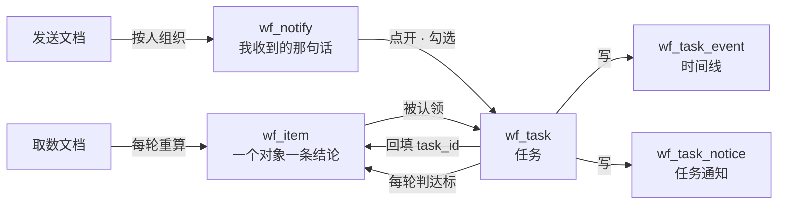
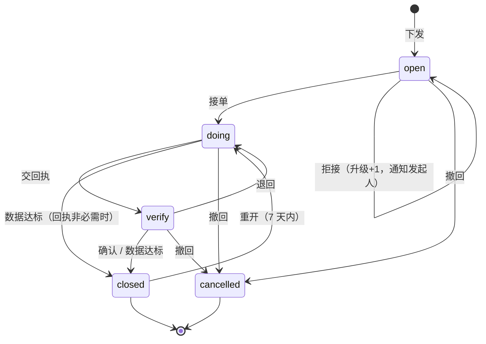

# 任务流转 · 设计（2026-11-07）

> 依据：预警已定死成三层 —— 取数文档 → `wf_item`（对象结论）→ 发送文档 → `wf_notify`（每人一句话），见 `2026-11-07-预警逻辑与表结构-定稿.md`。
> 旧的任务流转（10 张表 / 50 个路由 / `verify_rule` 6 种 SQL）随 `d8d8a1e` 整体删除，原件在 `docs/08-历史归档/预警旧链路/`，本文只作参照，不兼容旧接口。

---

## 零 一句话

**人的一句话是入口，对象的一条结论是任务的对象；数据有没有办好，由那条结论下一轮自己关掉来证明，任务不写任何 SQL 复算。**

旧设计是"预警一条 → 人判 → 任务自己带规则去查数据"；新设计是"结论一条 → 人认领 → 看它有没有自己变成 closed"。少一层复算，就少一份口径副本。

---

## 一 旧设计的五个前提没了

| 旧设计依赖 | 现在怎样 | 落到本文哪一节 |
|---|---|---|
| `alert_item.assignee_role` 定承办人 | `wf_item` 没这个字段；"发给谁"写在发送文档第五节、**不落库** | §四 承办人三级来源 |
| `alert_item.verify_hint` 预填核销规则，`verify_rule` 6 种 kind 手写 SQL | 没有 `verify_hint`；`wf_item` 每轮由取数文档重算，命中 open、没命中 closed | §五 核销 = 绑定的结论全 closed |
| 一条预警带 `dedupe_key`、一人一条，列表点进去 | 结论一对象一判据一条（`uk_wf_item`），人话在 `wf_notify` | §二 入口改从「我的通知」进 |
| 聚合预警 → 一次裂变出 N 条兄弟任务（`case_id` + `parent_task_id`） | 结论本来就一对象一行，勾选即逐条建单，不再需要"裂开" | §七 只留「下沉」一层含义 |
| 独立 `dispatch_tick` 定时器（10 分钟，催办/升级/核销） | `wf_schedule` 只跑文档，没有通用定时活 | §十 加一条内置 `task_tick`（纯 SQL，零模型） |

---

## 二 任务站在哪一层



三条边界钉死：

1. **任务不改结论**：`wf_item.status` 只有取数文档和人工关闭能改，任务侧只读。
2. **结论只归一条在办任务**：`wf_task_item` 的部分唯一索引 `(item_id) WHERE active=1` 兜住，别人再点下发是「复用」，不是新建。
3. **提示词/文档里不写任务字段**：任务要求、承办人、时限都在建单那一刻定下来落库，不写回取数/发送文档。

---

## 三 表（4 张，库 `ad_wf`，与预警同库）

沿用旧设计约定：`bigserial` 主键、`timestamptz`、`jsonb` 存明细、**不建外键**、逻辑删一律 `deleted_flag`。全部 `CREATE ... IF NOT EXISTS`。

### 3.1 `wf_task` 任务（30 列）

| 列 | 类型 | 含义 |
|---|---|---|
| `id` | bigserial | 主键 |
| `task_no` | varchar(32) | `T20261107-0001`，唯一 |
| `title` | varchar(200) | 标题，默认取结论的对象名 + 判据名 |
| `requirement` | text | 要办什么；拟办草稿可改 |
| `source` | varchar(16) | `alert`（从结论发起）/ `manual`（人直接开） |
| `primary_item_id` | bigint | 主对象结论；回填 `wf_item.task_id` 用；范围任务为空 |
| `alert_type` / `doc_id` / `doc_name` | varchar(16) / bigint / varchar(120) | 冗余自结论，列表不 join |
| `scope_type` | varchar(16) | `item`（一条结论）/ `unit`（一个所）/ `county`（一个县） |
| `unit_name` / `county_name` | varchar(120) | 任务管到哪 |
| `status` | varchar(16) | `open` / `doing` / `verify` / `closed` / `cancelled` |
| `close_mode` | varchar(8) | `data`（结论全关）/ `reply`（回执确认）/ `both` |
| `creator_login` / `creator_name` / `creator_role` | varchar(64) | 发起人 |
| `owner_login` / `owner_name` / `owner_role` | varchar(64) | 承办人（本期一人；多人下一期加表，不加状态） |
| `reply_due_at` / `due_at` | timestamptz | 回执时限 / 目标时限 |
| `require_plan` | smallint | 1 = 必须先交方案 |
| `check_state` | varchar(16) | `pending` / `passed` / `failed` / `unknown` |
| `last_check_at` | timestamptz | 最近一次判达标 |
| `escalate_level` / `overdue_flag` | smallint | 升级级数 / 是否逾期（标志，不是状态） |
| `parent_task_id` / `root_task_id` | bigint | 谁压给谁（下沉用） |
| `archived_flag` | smallint | 归档后默认列表不显示 |
| `closed_at` / `close_reason` | timestamptz / varchar(32) | `auto_verified` / `human_confirmed` / `cancelled` / `item_closed` |
| `created_at` / `updated_at` / `deleted_flag` | — | — |

索引：`UNIQUE (task_no)`、`(status, reply_due_at)`、`(owner_login, status)`、`(creator_login, created_at DESC)`、`(root_task_id)`、`(primary_item_id)`。

**没有 `draft` 状态**：拟办草稿不落库（旧设计 A8 本来也是这样），人点确认才写第一行。

### 3.2 `wf_task_item` 任务占哪几条结论（4 列）

| 列 | 类型 | 含义 |
|---|---|---|
| `id` | bigserial | 主键 |
| `task_id` | bigint | 任务 |
| `item_id` | bigint | `wf_item.id` |
| `active` | smallint | 1 = 还被这条任务占着；任务关闭时置 0 |

索引：**`UNIQUE (item_id) WHERE active = 1`**（一条结论同时只属于一条在办任务）、`(task_id)`。

这张表是旧设计没有的：旧设计的"范围"靠 `scope_type/scope_key` + `biz_keys` 反算，现在直接把结论 id 钉下来，下发那一刻的范围就是范围，后面新命中的不自动算进来（要算就再下一单）。

### 3.3 `wf_task_event` 时间线（10 列，append-only）

`id` / `task_id` / `action`（`create｜accept｜decline｜transfer｜reply｜confirm｜reject｜urge｜escalate｜sink｜cancel｜reopen｜archive｜check｜reject_invalid`）/ `actor_login` / `actor_name` / `actor_role` / `from_status` / `to_status` / `content` / `payload jsonb` / `at`。
索引：`(task_id, at)`。

核销的实测值不进单独的 check 表：`action=check` 的 `payload` 里放 `{"open":2,"closed":3,"items":{"6":"open","7":"closed"}}`，少一张表。

### 3.4 `wf_task_notice`（10 列）

`id` / `task_id` / `notice_type`（`assign｜urge｜escalate｜reply｜confirm｜close｜reopen`）/ `recipient_login` / `recipient_name` / `title` / `message` / `sent_at` / `read_at` / `dedupe_key`。
索引：`UNIQUE (dedupe_key) WHERE dedupe_key IS NOT NULL`、`(recipient_login, read_at, sent_at DESC)`。

**不并进 `wf_notify`**：那张表一条 = 一份预警的一句话，`message` 走"≤30 字、一个数字"的校验；任务通知是"谁在什么时候交了什么"，两条链路混一列以后两边都说不清。前端「通知中心」合并读两张表，未读数相加。

---

## 四 承办人从哪来（三级，按顺序取）

| 级 | 来源 | 查不到怎么办 |
|---|---|---|
| 1 | 发起人在拟办页**自己选**（实名搜索，必看可改） | 必须选 |
| 2 | 系统推荐：**谁收到过覆盖这条结论的通知** → 该单位该岗位的在职账号 | 降 3 级 |
| 3 | 都没有 → `owners=[]` + `reason`，前端红字「该单位无 XX 岗位账号」，任务标待指定 | 通知发起人 + 管理员 |

推荐不用新字段，直接从 `wf_notify` 反查——"发给谁"这件事发送文档已经算过一次，只是没落库：

```sql
SELECT recipient_login, recipient_name, role_code, level, scope_name
FROM wf_notify
WHERE alert_ids && ARRAY[:item_ids]::bigint[]
ORDER BY CASE level WHEN 'station' THEN 1 WHEN 'county' THEN 2 ELSE 3 END, sent_at DESC
LIMIT 5;
```

判据写死一句：**level 越贴近对象越优先**（所级 > 县级 > 市级）。市领导收到的是全市那句话，他点下发时不会推荐他自己。

旧设计里"按节点角色 + 部门树找人"那一套（`t_power_company.department_id`、上溯规则、多名排序）**不进本期**：现在有了发送文档这条现成的路径，再从组织树重算一遍就是第二个口径源。

---

## 五 核销：两种口径，一条铁律

| 口径 | 判据 | 谁闭环 | 何时判 |
|---|---|---|---|
| 数据达标（默认，`close_mode=data`） | 本任务的 `wf_task_item.active=1` 全部对应 `wf_item.status='closed'` | 系统 | `task_tick`（10 分钟一次） |
| 回执（人工，`close_mode=reply`） | 承办人交回执 → 发起人确认 | 发起人 | 人点 |
| 数据不可得 | 有 `wf_item.reliable=0` | **不算通过也不闭环**，转人工 | 同上 |

**铁律：任务侧一条 SQL 都不许写"数据算没算达标"。** 旧设计的 `budget_rate / work_status / audit_node / metric_value / task_tree / manual` 六种 `verify_rule` 全部作废——那六种规则各自要一份复算口径，和取数文档里的口径必然漂移，这正是 11-06 删掉那套链路的原因。

判定实现（`server/app/workflow/tasks.py`，纯 SQL）：

```sql
SELECT count(*) FILTER (WHERE i.status <> 'closed') AS open_n,
       count(*) FILTER (WHERE i.reliable = 0)      AS unknown_n
FROM wf_task_item ti JOIN wf_item i ON i.id = ti.item_id
WHERE ti.task_id = :tid AND ti.active = 1;
```

- `open_n = 0 且 unknown_n = 0` → `check_state=passed`，若 `close_mode in (data, both)` → `closed/auto_verified`
- `unknown_n > 0` → `check_state=unknown`，不闭环，通知发起人一次
- 其它 → `check_state=failed`，`open_n` 写进事件 payload

一期只有"数据达标"和"回执"两种，不组合（`both` 留给下沉的父任务，见 §七）。

---

## 六 状态机（5 个状态 + 2 个标志）



| 状态 | 含义 | 谁能推进 |
|---|---|---|
| `open` | 已下发，等接单 | 承办人（接/拒）、发起人（撤回） |
| `doing` | 办理中 | 承办人（回执/转派/下沉）、发起人（催办） |
| `verify` | 已交回执，等确认 | 发起人（确认/退回） |
| `closed` | 闭环 | 发起人（7 天内重开） |
| `cancelled` | 撤回 | 只读 |

非法迁移一律拒绝 + 写 `wf_task_event(action=reject_invalid)` + HTTP 409，不静默改状态（沿用旧设计）。状态迁移统一用 `UPDATE ... WHERE id=? AND status=?`，影响行数 0 → 409。

两个标志：`escalate_level`（0→1→2，每次 +1 写事件 + 通知）、`overdue_flag`（过了 `reply_due_at` 或 `due_at`）。

---

## 七 动作清单（人能干什么）

| 动作 | 谁 | 状态变化 | 写什么 |
|---|---|---|---|
| 拟办 `preview` | 看通知的人 | 不落库 | 返回：标题、要求草稿、推荐承办人、默认时限 |
| 下发 `create` | 同上 | — → `open` | task + task_item + notice(assign) + event |
| 接单 `accept` | 承办人 | `open` → `doing` | event + notice(发起人) |
| 拒接 `decline` | 承办人 | `open` 不变 | event + escalate+1 + notice(发起人) |
| 转派 `transfer` | 承办人 / 发起人 | 不变 | event + notice(新承办人) |
| 交回执 `reply` | 承办人 | `doing` → `verify` | event(content) + notice(发起人) |
| 确认 `confirm` | 发起人 | `verify` → `closed` | event + notice(双方)，`close_reason=human_confirmed` |
| 退回 `reject` | 发起人 | `verify` → `doing` | event(content) + notice |
| 催办 `urge` | 发起人 | 不变 | notice(urge)，`dedupe_key` 按天 |
| 上报 `escalate` | 发起人 | 不变 | escalate+1 + notice(职责线上一级) |
| **下沉 `sink`** | 承办人 | 不变（父） | 建子任务 N 条 + `parent_task_id`/`root_task_id`，父 `close_mode=both` |
| 撤回 `cancel` | 发起人 | → `cancelled` | 事件 + 通知，`active` 置 0 释放结论 |
| 重开 `reopen` | 发起人（7 天内） | `closed` → `doing` | 事件，`active` 重新置 1 |
| 归档 `archive` | 发起人 | 不变 | `archived_flag=1` |

**下沉 = 旧设计的"裂变"，只剩一层含义**：承办人手里是一条范围任务（`scope_type=unit/county`），他把它压给下级 → 按"该范围内、同一判据、`open` 且没被占用的结论"逐条建子任务；父任务闭环条件变 `both`（子任务全 closed **且** 父范围内的结论全 closed）。旧设计的 `case_id`/`adopted`/`reused`/`idempotency_key` 那套不用了：结论唯一归属已经由 `(item_id) WHERE active=1` 兜住，"已经有单了"天然是复用。

---

## 八 接口（20 个，全部挂 `/workflows/tasks`）

`/api/tasks` 被知识库异步任务占着，`/api/dispatch` 已删；新表在 `ad_wf`、和预警同库同模块，前缀沿用 `/workflows`。鉴权一律 `get_current_actor`（现查库，不接受调用方传角色/范围）。

| # | 方法 | 路径 | 说明 |
|---|---|---|---|
| 1 | GET | `/workflows/tasks` | `?role=mine\|created\|all&status=&limit=&offset=`；`mine` = 我是承办人 |
| 2 | GET | `/workflows/tasks/{id}` | 详情：要求、时间线、回执、绑的结论、子任务 |
| 3 | POST | `/workflows/tasks/preview` | 拟办（**不落库**）：传 `item_ids` 或 `notify_id` → 标题/要求/承办人/时限 |
| 4 | POST | `/workflows/tasks` | 下发，返回 task；带 `Idempotency-Key` 重放返回同一任务 |
| 5 | POST | `/workflows/tasks/{id}/accept` | 接单 |
| 6 | POST | `/workflows/tasks/{id}/decline` | 拒接（必填理由） |
| 7 | POST | `/workflows/tasks/{id}/transfer` | 转派 |
| 8 | POST | `/workflows/tasks/{id}/reply` | 交回执（`content` + 可选 `item_ids` 说明办了哪几条） |
| 9 | POST | `/workflows/tasks/{id}/confirm` | 发起人确认闭环 |
| 10 | POST | `/workflows/tasks/{id}/reject` | 退回 |
| 11 | POST | `/workflows/tasks/{id}/urge` | 催办 |
| 12 | POST | `/workflows/tasks/{id}/escalate` | 上报 |
| 13 | POST | `/workflows/tasks/{id}/sink` | 下沉（建子任务） |
| 14 | POST | `/workflows/tasks/{id}/cancel` | 撤回 |
| 15 | POST | `/workflows/tasks/{id}/reopen` | 重开 |
| 16 | POST | `/workflows/tasks/{id}/archive` | 归档 |
| 17 | POST | `/workflows/tasks/tick` | 内部令牌：核销判定 + 逾期 + 催办；幂等，返回本轮动作数 |
| 18 | GET | `/workflows/tasks/stats` | 闭环率、平均处置天数、逾期数、升级数 |
| 19 | GET | `/workflows/notifications/mine` | （已有）合并未读：`wf_notify` + `wf_task_notice` |
| 20 | GET | `/workflows/items/{id}/tasks` | 这条结论上开过的任务 |

**下发 body**：

```json
{
  "item_ids": [101, 102],
  "title": "两水供电所预算执行整改",
  "requirement": "11-19 前把执行率提到 80% 以上；3 天内交实施方案。",
  "owner_login": "sngdssz",
  "reply_due_at": "2026-11-10T18:00:00+08:00",
  "due_at": "2026-11-19T23:59:59+08:00",
  "require_plan": true,
  "close_mode": "data"
}
```

错误码：`400 INVALID_TRANSITION`、`403 NOT_PARTICIPANT`、`404 TASK_NOT_FOUND`、`404 ITEM_NOT_FOUND`、`409 STATE_CONFLICT`、`409 ITEM_TAKEN`（结论已被别的在办任务占，响应里给 `task_id`）、`422 NO_OWNER`。

---

## 九 页面（两个新 tab + 一个入口）

| 位置 | 内容 |
|---|---|
| `/workflows` 加「任务」tab | 四段：待接单 / 办理中 / 待核销 / 已闭环；卡片带倒计时、升级级数、来源那句话 |
| 任务详情（抽屉） | 顶部要求 + 时限条；左侧时间线（含催办/上报/下沉）；右侧回执与子任务；按钮：接单 / 交回执 / 确认 / 退回 / 催办 / 下沉 |
| 「我的通知」tab | 一条一句话 → 点开抽屉：列出它 `alert_ids` 的结论（对象/当前值/阈值/档位）→ 勾选 → 「下发」进拟办 |

本期不做独立路由页（`/tasks/:id` 不做），全部用抽屉，跟现有 `/workflows` 六个 tab 的形态一致。

---

## 十 时间从哪来（不新起通用定时器）

| 活 | 触发 | 干什么 |
|---|---|---|
| 核销判定 | `task_tick` 每 10 分钟 | 重算 `check_state`；`passed` 且 `close_mode` 含 data → 闭环 |
| 逾期 | 同上 | `reply_due_at` / `due_at` 过了 → `overdue_flag=1` + 通知（`dedupe_key` 按天） |
| 催办 | 同上 | 回执到期前 4 小时一次；超期每 24 小时一次 |
| 升级 | 同上 | 超宽限期（高 1 天 / 中 1 天 / 低 2 天）→ `escalate_level+1` + 通知职责线上一级，每天最多升一级，最多两级 |
| 结论重算 | `wf_schedule` 跑取数文档 | 跟任务无关，任务只在下一轮 tick 里看到结果 |

`task_tick` 挂在 `app/workflow/scheduler.py` 里的一条内置活（不带文档、不调模型），周期与其余参数进 `wf_param`：`task_tick_minutes=10`、`reply_hours_by_tier={"high":24,"mid":72,"low":168}`、`task_reopen_days=7`、`duty_chain={"预算":["sz","xgscwb","sgscwb"],"指标":["sz","cto","yxb"],"审批":["sz","xgscwb","sgscwb"]}`。

`duty_chain` 的键就是结论的 `alert_type`（取值来自取数文档，代码不校验枚举）；查不到这个键 → 通知发起人 + 管理员，不硬塞市领导。旧设计把职责线写死在 `dispatch_rules.DUTY_CHAIN`，这次挪进参数，改职责不动代码。

---

## 十一 验收判据（机器可判，动代码前定死）

| # | 判据 | 怎么验 |
|---|---|---|
| V1 | 4 张表在空库能建，`UNIQUE (item_id) WHERE active=1` 存在 | `psql -c "\d wf_task_item"`，断言索引名与谓词 |
| V2 | 一条结论只归一条在办任务 | 同一 `item_id` 连开两单 → 第二单返回 `409 ITEM_TAKEN` 并带第一单 id |
| V3 | 下发事务原子 | 注入 notice 插入失败 → `wf_task` 无行、`wf_task_item` 无行 |
| V4 | 幂等 | 同一 `Idempotency-Key` 两次 → 同一 `task_id`，通知只 1 条 |
| V5 | 非法迁移被拒 | `closed` 任务再 accept → 409 + 事件 `reject_invalid`，状态不变 |
| V6 | 数据达标闭环 | 3 条结论全 closed → tick 后 `closed/auto_verified`，`check_state=passed` |
| V7 | 不达标不闭环 | 留 1 条 open → 仍 `doing`，`check_state=failed`，payload 里有那条 id |
| V8 | 数据不可得不误判 | 一条 `reliable=0` → `check_state=unknown`，任务不闭环，发起人收到 1 条通知 |
| V9 | 承办人推荐按层面优先 | 造 station/county/city 三条通知 → 推荐出 station 那条的人；一条都没有 → `owners=[]` + `reason`，HTTP 200 |
| V10 | 一句话入口对得上 | `preview` 传 `notify_id` → 返回的 `items` 恰好等于该通知的 `alert_ids` |
| V11 | 越权 | 非参与人 GET 他人任务 → 403；非承办人 accept → 403 |
| V12 | 通知不刷屏 | 同一任务连跑 3 次 tick → 催办/逾期通知各 1 条 |
| V13 | 代码零业务口径 | `grep -rn "预算\|指标\|审批\|供电所\|所长\|财务" server/app/workflow/tasks.py` 命中 0 |
| V14 | 不写业务库 | `grep -rn "INSERT INTO dlj_data" server/` 命中 0（沿旧纪律） |
| V15 | 下沉两条件 | 子任务全 closed 但父范围还有 open → 父不闭环；两者都满足 → 父 `closed/auto_verified` |
| V16 | 重开 | `closed` 后 7 天内 reopen → `doing`，`active` 重新为 1；第 8 天 → 409 |

---

## 十二 分期

| 期 | 内容 | 验哪几条 |
|---|---|---|
| P0 | 4 张表 + ORM + `ensure_tables` 幂等 DDL + 状态机与事件 | V1、V5 |
| P1 | 拟办 / 下发 / 接单 / 拒接 / 回执 / 确认 / 退回 / `task_tick` | V2–V4、V6–V10 |
| P2 | 下沉 / 转派 / 催办 / 上报 / 撤回 / 重开 / 归档 / stats | V12、V15、V16 |
| P3 | 「任务」tab + 任务详情抽屉 + 通知点开发下 | 页面能点通，V11 |

先做 P0+P1 就能闭环（一条结论 → 一单 → 数据自己关掉 → 任务关掉），P2 的催办上报是"没人办时"的补丁，P3 之前用接口验证。

---

## 十三 相关说明怎么处置

| 文档 | 现状 | 处置 |
|---|---|---|
| `docs/08-历史归档/预警旧链路/预警与任务流转-接口文档.md`（43 个接口） | 描述已删的 10 张表和 50 个路由 | 已归档，**不再维护**，开头加一行"已作废，看 `2026-11-07-任务流转-design.md`" |
| 同上目录的 `-前端改动说明.md`、`-部署说明.md`、`2026-10-19-...-design.md`、`2026-10-15-每日预警推送-design.md` | 同上 | 同上 |
| `docs/03-设计/任务全流程图.md` | 图形与本文 §六 冲突（它有全局 tick、6 状态含 draft） | 归档，图上内容已被本文 §二/§六 取代 |
| `docs/03-设计/任务裂变设计.md` | 裂变 / adopted / case_id 已被「下沉 + 结论唯一归属」取代 | 归档，判据 §一/§七 |
| 新接口文档 `docs/01-接口/任务流转接口文档.md` | 还没有 | P1 结束时按本文 §八 写，字段与错误码以本文为准 |
| 代码里的死引用 | `api/v1/agent.py:391-407`（每次 `/api/ask` 打一行"自动拟办跳过"）、`api/v1/doc_jobs.py:104,119`（两个转派单接口，import 已删模块，必 500）、`tests/agent/test_dispatch_chain.py`、`test_batch_jobs.py:29`、`test_digest_to_task.py:22`（都 import 已删模块） | P0 顺手删；`schemas/agent.py` 的 `task_draft` 先留着（P2 拟办接进对话时复用） |

---

## 十四 与旧设计的取舍

**保留**：6→5 状态机、事件表、通知去重、升级只在职责线内、市领导不收执行层、闭环 7 天内可重开、状态迁移乐观锁、不写业务库。

**不做**：

- ❌ 六种 `verify_rule` 与 `dispatch_check` 表（核销改成看结论关没关，见 §五）
- ❌ 按组织树推荐承办人（`department_id` 上溯、多部门排序）—— 改用 `wf_notify` 反查
- ❌ `case_id` / `adopted` / `reused` / 批量 fanout 接口 —— 结论唯一归属天然兜住
- ❌ 附件、报告 docx、润色、AI 九挂点里除拟办外的八项（本期只做"拟办给草稿"和"核销时说明为什么没达标"两句）
- ❌ 加签 / 会签 / 并行审批 / BPMN / 节假日日历 / 移动推送
- ❌ 多人主责表（`wf_task_assignee`）—— 一期一人，下沉表达"多人"（每人一条子任务）

**遗留可加**：多人主责、附件、报告、督办看板、`/health` 的 task 段、闭环时长统计的按单位下钻。
