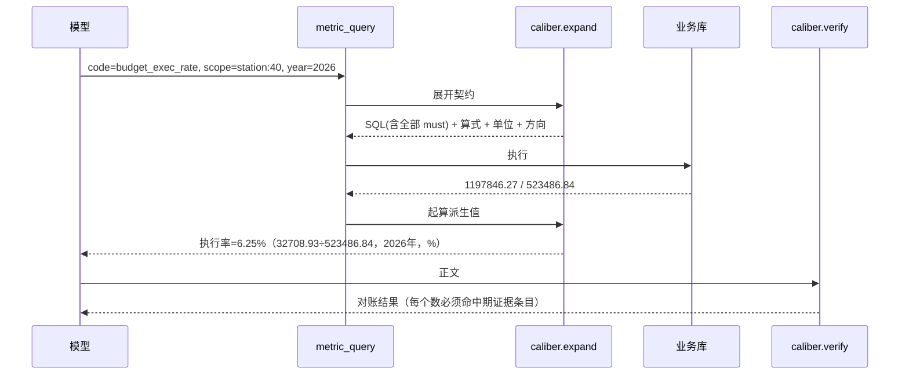

# 指标契约（口径可改 + 约束硬）· 设计（草稿 v0.1，2026-11-10）

> 状态：**待 Fred 看**，未动代码。依据是 2026-11-10 府河所那份内网日志的实测：五个方面里一个答对、两个查成历年累计、两个答"需另查"。

---

## 一、要治的三类错

| 错法 | 这次的表现 | 现在的成因 |
|---|---|---|
| 期间不一致 | 工单 63 件/1197846.27 元是 2023–2026 四年累计，预算 523486.84 是 2026 单年 | 工单 SQL 没带 year，预算带了；两条规矩都只在提示词里 |
| 派生值不给 | 执行率答"需另查"，两个数都在证据里 | 证据包规则②禁止相除，口径里写着"这个除这个"，两条对撞 |
| 只看了一部分还给结论 | 成效"下降最多/上升最高"答"需另查" | 证据包把 22 行截成 12 行并声明"其余略"，极值没算 |

三条的共性：**口径写在提示词里，正确性靠模型自觉**。改提示词管不住，因为提示词本身也在对撞（一边让算、一边禁止算），而且它离数据比证据包更远。

---

## 二、判断

- **写死在代码里** = 只拦住你想到的那一次，而且改一次要发版。
- **只写在提示词里** = 模型可以绕、可以和别的段落打架、可以这一轮听下一轮不听。
- **做成数据 + 一个通用解释器 + 三道通用闸**：业务口径全在数据里（随时改、改完下一轮生效），约束强度来自"判据机器可判且挂在执行路径上"，代码只认契约结构，不认识"预算""工单"这些词。

一句话：**代码里不该有业务，只该有"契约说了就必须做到"这条机制。**

---

## 三、架构

```mermaid
flowchart TB
    subgraph 数据
        C[caliber_metric<br/>指标契约：算式 + 必需过滤]
        D[(业务库<br/>工单 / 预算 / 六项指标)]
    end
    subgraph 代码（只有机制，没有业务）
        E[caliber.py<br/>expand / check / verify]
        T1[metric_query 工具]
        T2[run_sql 工具]
        G1{闸1 期间/范围}
        G2{闸2 派生值不许模型写}
        G3{闸3 交卷对账}
        EV[evidence.py<br/>证据条目]
    end
    M[模型]
    C --> E
    M -- 选指标代号 --> T1 --> E
    M -- 探索性 SQL --> T2 --> G1 --> E
    E --> G1 --> D
    E --> G2 --> EV
    EV --> M
    M -- 正文 --> G3 --> U[用户]
```

---

## 四、数据模型

两张表，存 PG（与 `prompt_material` 同库，复用版本与缓存失效机制）。

```sql
CREATE TABLE caliber_metric (
  id            bigserial PRIMARY KEY,
  code          varchar(64)  NOT NULL UNIQUE,   -- 代号，模型只认这个
  label         varchar(128) NOT NULL,          -- 预算执行率
  unit          varchar(16)  DEFAULT '',        -- % / 元 / 件
  digits        smallint     DEFAULT 2,
  direction     varchar(8)   DEFAULT '',        -- bigger_better / smaller_better / none
  expr          text         DEFAULT '',        -- 派生式，只准引用本表 code 或 base 列
  notes         text         DEFAULT '',        -- 给人看的口径说明，不进提示词
  enabled       boolean      DEFAULT true,
  version_no    int          DEFAULT 1,
  updated_by    varchar(64)  DEFAULT '',
  updated_at    timestamptz  DEFAULT now()
);

CREATE TABLE caliber_base (            -- 非派生指标 = 一条取数规则
  id            bigserial PRIMARY KEY,
  metric_code   varchar(64) NOT NULL REFERENCES caliber_metric(code),
  table_name    varchar(64) NOT NULL,
  column_name   varchar(64) NOT NULL,
  agg           varchar(8)  DEFAULT 'sum',      -- sum / count / max / min / last
  must          jsonb       DEFAULT '[]',       -- 必需过滤，见下
  sort_key      varchar(64) DEFAULT ''          -- 多行时取哪一行（last = 按它取最新）
);

CREATE TABLE caliber_metric_ver (      -- 改一次留一版，回滚用
  id bigserial PRIMARY KEY, code varchar(64), body jsonb, saved_by varchar(64),
  saved_at timestamptz DEFAULT now()
);
```

`must` 的每一项是 `{col, op, value}`，`value` 里允许唯一一种变量 `$问题年份`：

```json
[
  {"col": "year",       "op": "=",  "value": "$问题年份"},
  {"col": "work_status","op": "in", "value": ["2", "3"]},
  {"col": "deleted_flag","op": "=", "value": "0"}
]
```

预算执行率在这两张表里就是三行数据：

| code | 说明 |
|---|---|
| `work_order_budget` | t_power_ai_work_order.total_budget，sum，must 三条上面那三条 |
| `budget_allocated` | t_power_ai_company_budget_result.budget_amount，sum，must = year=$问题年份 + deleted_flag=0 |
| `budget_exec_rate` | expr = `work_order_budget / budget_allocated`，unit=%，digits=2 |

---

## 五、执行链路与三道闸



**闸1 · 期间/范围**（`run_sql` 执行前）

- 触发：SQL 里出现的表被任一 enabled 契约引用，则该契约的 `must` 列必须在 SQL 里出现。
- 不满足 → 返回 `ERROR_CALIBER`，带"缺哪一列、该填什么值、可用指标代号"，和现在 `ERROR_DICT` 的写法一致。
- 覆盖探索性 raw SQL，否则模型绕开 `metric_query` 就绕开了闸。

**闸2 · 派生值**（`metric_query` 内部）

- 派生指标不接受模型给的任何算式，`expr` 由解释器展开成 SQL 的除/差/比。
- 模型只会看到结果，看不到分子分母之间还有手脚可做。

**闸3 · 交卷对账**（`_write_answer` 之后）

- 正文里每个"数字+单位"都要在证据条目里命中同值、同期间、同单位；派生数必须带解释器给的算式。
- 不命中 → 带差异清单重写一次；仍不命中 → 正文保留但标未核实，落 `unverified`。
- 这一道替换现在"查过工具就 pass"的 `evidence_gate.decide`。

---

## 六、证据包怎么变

`evidence.py` 现在按"行数"截（`ordered[:12]`）并禁止算术，改成按"答案形态"生成：

| 答案形态 | 证据给什么 |
|---|---|
| 单值（多少 / 最新） | 那一行 + 期间 + 单位 + 方向 |
| 极值（最多 / 最高 / 下降最多） | SQL 直接 `ORDER BY ... DESC LIMIT 1` 的一行，不是让模型在 12 行里挑 |
| 全量（列出 / 明细） | 整份给；太长分页读，不切在中间 |

每条证据带 `code`，`verify` 靠它做集合比对 —— 对账不需要模型配合。

`direction` 解决"好坏方向"：售电量同比上升是好，其余下降是好。这条现在是提示词里的一句话，改成契约字段后，方向反了会被闸3 抓到。

---

## 七、前端

**复用现有 `web/src/pages/Prompts.tsx` 的骨架**（左侧 tab + 右侧表格 + 抽屉编辑 + 保存即生效），加一个「指标契约」tab，不引新依赖、不改整体框架。

页面三块：

1. **契约列表**：代号 / 中文名 / 类型（取数或派生）/ 算式 / 必需过滤（chips）/ 单位 / 方向 / 启用。每行"编辑/停用/历史"。
2. **编辑抽屉**：
   - 派生：只填算式（下拉选已有代号，不给自由输入框，避免拼错）。
   - 取数：选表 → 选列（下拉来自业务字典，和现在"数据表覆盖层"同一份）→ 聚合 → 必需过滤（逐条加：列 / 运算符 / 值或 `$问题年份`）。
3. **预览（关键）**：抽屉底部一个"预览"页签，显示这行契约对一个样例范围生成的 SQL 与证据条目（`expand` 的返回），以及一句"这行口径会拦下不带 year 的工单查询"。改完能立刻看到它生成什么，不用跑一遍问数。

为什么要这个 tab，而不是继续写在提示词里：口径现在藏在规则材料段落中，人眼看不出它和实际 SQL 是否一致；表格化之后，一行契约 = 一次生成的 SQL，改哪条、拦哪条都看得见。

**业务逻辑不进前端**：前端只做 CRUD 与预览，判定全在后端（`caliber.py`）。前端改一次存一次，后端缓存按 `version_no` 失效，下一轮生效，不用重启。

---

## 八、改动清单

新增 4：

| 文件 | 内容 |
|---|---|
| `server/app/secretary/caliber.py` | expand / check_sql / verify，纯机制 |
| `server/app/api/v1/caliber.py` | 列表、保存、启停、历史、预览 |
| `web/src/pages/CaliberPanel.tsx` | 上面第七节的 tab 内容 |
| `server/tests/agent/test_caliber.py` | 闸1/2/3 的单测 |

改 5：

| 文件 | 改什么 |
|---|---|
| `server/app/secretary/tools_db.py` | `run_sql` 前加 `caliber.check_sql`；新增 `metric_query` |
| `server/app/secretary/agent.py` | 工具清单加 `metric_query`；`_write_answer` 后加闸3 |
| `server/app/secretary/evidence.py` | 删规则②、删 `ordered[:12]`；证据条目改由契约生成 |
| `web/src/pages/Prompts.tsx` | 注册「指标契约」tab |
| `server/app/api/v1/__init__.py` | 挂新路由 |

删 3（留着就继续打架）：

1. 提示词里"预算执行率（工单预算总额除以预算分配总额）"的算式句 → 只留代号。
2. `evidence.py` 规则②"相减/相除就写需另查"。
3. `evidence.py` 的 `ordered[:12]` 与"其余 10 行略"。

---

## 九、分三阶段

**P1 · 契约与闸1**（先治"查成历年累计"）

- 建表、`caliber.expand/check_sql`、三条预算类契约、`run_sql` 前置校验。
- 验收：`SELECT SUM(total_budget) FROM t_power_ai_work_order WHERE power_station_id=40 AND work_status IN ('2','3')` 被执行前拒掉，返回 `ERROR_CALIBER`（缺 year）；补上 year 后放行。
- 单独上线即有效：府河所工单从 63 件变成 1 件。

**P2 · metric_query 与证据条目**（治"不算"）

- `metric_query`、契约生成证据条目、`evidence.py` 换成新形态。
- 验收：同一题正文出现"执行率 6.25%（32708.93÷523486.84）"，且模型无任何算式入口。

**P3 · 闸3 与前端 tab**（治"看起来对其实错"）

- 对账闸、`CaliberPanel.tsx`、预览。
- 验收：答案数字逐个可溯源；在页面上把分母改成 `budget_allocated * 2`，下一轮答案变 3.12%，不改代码不重启。

---

## 十、改完的效果（同一题对照）

| 方面 | 现在 | 改完 |
|---|---|---|
| 预算分配总额 | 523486.84 元 | 523486.84 元（不变） |
| 缺陷治理工单数量 | 63 件（2023–2026 累计） | 1 件（2026） |
| 工单预算总额 | 1197846.27 元（四年） | 32708.93 元（2026） |
| 预算执行率 | 需另查 | 6.25%，带算式与期间 |
| 成效下降最多 / 上升最高 | 需另查 | 各一条，取最新累计月，并标出源数据异常 |
| 带不可溯源数字的答案 | 允许交出 | 拦下重写，仍不齐则标未核实 |

成效那条要说清：契约只保证"取数口径对、方向对、期间对"，**修不了源数据**。府河所 2025-10 的故障报修累计从 67 掉到 3，导致 2026-10 同比 1666%，这行得标成数据异常，不能当成效上报。

---

## 十一、风险与回退

| 风险 | 处理 |
|---|---|
| 契约本身写错 | 前端预览 + 回归集；每次保存写 `caliber_metric_ver`，一键回滚 |
| 模型绕开 `metric_query` 写 raw SQL | 闸1 对 raw SQL 同样生效（按"表被契约引用"判定，不看模型意图） |
| 契约表空了 / 读不到 | 闸失效但不阻断查询（记 `caliber_off`），答案标未核实，不静默放行 |
| 源数据坏行 | 契约标 `direction` + 环比合理性检查，异常标异常 |

---

## 十二、要你拍板三处

1. **契约粒度**：一行一个"指标"（预算执行率、缺陷治理工单数…），还是按"问答方面"（台区题一组、非台区题一组）？我倾向前者 —— 后者会把组合逻辑也做成数据，改起来更难。
2. **变量语法范围**：先只支持 `$问题年份`（加所/县的 id 由 scope 传），还是连月份、状态这类也做成变量？我倾向先只做年份。
3. **raw SQL 要不要留探索口子**：现在设计是"缺必需过滤一律拒"。折中是允许 `EXPLORE` 标记的探索查询（只警告不拒），但结果不许进正文。选哪个？
