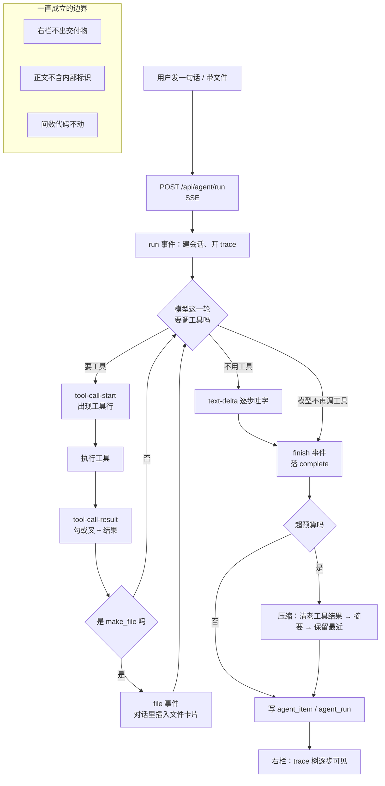

# 主智能体 —— 设计（2026-11-18）

> 需求来源：2026-11-18 会话逐条问出、Fred 确认（本文件 §1）。旧设计 `2026-11-17-干活线-智能体设计.md` 只作参考，其中「回答像秘书」「P1–P4」「配置页九块」三条作废。
> 调研依据：`~/.dsh/docs/research/2026-11-18-开源交互-*.md` 三份（LibreChat / assistant-ui / Dify+Langfuse），下文标「抄」的地方都能在里头找到源码行号或官方链接。

## 1 需求（一句话 + 边界）

**一句话**：把这套系统做成一个主智能体——你说一句话，它自己判断读什么、查什么、出什么；本事（技能、知识、口径）都在库里，不在代码里；界面像正常 agent，能闲聊、能连改、能一次交多份。

| 类型 | 内容 |
|---|---|
| 用户 | 现阶段只有 Fred 一个人测，随口按类试 |
| 为什么改 | 现有版本「啥都不完善、只能对话」，交互不像 agent |
| 交付 | 文件在对话里以卡片交付；右栏只放运行步骤，调试用，不放任何交付物 |
| 风格 | 由 Fred 在后台页设定，不写在代码里；代码只保证内部标识（`file_id`、URL、路径、原始 JSON、trace）不进正文 |
| 加能力 | 加一篇技能即可，不改代码，下一轮生效 |
| 交互 | 抄 DeepSeek / DSH / 豆包工作那类：流式、步骤看得见、附件两态、会话能接着聊；后端能力自己补齐，不换栈 |
| 固定不动 | 问数线代码、大屏那份、`/api/ask` 分流结构（测试期先绕开，上线指回新智能体） |
| 不做 | 不做多人权限；不重写问数；不重做分流；不接 MCP |

## 2 完成条件（能判 pass/fail）

| # | 判据 | 怎么判 |
|---|---|---|
| 1 | 停用全部技能，说「写个通知」，仍交一份能直接用的 docx | 打开产物看版式与内容 |
| 2 | 新加一篇技能（页面或接口），下一轮它自己 `read_skill` 并照做，代码零改动 | 加完直接对话，成品与技能写的规矩逐条对 |
| 3 | 同一会话连改三轮，改的是同一份文件（`read_file` → `make_file`），不重写无关部分 | 对比三版差异只落在被要求改的地方 |
| 4 | 纯闲聊（「今天几号」）不出文件、不调无谓工具 | 右栏无工具步骤 |
| 5 | 一次要三份文件，对话里出现三张卡片 | 看消息区 |
| 6 | 正文里不出现 `file_id`、下载地址、`/api/`、原始 JSON、trace | 通读一遍 |
| 7 | 工具报错时模型能读到真实异常并改参数，不再只看到一句通用文案 | 故意传坏参数 |
| 8 | 中途点停止，已出的文件保留，会话能接着干 | 停止后续聊一轮 |
| 9 | 会话到 6 万 token 之后还能接着说，靠压缩不靠截断 | 长会话实测 |
| 10 | 问数回归：`/api/ask` 数字与改前一致（大屏走它） | 12 题逐字比 |
| 11 | 后台页改「回答风格」，下一轮回答跟着变 | 改一句话，下一轮看 |

## 3 现状差距（代码证据）

| 差距 | 位置 |
|---|---|
| 回答风格写死在代码：14 条规则里有「像秘书说话」「不要用 ✔ 做自检」 | `server/app/agent/runtime.py:38-54` |
| 步骤只在右栏，对话里看不见它做了什么 | `web/src/pages/AgentChat.tsx:329-337` |
| 文件是正文里的 `<a href>` 下载链接，不是卡片 | `AgentChat.tsx:226-235` |
| 产物跑完才一起推，出三份要等到最后 | `runtime.py:180-181` |
| 工具结果靠 pending 猜配对，并发就配错 | `AgentChat.tsx:163-170` |
| 音视频/思考/来源都没有 part 类型，只有文本 | `AgentChat.tsx:33-64` |
| trace 是扁平的：`agent_span` 只有 `run_id`+`seq`，没有父子与类型 | `server/app/agent/db.py:69-79` |
| 工具描述只有「做什么」，没有「何时用/何时别用」 | `server/app/agent/tools.py` 各工具 docstring |

## 4 抄什么（三家 → 我们的落点）

| 抄 | 来源 | 落点 |
|---|---|---|
| 工具结果不单独成 part，`result`/`isError`/`status` 挂在工具调用上 | assistant-ui `core/src/types/message.ts:332-425` | 消息 part 定义 §5.1 |
| 一条消息的 part 是判别联合：`text`/`reasoning`/`tool-call`/`file`/`source` | 同上 `:427-442` | §5.1 |
| 附件两态：`Pending`（输入框，带 `file`）/ `Complete`（消息，带 `content`） | `core/src/types/attachment.ts:27-46` | §5.2 |
| SSE 只推「开 part / 追加 / 关 part / 给结果 / 结束」，不推 UI 指令 | `assistant-stream/src/core/AssistantStreamChunk.ts:71-172` | §5.3 |
| 工具行形状：折叠标题（图标+动词+工具名+耗时），展开看参数原文与结果 JSON，连续调用并成一组显示「3/5」 | `ui/.../tool-fallback.aui.tsx:103-171`、`tool-group.tsx:34-62` | §6.3 |
| 用户上滑就停跟随；历史前插保位 | `store/src/utils/thread-viewport-auto-scroll.ts:239-287` | §6.4 |
| 编辑重发 = 新分支，不覆盖原消息 | `core/src/types/message.ts:646-655` | §6.5 |
| trace 三层：会话 → 每轮 trace → 树里 agent 下挂 tool；每次模型调用单记一条 | Langfuse 官方文档（见 Dify-Langfuse 笔记 §2） | §7 |
| 配置页「能力」与「任务」分开，能力只在配置页改 | Dify 官方文档（笔记 §1） | §8 |
| 技能三态：关 / 全开 / 指定（`skills_enabled` + `skills_scope`） | LibreChat `SidePanel/Agents/Tools/ToolsSection.tsx:91-98`、`AgentSelect.tsx:187-246` | §8.4 |
| 每个工具、每个知识库配一行「何时用、何时别用」 | Dify 官方文档（笔记 §3） | §9 |

## 5 数据契约

### 5.1 消息 part（前端渲染的唯一依据）

```
ThreadItem =
  | { type:'user',      parts:[text|file] }
  | { type:'assistant', parts:[text|reasoning|tool-call|file|source] }

tool-call  = { type:'tool-call', toolCallId, toolName, args, argsText,
               result?, isError?, status }
   status  = running | complete | incomplete{reason: cancelled|error, message?}
text       = { type:'text', text }
reasoning  = { type:'reasoning', text }
file       = { type:'file', fileId, name, mime, size }     # 只给引用，前端另取预览地址
source     = { type:'source', url, title }
```

规则：工具结果不单独成条；参数边流边存 `argsText`（原文，不解析）；结果只存序列化后的值。

### 5.2 附件两态

- 输入框：`{ id, file, name, mime, status: running{progress} | requires-action | incomplete{message} }`，可删。
- 消息里：`{ id, fileId, name, mime, size }`，只读，点击预览。
- 契约里**不放** `pages`/`swatch` 这类演示字段；大小渲染时算。

### 5.3 SSE 事件（9 类，全部可推导 UI 状态）

| 事件 | 载荷 | 前端反应 |
|---|---|---|
| `run` | runId, sessionId, model | 建本轮消息，开右栏 trace 根 |
| `text-delta` | text | 往当前文本 part 追加 |
| `reasoning-delta` | text | 往思考 part 追加（折叠） |
| `tool-call-start` | toolCallId, toolName | 出现工具行（转圈） |
| `tool-call-args-delta` | toolCallId, argsTextDelta | 追加参数原文 |
| `tool-call-result` | toolCallId, result, isError | 换勾/叉，展开区出现结果 |
| `file` | fileId, name, mime, size | 消息里插入文件卡片 |
| `error` | code, message, severity | 消息落 incomplete，出现错误块 |
| `finish` | status, usage | 落 complete，动作条出现 |

停止 = 客户端断开 + `POST /api/agent/stop`；服务端在下一步边界退出，已出的文件保留。

### 5.4 表（只动 `qa.agent_*`，不动 `t_chat_*`）

| 表 | 用途 | 这次要加的列 |
|---|---|---|
| `agent_session` | 会话 | 不变 |
| `agent_item` | 一轮里的 item（`payload` 存 part） | `run_id`、`seq` |
| `agent_run` | 一次请求 = 一条 trace | 不变（已有 tokens/ms/status） |
| `agent_span` | 一次 observation | `parent_id`、`type`（generation/tool/retriever）、`input`、`output`、`level` |
| `agent_memory` | 跨会话记忆 | 不变 |
| `agent_note` | 工作笔记 | 不变 |

## 6 主流程（对着图能讲）



## 7 模块职责（输入 → 输出）

| 模块 | 输入 → 输出 |
|---|---|
| `agent/api.py` | HTTP 请求 → SSE 事件流、会话 CRUD |
| `agent/runtime.py` | 一句话 + 会话 → 一轮事件流（循环、停止、压缩） |
| `agent/tools.py` | 工具名 + 参数 → 结果摘要（每只带「何时用/何时别用」） |
| `agent/skills.py` | 用户 + 名字 → 技能目录 / 正文 |
| `agent/session.py` | 会话 → item 列表；超预算 → 压缩 |
| `agent/memory.py` | 写入 / 查询 → 记忆条目 |
| `agent/trace.py` | run / span → 树 |
| `agent/config.py` | 库里的配置 → 运行参数（模型、预算、步数） |
| `web/pages/AgentChat.tsx` | SSE 事件 → part 状态机 → 三栏界面 |

## 8 界面（重做，只在这条线内）

### 8.1 三栏

- 左：会话列表（新建、改名、删除、按标题搜）。
- 中：消息流。一条 assistant 消息 = 文本 + 工具行组 + 文件卡片 + 动作条。
- 右：运行步骤（trace 树），调试用；**不放任何交付物、不放下载**。

### 8.2 消息区

- 文件卡片：图标 + 文件名 + 大小 + 点击预览；不给「下载跳转链接」当正文。
- 一次多份 = 多张卡片，逐张可预览。
- 无内容轮（只出了文件）也要有个短句，不留空气泡。

### 8.3 工具行

- 折叠标题：状态图标 + 动词 + 工具名 + 耗时（`<1s`/`1.2s`/`1m 5s`）。
- 展开：`参数`（模型原文）在上，`结果`（序列化 JSON）在下，失败时多一块 `错误`。
- 连续多个调用并成一组，组头显示 `3/5`、`2 failed`。
- 默认折叠，失败与「等用户确认」自动展开。

### 8.4 输入区

- 多行输入，Enter 发送、Shift+Enter 换行，支持拖文件。
- 附件三态：上传中（转圈遮罩）、失败（红叉 + 原因）、已就绪（可删）。
- 停止：跑到一半变成取消按钮，停下后本条标「已停止」，可接着说。

### 8.5 交互细节

- 自动滚动：用户上滑就停止跟随，右上角出现「回到底部」。
- 编辑重发：改一句就是新分支，原消息保留，可切 `2/3`。
- 重新生成：原位出新分支。
- 会话续跑：切回旧会话，消息与工具行按 part 还原；右栏按 trace 还原。

## 9 后台配置页

放在现有 `/inject` 提示词页上（问数、干活线两个 lane 都在那儿），新增一块「主智能体」：

| 块 | 内容 | 存哪 |
|---|---|---|
| 身份 | 一段话 | 提示词表（已有） |
| 回答风格 | Fred 自己写的一段话（口吻、长度、结构、要不要要点/表格/出处） | 新增配置项 |
| 查数口径 | 引用问数页已有的口径材料，可看、可改 | 现有口径表（问数侧只读它的内容，不动其代码） |
| 技能 | 关 / 全开 / 指定（三态）；上传、正文编辑、检查项、发布/退役 | `kb.spec`（已有） |
| 工具开关 | 9 只，每只一行「何时用 / 何时别用」，可关 | 新增配置项 |
| 模型与参数 | 模型、步数上限、上下文预算、压缩阈值 | `/runtime`（已有） |

规则：技能只改库，不改代码；页面改的每一项都要在下一轮生效。

## 10 观测（右栏 + 独立页）

三层：会话 → 每轮一条 trace → 树里 `agent` 下挂各次模型调用（`generation`）与工具调用（`tool`，带唯一 ID，结果回传同一 ID）。
右栏给「按步骤聚合」一栏；独立页给「树 / 时间线」两个视图。这版先做右栏，独立页列在计划里。

## 11 技术栈

| 组件 | 版本 | 用途 |
|---|---|---|
| OpenAI Agents SDK | 0.24 | 循环、工具、session、停止 |
| `OpenAIChatCompletionsModel` | — | 接公司 MaaS 的 DeepSeek |
| FastAPI + SSE | 现有 | 事件流 |
| PostgreSQL `qa.*` | 现有 | 会话、item、trace、记忆 |
| `kb.spec` | 现有 | 技能库 |
| React 18 + antd 5 + `@ant-design/x` 1.6 | 现有 | 三栏界面 |
| 现有 docgen（python-docx / openpyxl / python-pptx） | 现有 | 出文件 |

不引入：LibreChat/assistant-ui 的技术栈（Node、Tailwind/shadcn）；只抄契约与交互形状。

## 12 要删的

- `runtime.py` 里写死风格的规则（「像秘书说话」「不要用 ✔ 做自检」）。
- 现有 `AgentChat.tsx` 的 `itemsToView` 猜配对逻辑（换成 part 状态机）。
- 右栏里的任何下载入口（现在没有，加的时候也不许有）。

## 13 已定（原三处待定，2026-11-18 Fred 说继续，按下面执行）

1. **配置改了保存即生效**，下一轮就变；不做草稿/发布/整版回滚。这版只有一个人用，版本是负担。
2. **技能两处都能上传**：知识库页与配置页各一个入口，同一张表、同一份正文，改哪边都一样。
3. **观测这版只做右栏**；独立页等服务给多人用时再做。
