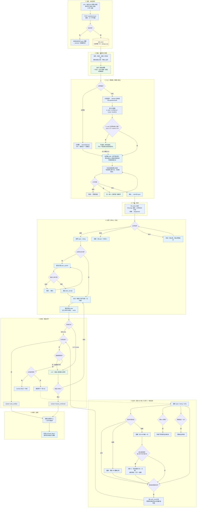
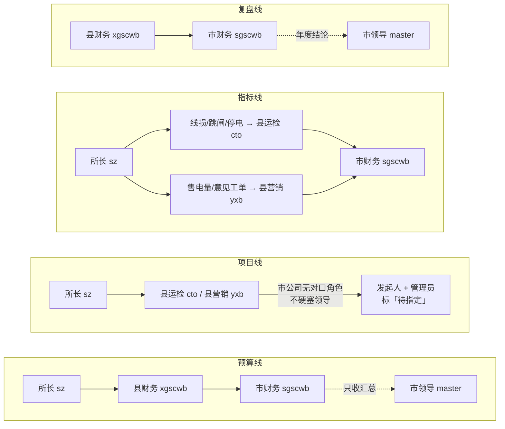
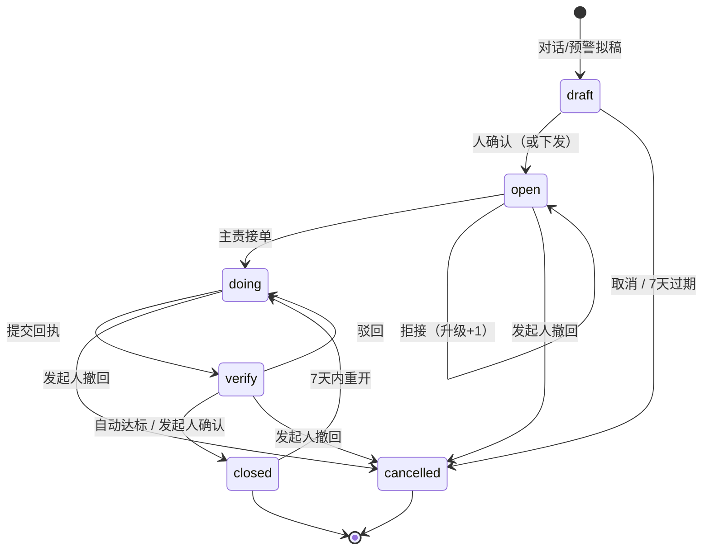

# 预警 · 任务全流程图（Mermaid）

> 对应代码：`d8653ab` 之后（整理提交 `1285ebf`）｜2026-10-19
> 在 VSCode 里打开本文件 → `Ctrl+Shift+V` 预览即渲染。
> 若预览里是代码块而不是图：装扩展 **Markdown Preview Mermaid Support**（`bierner.markdown-mermaid`）。

**颜色约定**：蓝=系统自动｜绿=人｜黄=预警数据｜浅蓝=任务｜灰=终态。

---

## 一、任务全流程（从扫描到闭环）

---

## 二、监测与升级：谁盯着谁

| 监测点 | 谁在监测 | 判断 / 动作 |
|---|---|---|
| 有没有异常、预警是否恢复 | **系统 cron** | 命中建/更新预警；不再命中 → `resolved` |
| 这句话是不是"要办一件事" | **语义分类器 + 人** | 模型判意图/置信度；人回「确认」才建任务 |
| 任务该谁办 | **系统推荐 + 发起人** | 范围+角色找人；找不到往上找 / 标待指定 |
| 回执有没有交 | **系统 tick** | 提前 4h 提醒；超期每 24h 催 |
| 超时要不要升级 | **系统 tick** | 宽限期后升一级；每天最多一次；≤2 级 |
| 任务办得怎么样 | **发起人 / 上级** | 审方案、看回执与附件 |
| 数据有没有变好 | **系统 tick** | 自动核销；数据取不到 → 转人工，不静默闭环 |
| 承办人还在不在 | **系统 tick** | 停用/离职 → 同部门同角色转派 |
| 草稿没人确认 | **系统 tick** | 7 天自动作废 |
| 闭环后归档 | **发起人 + 系统** | 7 天内可重开；归档后列表隐藏、时间线保留 |

---

## 三、任务状态机

> `escalate_level`（0→1→2）、`overdue_flag`（0/1）、`archived_flag` 是**标志位**，不新增状态；
> 非法迁移（如 open 直接 closed）一律 409 拒绝。

---

## 四、运行参数（线上实际值）

| 项 | 值 |
|---|---|
| 扫描 | 每日 8:00（预算+项目）、周一 8:20（周）、每月 5 日 8:30（指标+复盘）、1/7 月 1 日 8:40（复盘） |
| tick | 服务内嵌循环，**每 10 分钟**（`DISPATCH_TICK_MINUTES=10`） |
| 回执时限 | 高 24h / 中 3 天 / 低 7 天（发起人可改） |
| 完成时限 | 默认 30 天；预算类可设月底/年底 |
| 催办 | 回执前 4h 一次；超期后每 24h 一次 |
| 升级 | 宽限期后每天最多一级，上限 2 级 |
| 草稿 | 7 天未确认自动作废 |
| 自动核销 | 每轮 tick 实测；数据取不到 → 不闭环，转人工 |

---

## 五、代码位置（改行为先看这里）

| 内容 | 文件 |
|---|---|
| 四类判据 / 13 子判据 | `server/app/secretary/alerts4.py` |
| 扫描落库 / 列表 / 卡片 / 预警对话 | `server/app/services/alert_service.py` |
| 任务流转 / tick / 升级 / 核销 | `server/app/services/dispatch_service.py` |
| 意图分类 / AI 建议 / 报告 | `server/app/services/dispatch_ai.py` |
| 口径 / 职责线 / 时限阈值 | `server/app/dispatch_rules.py` |
| 状态、事件、通知枚举 | `server/app/models/dispatch.py` |
