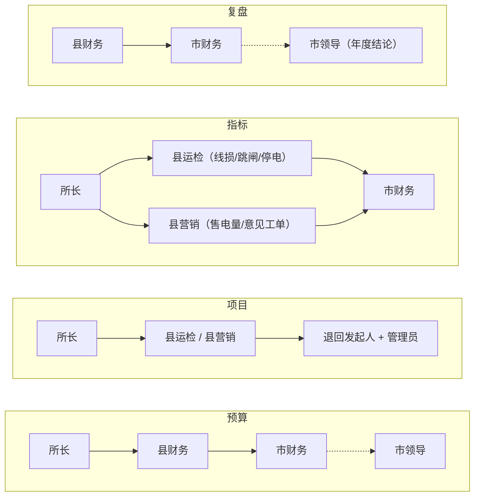

# 任务全流程图（大白话版 · 待对齐）

> 只画关键动作和判断；节点里只写**谁 + 做什么/判什么**，展开的解释放在图下面。
> VSCode：`Ctrl+Shift+V` 预览。若显示成代码块，装扩展 `bierner.markdown-mermaid`。

**颜色**：蓝=系统｜绿=人工｜黄=预警｜灰=结束。

---

## 一、主流程

```mermaid
flowchart LR
  classDef sys fill:#e8f0ff,stroke:#3355aa,color:#123
  classDef human fill:#e9f7ec,stroke:#2e7d32,color:#123
  classDef data fill:#fff8e1,stroke:#b8860b,color:#123
  classDef done fill:#eceff1,stroke:#546e7a,color:#123

  subgraph S1["1 发现"]
    direction TB
    A1["系统扫描数据"]:::sys --> A2{"超规则？"}:::sys
    A2 -->|"否"| A0["不生成"]:::done
    A2 -->|"是"| A3["生成预警<br/>同一条只留一条"]:::data
  end

  subgraph S2["2 建任务"]
    direction TB
    B1["推送本人"]:::sys --> B2{"本人要办？"}:::human
    B2 -->|"否"| B0["继续对话"]:::done
    B2 -->|"是"| B3["拟任务草稿"]:::sys
    B3 --> B4{"确认草稿？"}:::human
    B4 -->|"改"| B3
    B4 -->|"取消/过期"| B5["作废"]:::done
    B4 -->|"确认"| B6["任务创建"]:::sys
  end

  subgraph S3["3 分派"]
    direction TB
    C1["推荐承办人"]:::sys --> C2{"发起人确认？"}:::human
    C2 -->|"换人"| C1
    C2 -->|"确认"| C3["通知承办人"]:::sys
  end

  subgraph S4["4 办理"]
    direction TB
    D1{"承办人接单？"}:::human
    D1 -->|"接"| D2["办理"]:::sys
    D1 -->|"拒"| D3["上报一级"]:::sys
    D2 --> D4["交回执"]:::human
  end

  subgraph S5["5 结束"]
    direction TB
    E1{"怎么算完成"}:::sys -->|"自动"| E2{"数据达标？"}:::sys
    E1 -->|"人工"| E3{"发起人认可？"}:::human
    E2 -->|"是"| E4["结束"]:::done
    E2 -->|"否/查不到"| E3
    E3 -->|"是"| E4
    E3 -->|"否"| D2
    E4 --> E5["归档 / 7天内重开"]:::done
  end

  A3 --> B1
  B6 --> C1
  C3 --> D1
  D4 --> E1

  T1["监督：每10分钟查一次<br/>提醒 · 催办 · 上报 · 转派"]:::sys
  T1 -.-> D2
  T1 -.-> E2
```

---

## 二、图里的判断，展开说

| 判断 | 谁判 | 怎么判 | 不满足 |
|---|---|---|---|
| 超规则？ | 系统 | 按 13 条固定规则（超阈值、超期、比例异常） | 不生成；已存在的恢复后自动标已解决 |
| 本人要办？ | 看预警的人 | 只了解就继续问；要办才拟稿 | 不产生任务 |
| 确认草稿？ | 本人 | 对话里回"确认 / 改 / 取消"；7 天不回自动作废 | 改则重拟 |
| 发起人确认？ | 发起人 | 系统按责任单位 + 岗位推荐，本人可换人、加协办/抄送，主责至少 1 人 | 找不到人标"待指定" |
| 承办人接单？ | 主责 | 接单、拒接（写理由）、转派 | 拒接留在原地并上报一级 |
| 怎么算完成 | 创建时定 | 自动：按指标查数据；人工：看回执和附件 | 数据查不到转人工，不静默闭环 |
| 数据达标？ | 系统 | 达标即结束并写实测数字；没达标又过期限则标逾期并上报 | 转人工 |
| 发起人认可？ | 发起人 | 看回执、附件；不认可打回继续办 | 打回办理 |

> 对话里直接提要求时，系统会先判断"这句话是不是在安排人办事"（看整句意思，不看关键词），
> 拿不准就不拟稿，只当普通提问；本人可手动点"把这段对话变成任务"。**最后一律本人确认才建任务。**

---

## 三、分给谁

| 管什么 | 单位 | 承办人 |
|---|---|---|
| 本所预算、审批、项目 | 供电所 | 所长 |
| 全县预算、资金监督 | 县公司 | 县财务 |
| 项目审批、施工 | 县公司 | 县运检 |
| 营销工单、售电量、意见工单 | 县公司 | 县营销 |
| 全市预算、制度卡点 | 市公司 | 市财务 |
| 全市盘子、年度复盘结论 | 市公司 | 市领导（只收汇总） |

---

## 四、上报给谁

> 虚线 = 只收汇总，不接执行。项目类市公司无对口岗位，不硬塞领导。

---

## 五、状态

**草稿** →（本人确认）**已下发** →（接单）**办理中** →（交回执）**待确认** →（达标/认可）**已结束**
例外：草稿取消或 7 天过期 → **已作废**；拒接留在**已下发**并上报；结束 7 天内可重开。

---

## 六、参数

| 项 | 值 |
|---|---|
| 预警检查 | 每天 8:00 预算+项目；每月 5 日指标+复盘；1/7 月复盘 |
| 任务检查 | 每 10 分钟 |
| 回执期限 | 高 24h / 中 3 天 / 低 7 天 |
| 催办 | 到期前 4h 一次；超期后每 24h 一次 |
| 上报 | 超宽限期后每天最多升一级，最多两级 |
