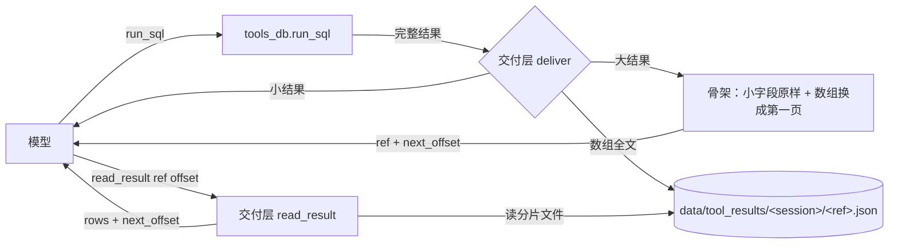

# 工具结果交付层（2026-11-08）

> 目标：**工具结果再大，模型也不会因为"看不到"而把"没给"当成"没有"**。
> 触发它的是当天两次线上事故（见 §1）。这份文档先定接口与不变量，改完按 §7 逐项验收。

## 1. 为什么做（两次事故）

### 事故 A：查数轮正文被截在半句（2026-11-07）

`ask("全市")` 的 trace：一次模型调用、0 次工具、正文停在「再根据数据判断哪」，用户收到一段"查数计划"。
查数轮的 `max_tokens` 写死 600（`_mt = 4000 if 'make_file' in _want else 600`），模型先写提纲、提纲把额度吃满、`run_sql` 一个都没发出来；`if not calls:` 分支又把这段正文当成了最终答案。
额度那部分已收口到 `config.LLM_MAX_TOKENS`（2026-11-08），**不在本文范围**。

### 事故 B：5 条数组查询被裁成空（2026-11-07）

`ask("预算情况")`：SQL 全对、5 条查询共 15,203 字真实数据，模型收到的是 140 字——

```json
{"multi": true, "count": 5, "results": [],
 "note": "results 共 5 条，为省篇幅只列出前 0 条…"}
```

于是事实清单六项全写「无数据」，正文照抄三行「暂无数据」。
原因：`_trim` 只认识 `{columns, rows, summary}` 这一种形状。2026-11-05 加了"一次传 SQL 数组"，外层多出 `results`，`_trim` 把外层当成"最占地方的明细列表"整块砍到 0 条，每条的 `rows` 与 `summary` 一起消失。

## 2. 根因（不是阈值）

1. **形状耦合**：裁剪逻辑按返回形状写分支，每加一种形状就漏一次。
2. **用字符数代理信息量**：砍在哪与"这题要哪几个数"无关。
3. **静默降级**：砍完只留一句 note，结果仍是合法 JSON，模型没有理由怀疑它残缺——于是把缺失当结论。

三家对照（Claude Code / Anthropic context editing / LangChain deepagents）的共同做法：**超限不砍，换成能再取的形式**（落盘给路径、换占位符、清载荷留调用记录），模型永远知道"这里本来有东西、去哪拿"。本设计与之一致，并复用本项目已有的 `read_file(offset/limit)` 契约。

## 3. 设计

### 3.1 分层



### 3.2 骨架的形状（不变量）

任何数组装不下时，换成：

```json
{"total": 47, "shown": 20, "next_offset": 20, "ref": "r3f9a1c2d4e5",
 "items": [ …前 20 项的裁剪版… ]}
```

规则：

- `total` 恒为真实条数（**永远不许丢**）；
- `next_offset` 为 `null` 表示这一片给完了；
- `ref` 唯一指向一个落盘的数组文件，`read_result(ref, offset)` 能取回原始项；
- 落盘失败时不许沉默：改成 `"truncated": true` + 一句"剩下的取不到"；
- 空数组 `[]` 保持不变（那才是真的空集）。

### 3.3 递归规则（与形状无关）

| 类型 | 放不下时 |
|---|---|
| `dict` | 小值（≤400 字，例如 `summary` / `columns` / `row_count` / `sql`）原样保留；大值按剩余预算递归 |
| `list` | 元素预算 = 剩余 / 条数，逐元素递归；单个元素连 200 字都给不到时，整条数组落盘、只给前 m 个（m ≥ 1）并加 `total/ref/next_offset` |
| `str` | 截头 + `…（已截断）` |
| 其他 | 原样 |

递归后若仍超预算，落到 `_hard_cut`：返回 `{"truncated": true, "note": "结果过大，请缩小范围（加 WHERE / 用 SUM 聚合）"}`。**任何路径都不返回假空数组。**

### 3.4 接口

```python
# tools_result.py
deliver(name: str, res: Any, session_id: str | None = None, cap: int | None = None) -> str
read_result(ref: str, offset: int = 0, limit: int = 20) -> dict
```

`read_result` 返回 `{ref, total, offset, rows, next_offset, note}`，语义与 `tools_file.read_file` 的 `next_offset=None 表示读完` 一致。

工具表新增一个 `read_result`（只在 `use_db` 时给，和 `run_sql` 一起出现）。

### 3.5 配置

| 键 | 默认 | 说明 |
|---|---|---|
| `TOOL_RESULT_CHARS` | 12000 | 单次工具结果交给模型的字数上限（原来写死 4000） |
| `TOOL_RESULT_DIR` | `data/tool_results` | 分片落盘目录，按 session 分 |
| `READ_RESULT_CHARS` | 6000 | 一次 `read_result` 最多回多少字（再按条数封顶） |

## 4. 影响面

| 文件 | 改动 |
|---|---|
| `server/app/secretary/tools_result.py` | 新建 |
| `server/app/secretary/agent.py` | 工具表 +1、`_want` 加 `read_result`、`execute` 加分支、tool 回填改 `deliver`、删 `_trim` / `_TOOL_RESULT_CHARS`、`get_rule` 的 4000 字硬切也走 `deliver` |
| `server/app/secretary/config.py` | +3 项 |
| `server/app/secretary/prompt_text.py` | `DEFAULT_TOOLS_GUIDE` +1 句 |
| `server/tests/agent/test_tool_result.py` | 新建（极端情况 + 接线断言） |

不动：前端、`db/`、`api/`、`workflow/`、文件链路（`kb_read` / `read_file` 本来就分页，`deliver` 判为没超原样放行）。

**风险**：所有工具结果都过新层 → 所有查数题都受影响。缓解：`deliver` 对未超限结果**原样返回**（不做任何改写），只有超限才动；用 §7 的验收逐项过。

## 5. 副作用与代价

- 落盘文件：按 session 目录，目录内文件超过 300 个时删最旧的；会话结束不主动清（后续可挂清理任务）。
- 多一次工具往返：只有模型真要看明细才会调 `read_result`，多数题用 `summary` 就够了。
- prompt 变长：工具说明 +1 句，工具表 +1 个（约 200 字）。

## 6. 不做的事

- 不做语义压缩（不在这里做摘要模型调用，压坏了没人知道）。
- 不按返回形状写分支（这是本次事故的病因，复发了就等于没改）。
- 不动 `read_file` / `kb_read` 的分页契约。

## 7. 验收条件（可判真假）

1. `deliver('run_sql', <事故样本>)` 的输出里 **有 `summary`、有 `total: 47`、有 `ref`**，且 `results` 非空；不再出现 `"results": []`。
2. 按 `next_offset` 逐页 `read_result` 直到 `null`，拼起来的元素与原始数组**逐项相等**。
3. 输出永远是合法 JSON（`json.loads` 通过），且长度 ≤ `TOOL_RESULT_CHARS`。
4. 落盘目录不可写时不崩，骨架带 `truncated: true`。
5. `ref` 只接受 `r[0-9a-f]{12}`，`../` 之类一律拒绝（不读任意路径）。
6. `server/tests/agent/test_tool_result.py` 全绿；`test_loop_gate` / `test_rule_take` / `test_digest` / `test_proofread` / `test_doc_jobs` 与改动前一致（原有红项仍是那几项）。
7. tool 回填走 `tools_result.deliver`；旧"按字符砍"的实现（`list_key` / `build(mid)` 二分丢行）从源码里消失，`_trim` 只剩一个转调 deliver 的壳（老的调用点和 `test_trim_summary.py` 还在用它）。

## 8. 极端情况清单（测试要覆盖）

| # | 形状 | 期望 |
|---|---|---|
| 1 | 单条 47 行明细 | 保留 `summary` + 前几行 + `ref` |
| 2 | 5 条数组 × 47 行（事故样本 15 KB） | 5 条都在，每条带自己的 `ref` |
| 3 | 空数组 / 0 行 | 原样 `[]`，不加 ref |
| 4 | 4 层嵌套 dict/list | 每层都合法，被裁的数组各自带 `ref` |
| 5 | 单个 20 万字字符串 | 头部 + `…（已截断）` |
| 6 | 全是小字段的超大 dict | 进入 `_hard_cut`，不返回假空 |
| 7 | `cap=300` | 仍合法 JSON、仍带 `total` 与 `ref` |
| 8 | `ref` 传 `../x`、空串、超长 | 一律报错，不读文件 |
| 9 | 落盘目录不可写 | `truncated: true`，进程不崩 |
| 10 | 分页取到最后一页 | `next_offset` 为 `null`，拼接完整 |
| 11 | 中文 / emoji / 换行 / 引号 | 合法 JSON，内容不串行 |
| 12 | `session_id=None` | 落到 `anon` 目录，仍可读回 |

## 9. 落地与验证记录（2026-11-08）

### 事故样本回放

拿「预算情况」那份日志里的 `run_sql` 结果（`{"multi": true, count: 5}`，15,203 字）跑新交付层：

| | 改前 `_trim` | 改后 `deliver` |
|---|---|---|
| 给模型的字数 | 140 | 7,146 |
| 外层 `results` | `[]`（5 条全丢） | 5 条都在 |
| `summary` | 无 | 4 条有（第 4 条 SQL 本身报错，原样保留 error + hint） |
| 明细 | 0 行 | 第 1 条 8/47 行、第 5 条 21/47 行，其余两条是 4 行的聚合表，原样给全 |
| 再取 | 无路可走 | `read_result(ref, 0)` 取回 20 条，`next_offset=20`，`total=47` |

顺带发现：那 5 条查询里第 4 条是 `Unknown column 'power_station_id'`（工单表没这个字段）。旧代码把这段 error 一起吞了；现在 error 与字段提示都原样保留，模型能自己改正重查。

### 测试

- `server/tests/agent/test_tool_result.py`：**37 项 0 失败**（§8 的 12 类极端情况 + 分页拼回 + 路径穿越 + 落盘失败降级 + 接线断言），结果落 `server/tests/output/test_results/tool_result_test.json`。
- 回归：`test_loop_gate` 30 项 12 失败、`test_rule_take` 39 项 1 失败 —— 与改动前逐条一致（都是旧架构断言：工具一律给 / trace 有 scope 步 / 默认步数 30 / `allow_rule=True` 出现 ≥5 次），本次没有新增红项。
- `test_digest` 19/19、`test_proofread` 21/21、`test_doc_jobs` 15/15。
- `test_trim_summary`：3a~3f 六项新判据全绿；1 / 4 / 8d 三项依赖真实业务库（本机没有 `t_power_company_budget_result`），与本次改动无关。
- `compileall` 通过。
