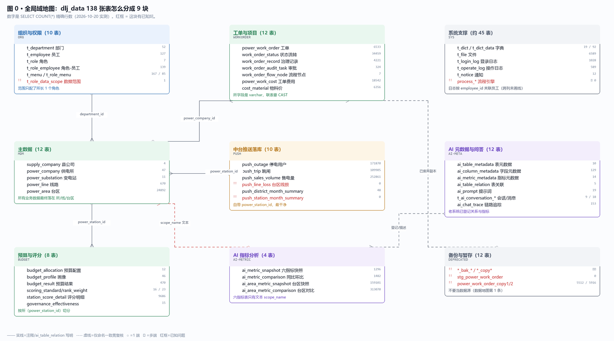
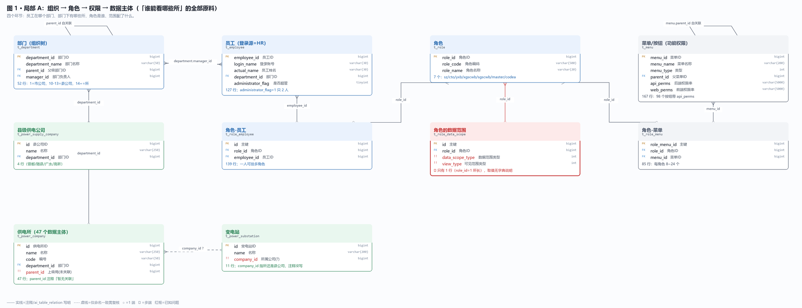
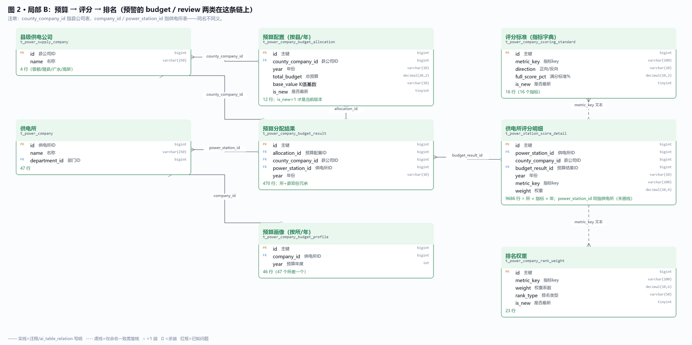
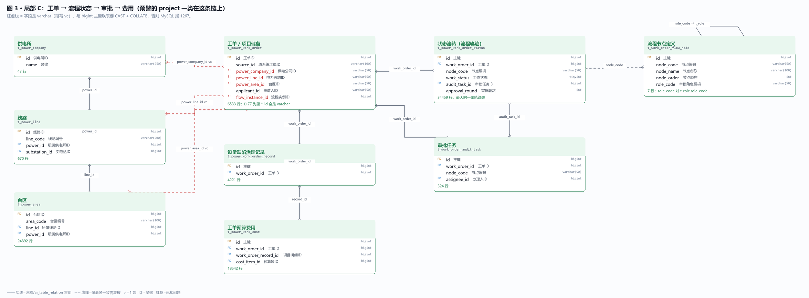
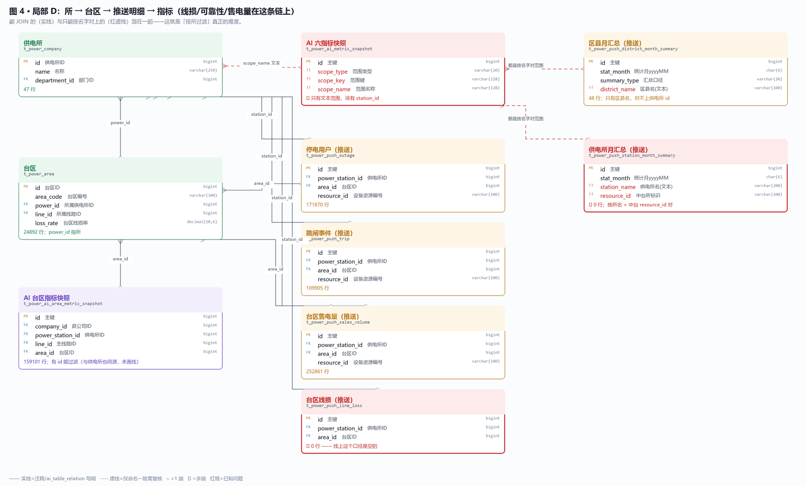

# dlj_data 业务库 E-R 图（全局 + 4 张局部）

> 2026-10-20 只读连 `47.121.183.81:3306/dlj_data` 实测生成。
> 行数是 `SELECT COUNT(*)` 的**精确值**，不是 `information_schema.table_rows` 的估算值。
> 图片：`docs/06-口径与数据/ER/*.svg`（矢量）/ `*.png`（预览）。复现：`python build_er.py`。

## 一句话

库里 **138 张表**，真正有业务的只有 5 个域；「谁能看哪些所」这件事，**角色和组织树是齐的，数据范围配置只有 1 行，业务表的组织字段有 3 种不一致的写法**。

## 线型约定

| 画法 | 含义 |
|---|---|
| 实线 | 字段注释写明「关联 表.id」，或 `ai_table_relation` 登记过 |
| 虚线 | 只有命名一致，注释没写 → 按命名推测，**用前要核对数据** |
| 红虚线 | 文本范围字段（按名字对，不是 JOIN） |
| 红框 | 该表/字段有已知问题 |
| ○ / ⊰ | 1 端 / 多端（crow's foot） |

## 图 0 · 全局域地图

138 张表按业务域分成 9 块。读法是「先看块、再看块内代表表」——**看数字就知道哪块有真数据、哪块是空壳**。

## 图 1 · 局部 A：组织 → 角色 → 权限 → 数据主体

「本所角色只能看本所」要用到的全部原料都在这张图里：员工挂哪个部门、部门下有哪些所、角色是谁、范围配了几行。红框那张 `t_role_data_scope` 就是全系统唯一的「数据范围配置」，实测只有 1 行。

## 图 2 · 局部 B：预算 → 评分 → 排名

预警里 `budget`（预算花不完/超支）和 `review`（投入产出低）两类都在这条链上。核心陷阱：`county_company_id` 指县公司表，`company_id` / `power_station_id` 指供电所表——**同名不同义**。

## 图 3 · 局部 C：工单 → 流程状态 → 审批 → 费用

预警里 `project`（审批停留、已批未开工、施工停滞）在这条链上。红虚线那三条是**工程上的真坑**：`t_power_work_order` 的 77 列里 `*_id` 全是 `varchar`，与 `bigint` 主键联表必须 `CAST` + `COLLATE`。

## 图 4 · 局部 D：所 → 台区 → 推送明细 → 指标

线损 / 可靠性 / 售电量这条链。这张图最能说明「按所过滤」为什么不是配置问题：有的表有 `power_station_id`（能 JOIN），有的只有 `scope_name` / `station_name` 文本（只能按名字对，而部门表叫「新城供电所」、档案写「新城供电站」）。

## 关系依据清单

| 关系 | 含义 | 依据 | 画法 |
|---|---|---|---|
| `t_department.parent_id → t_department.department_id` | 自关联（组织树） | 字段注释 | 实线 |
| `t_employee.department_id → t_department` | 员工归属部门 | 字段注释 | 实线 |
| `t_department.manager_id → t_employee.employee_id` | 部门负责人 | 字段注释 | 实线 |
| `t_role_employee.role_id / employee_id → t_role / t_employee` | 角色-员工 | 字段注释 | 实线 |
| `t_role_data_scope.role_id → t_role` | 角色范围（只 1 行） | 字段注释 | 实线（红） |
| `t_role_menu.role_id / menu_id → t_role / t_menu` | 角色-菜单/按钮 | 字段注释 | 实线 |
| `t_power_supply_company.department_id → t_department` | 县公司挂部门 | 字段注释 | 实线 |
| `t_power_company.department_id → t_department` | 供电所挂部门 | 字段注释 | 实线 |
| `t_power_company.parent_id → ?` | 注释放明「暂无关联」 | 注释否定 | 不画 |
| `t_power_line.power_id → t_power_company.id` | 线路的所 | 字段注释 | 实线 |
| `t_power_area.power_id → t_power_company.id` | 台区的所 | 字段注释 | 实线 |
| `t_power_area.line_id → t_power_line.id` | 台区的线 | 字段注释 | 实线 |
| `t_power_work_order.power_company_id → t_power_company.id` | 工单的所 | ai_table_relation + 命名 | 虚线（varchar） |
| `t_power_work_order.power_line_id → t_power_line.id` | 工单的线 | ai_table_relation | 虚线（varchar） |
| `t_power_work_order.power_area_id → t_power_area.id` | 工单的台区 | ai_table_relation | 虚线（varchar） |
| `t_power_work_order_status.work_order_id → 工单` | 流程轨迹 | 字段注释 | 实线 |
| `t_work_order_audit_task.work_order_id → 工单` | 审批任务 | 字段注释 | 实线 |
| `t_work_order_audit_task.assignee_id → t_employee` | 办理人 | 命名（未画线） | 按命名推测 |
| `t_power_work_cost.work_order_id / record_id → 工单/记录` | 费用归属 | 字段注释 | 实线 |
| `t_power_company_budget_result.allocation_id → budget_allocation` | 预算结果←配置 | 字段注释 | 实线 |
| `t_power_company_budget_result.county_company_id → t_power_supply_company` | 县 | ai_table_relation（同构表） | 实线 |
| `t_power_company_budget_result.power_station_id → t_power_company` | 所 | 字段注释 | 实线 |
| `t_power_company_budget_profile.company_id → t_power_company` | 画像的所 | 字段注释 | 实线 |
| `t_power_station_score_detail.budget_result_id → budget_result` | 评分←预算结果 | 字段注释 | 实线 |
| `t_power_station_score_detail.metric_key → scoring_standard.metric_key` | 指标字典 | 命名（文本，无 FK） | 虚线 |
| `t_power_push_outage / trip / sales_volume / line_loss.power_station_id → t_power_company` | 推送→所 | 字段注释 | 实线 |
| `t_power_push_*.area_id → t_power_area.id` | 推送→台区 | 字段注释 | 实线 |
| `t_power_ai_metric_snapshot.scope_name → 供电所/县名` | 文本范围，无 id | 无依据（只能按名字对） | 红虚线 |
| `t_power_push_station_month_summary.station_name → 供电所名` | 文本范围，无 id | 无依据 | 红虚线 |
| `t_power_ai_area_metric_snapshot.*_id → 县/所/线/台区` | 有 id 能过滤 | 字段注释 | 实线 |

## 6 个已知坑（都有实测证据）

| 坑 | 说明 | 证据 |
|---|---|---|
| `t_role_data_scope` 只有 1 行 | 全系统「数据范围」配置只给所长（role_id=1）配了一条，`data_scope_type=1 / view_type=2` 且**没有任何字典说明取值含义**（`t_dict` 里查不到）。 | `SELECT * FROM t_role_data_scope` → 1 行 |
| 工单表的 id 是 varchar | `t_power_work_order` 的 `power_company_id` / `power_line_id` / `power_area_id` / `applicant_id` 全是 `varchar(50)`，与 `bigint` 主键联表会直接报错。 | 实测 `LEFT JOIN` 报 1267：`Illegal mix of collations (utf8mb4_0900_ai_ci vs utf8mb4_general_ci)` |
| 同名字段不同义 | `company_id` = 供电所 id（`t_power_company`）；`county_company_id` = 县公司 id（`t_power_supply_company`）；两者都出现在预算相关表里，取值都从 1 开始。 | `budget_profile.company_id=3` 是厉山供电所；`budget_result.county_company_id=3` 是某个县公司 |
| AI 指标表没有 id 维度 | `t_power_ai_metric_snapshot` / `_comparison` 只有 `scope_type` + `scope_key` + `scope_name` 文本，没有 `station_id`，无法 JOIN 供电所表。 | `scope_name` 取值：随州市 / 曾都区供电公司 / 文峰供电所 … |
| 两张「汇总表」是空的 | `t_power_push_station_month_summary` 和 `t_power_push_line_loss` 都是 0 行，但文档/口径里被当成主力数据源。 | `SELECT COUNT(*)` → 0 |
| 文档行数不可信 | `docs/06-口径与数据/口径/数据地图.md` 记的是 133 张表、`t_role_data_scope` 0 行、`t_role_employee` 124 行——都是 `information_schema.table_rows` 的 InnoDB **估算值**。 | 实测 138 张表 / 1 行 / 139 行 |

## 行数核对（图上数字的抽样）

| 表 | COUNT(*)|
|---|---|
| `t_power_company` | 47 |
| `t_power_area` | 24892 |
| `t_power_work_order` | 6533 |
| `t_role_data_scope` | 1 |
| `t_employee` | 127 |
